<!-- Slide 1: título à esquerda, capa do livro à direita -->

::: {.columns style="align-items: center;"}
::: {.column width="45%"}
::: {style="text-align: center;"}
**1 \| Os Fundamentos da Bioquímica**

[© 2017 W. H. Freeman and Company]{style="font-size: .5em;"}
:::
:::
::: {.column width="55%"}
{width=430 fig-align="center"}
:::
:::

<!-- Slide 2 -->

## Albert Lehninger (1917–1986)

- O ciclo do ácido cítrico ocorre nas mitocôndrias
- Mecanismo da fosforilação oxidativa
- Estrutura e função mitocondrial
- Bioenergética
- Autor de livros didáticos clássicos:
    - *Bioquímica* (1970–1983)
    - *A Mitocôndria* (1964)
    - *Bioenergética* (1965–1974)

<!-- Slide 3: foto (recortada) + crédito, sem título -->

---

::: {.absolute left="240" top="11" width="448"}

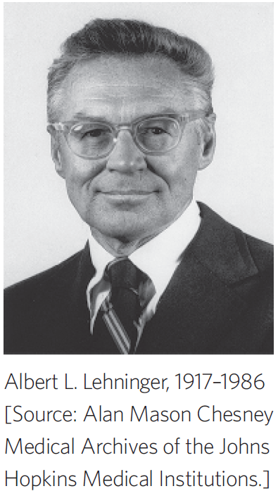

:::

{.absolute left=243 top=648 width=205}

<!-- Slide 4 -->

## CAPÍTULO 1  Os Fundamentos da Bioquímica

*Objetivos de aprendizagem:*

- Características distintivas dos organismos vivos
- Estrutura e função das partes da célula
- Papéis das pequenas e grandes biomoléculas
- Transformação de energia nos organismos vivos
- Regulação do metabolismo e catálise
- Codificação da informação genética no DNA
- Papel das mutações e da seleção na evolução

<!-- Slide 5 -->

## A Bioquímica É  a Química da Matéria Viva {.smaller}

**A matéria viva é caracterizada por:**

- um alto grau de complexidade e organização
- a extração, transformação e uso sistemático de energia para criar e manter estruturas e realizar trabalho
- as interações de componentes individuais serem dinâmicas e coordenadas
- a capacidade de perceber e responder às mudanças no ambiente
- uma capacidade de autorreplicação bastante precisa, permitindo mudanças suficientes para a evolução

<!-- Slide 6 -->

## Complexidade e Organização

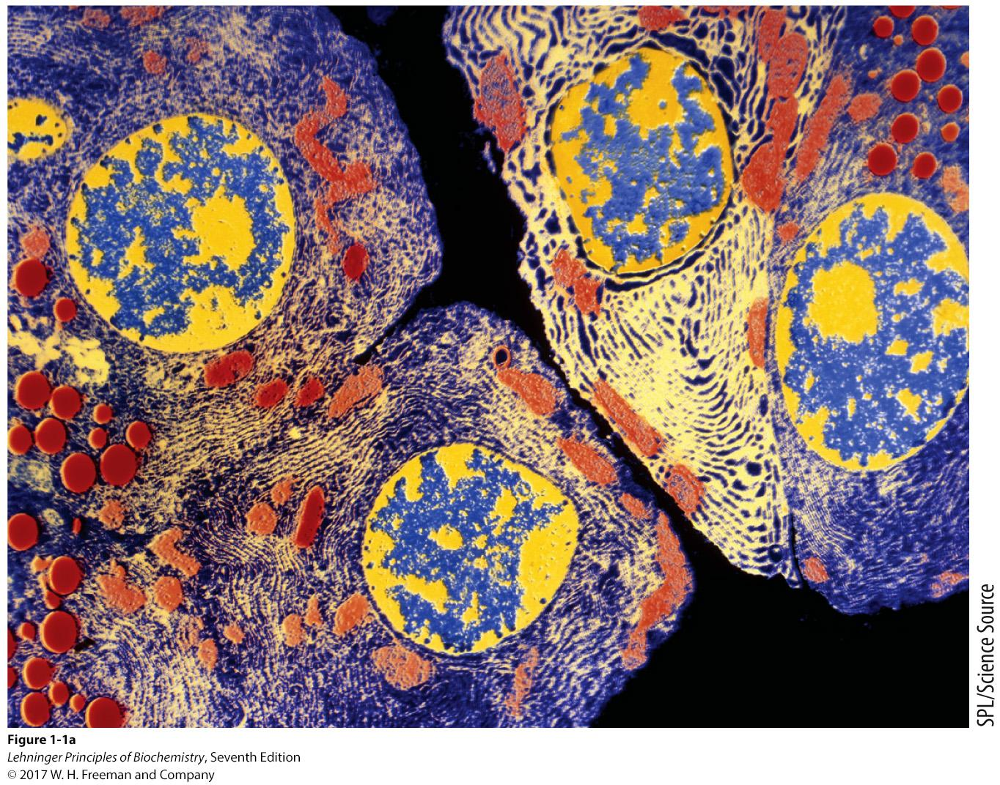{.r-stretch fig-align="center"}

<!-- Slide 7 -->

## Os Organismos Vivos Devem Ingerir e Transformar Nutrientes em Energia

{.r-stretch fig-align="center"}

<!-- Slide 8 -->

## Os Organismos Vivos Devem  Reproduzir-se com Precisão

{.r-stretch fig-align="center"}

<!-- Slide 9 -->

## Três Domínios Distintos da Vida Definidos por Diferenças Celulares e Moleculares que Evoluíram ao Longo do Tempo

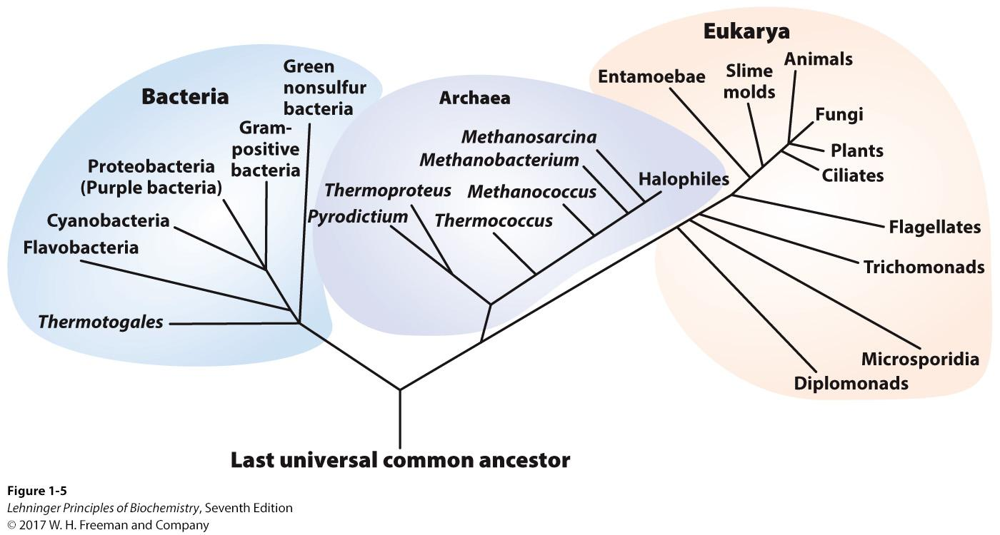{.r-stretch fig-align="center"}

<!-- Slide 10: tabela de duas colunas com setas -->

## Seis Reinos da Vida Definidos por Diferenças Orgânicas, Celulares e Moleculares {.smaller}

| Seis reinos | | Organização celular |
|:------------|:-:|:--------------------|
| [Archaea]{.azul}  | → | Procarioto unicelular |
| [Bacteria]{.azul} | → | Procarioto unicelular |
| [Protista]{.azul} | → | Eucarioto unicelular |
| [Fungi]{.azul}    | → | Eucarioto uni ou multicelular |
| [Plantae]{.azul}  | → | Eucarioto multicelular |
| [Animalia]{.azul} | → | Eucarioto multicelular |

: {tbl-colwidths="[28,8,64]"}

<!-- Slide 11 -->

## Célula: O Bloco Construtor Universal

- Os organismos vivos são feitos de células.
- Os organismos vivos mais simples são unicelulares (uma única célula).
- Organismos maiores são multicelulares (muitas células), com diferentes funções para diferentes células.
- As células têm algumas características comuns, mas podem conter componentes exclusivos para diferentes organismos.

<!-- Slide 12 -->

## Todas as Células Compartilham Algumas Características Comuns

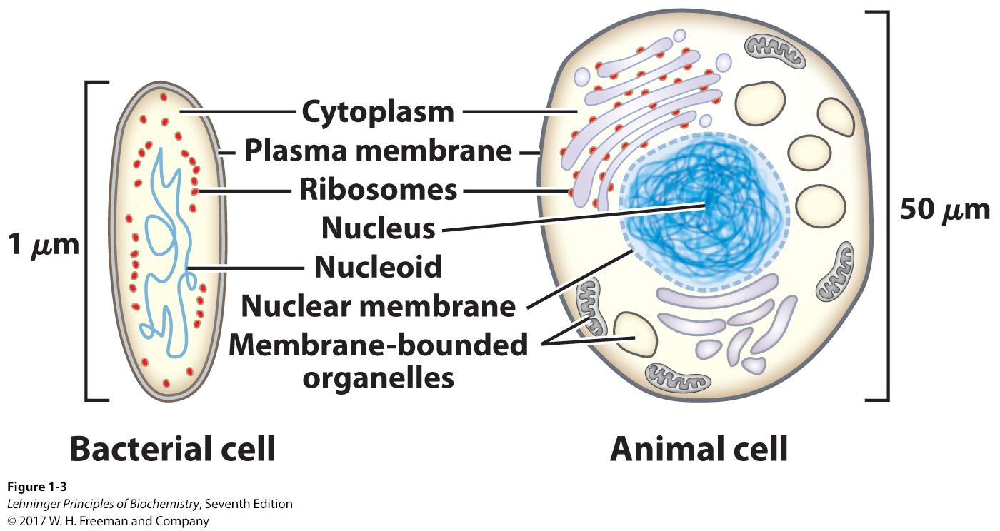{.r-stretch fig-align="center"}

<!-- Slide 13 -->

## Estrutura da Célula Bacteriana

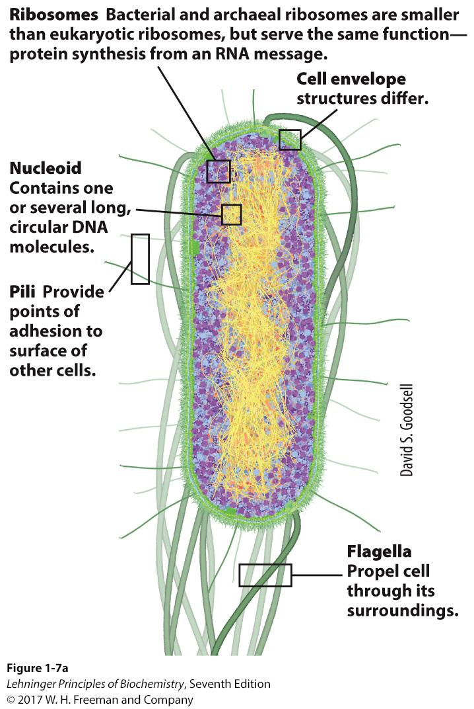{.r-stretch fig-align="center"}

<!-- Slide 14: tabela -->

## Componentes da Célula Bacteriana {.smaller}

| Estrutura | Composição | Função |
|:----------|:-----------|:-------|
| Parede celular   | Carboidrato + proteína | Suporte mecânico |
| Membrana celular | Lipídio + proteína     | Barreira de permeabilidade |
| Nucleoide        | DNA + proteína         | Informação genética |
| Ribossomos       | RNA + proteína         | Síntese proteica |
| Pili             | Proteína               | Adesão, conjugação |
| Flagelos         | Proteína               | Motilidade |
| Citoplasma       | Solução aquosa         | Local do metabolismo |

: {tbl-colwidths="[28,38,34]"}

<!-- Slide 15 -->

## Células Eucarióticas: Maior Complexidade {.smaller}

- Possuem núcleo delimitado por membrana por definição:
    - proteção para o DNA; local do metabolismo do DNA
    - importação e exportação seletivas através dos poros da membrana nuclear
- Possuem organelas envolvidas por membrana:
    - mitocôndrias para energia em animais, plantas e fungos
    - cloroplastos para energia em plantas
    - lisossomos para digestão de moléculas desnecessárias
- A segregação compartimental de reações produtoras e consumidoras de energia ajuda as células a manter a homeostase e a permanecerem longe do equilíbrio.

<!-- Slide 16 -->

## Células Animais e Vegetais Contêm Componentes Exclusivos

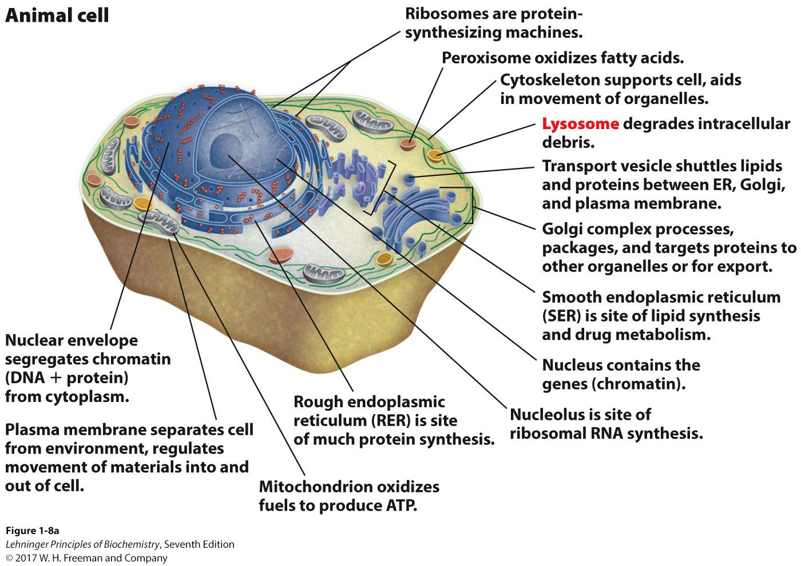{.r-stretch fig-align="center"}

<!-- Slide 17 -->

## Células Animais e Vegetais Contêm Componentes Exclusivos

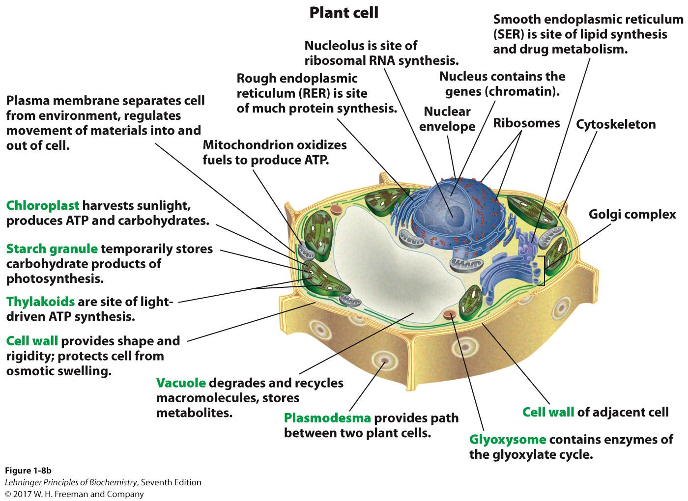{.r-stretch fig-align="center"}

<!-- Slide 18: diagrama de Venn (Vegetal | Ambos | Animal) -->

## Células Animais e Vegetais Contêm Componentes Idênticos e Exclusivos

VegetalAmbosAnimal

::: {.venn-lista .absolute left="115" top="302" width="182"}
Cloroplasto

Vacúolo

Glioxissomo

Plasmodesmo

Parede celular
:::

::: {.venn-lista .absolute left="326" top="302" width="288" style="text-align: center; color: #fff; font-weight: bold;"}
Membrana

Núcleo e Nucléolo

Mitocôndrias

RE Rugoso e Liso

Ribossomos

Complexo de Golgi

Citoesqueleto
:::

::: {.venn-lista .absolute left="710" top="353" width="173"}
Lisossomo

Peroxissomos
:::

<!-- Slide 19 -->

## Citoplasma e Citoesqueleto

- O citoplasma é uma solução altamente viscosa onde ocorrem muitas reações.
- O citoesqueleto consiste em microtúbulos, filamentos de actina e filamentos intermediários.
    - forma e divisão celular
    - organização intracelular
    - vias de transporte intracelular
    - mobilidade celular

<!-- Slide 20: figura com rótulos e linhas-guia sobrepostos -->

## O Citosol É Muito Denso (Superlotado)

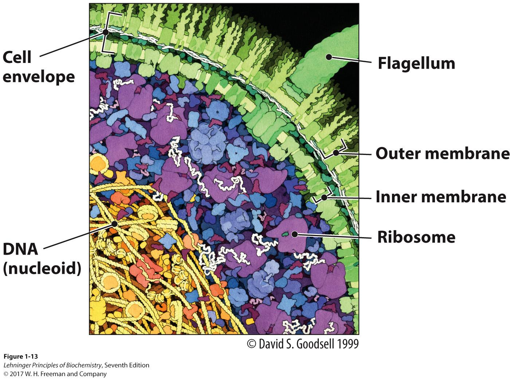{.r-stretch fig-align="center"}

<!-- Slide 21 -->

## O Citoesqueleto Mantém  a Organização Celular

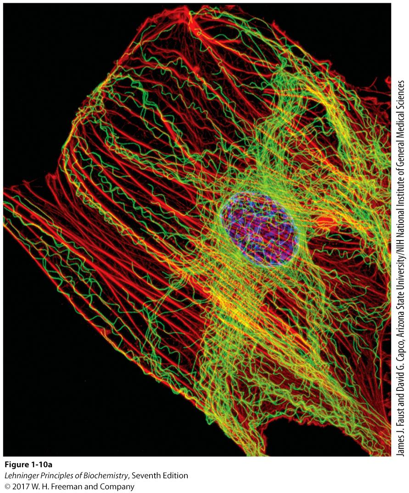{.r-stretch fig-align="center"}

<!-- Slide 22 -->

## A Organização Celular É Dinâmica,  Mudando Drasticamente em Diferentes Estágios

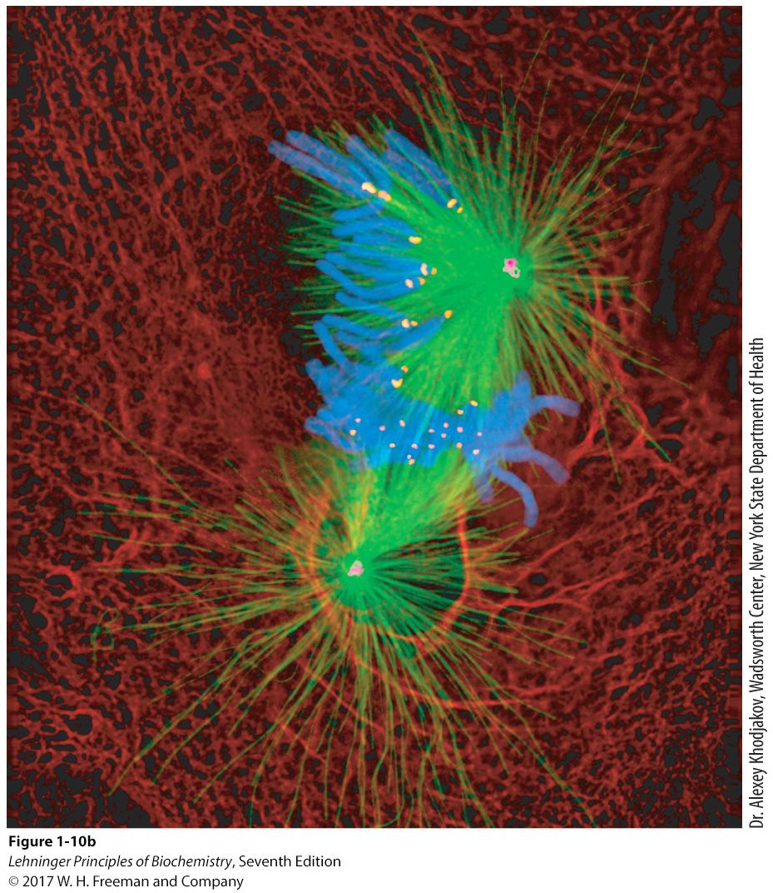{.r-stretch fig-align="center"}

<!-- Slide 23 -->

## A Bioquímica É  a Química da Matéria Viva {.smaller}

- A base de toda a vida são as reações químicas que ocorrem dentro da célula.

**A química permite:**

- um alto grau de complexidade e organização
- a extração, transformação e uso sistemático de energia para criar e manter estruturas e realizar trabalho
- que as interações dos componentes individuais sejam dinâmicas e coordenadas
- a capacidade de perceber e responder às mudanças no ambiente
- uma capacidade de autorreplicação bastante precisa, permitindo mudanças suficientes para a evolução

<!-- Slide 24 -->

## Os Organismos Também Podem Ser Classificados por Diferentes Fontes de Energia e Carbono

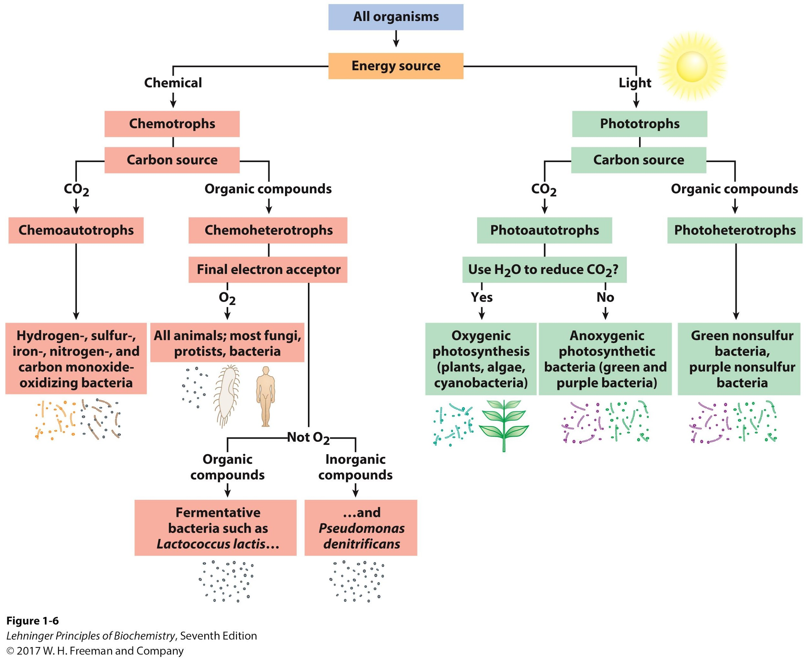{.r-stretch fig-align="center"}

<!-- Slide 25: lista à esquerda, figura à direita -->

## Sistemas Vivos Extraem Energia

::: {.columns}
::: {.column width="62%"}
- Da luz solar
    - plantas
    - bactérias verdes
    - cianobactérias
- De combustíveis
    - animais
    - maioria das bactérias
- O aporte de energia é necessário para manter a vida.
:::
::: {.column width="38%"}
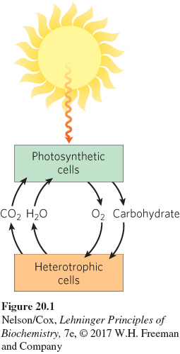{width=290 fig-align="center"}
:::
:::

<!-- Slide 26 -->

## A Lógica Molecular da Vida

Observamos a química que está por trás de:

- iniciação e aceleração de reações
- organização e especificidade do metabolismo e sinalização
- armazenamento e transferência de informação e energia

<!-- Slide 27 -->

## A Hierarquia Molecular da Estrutura

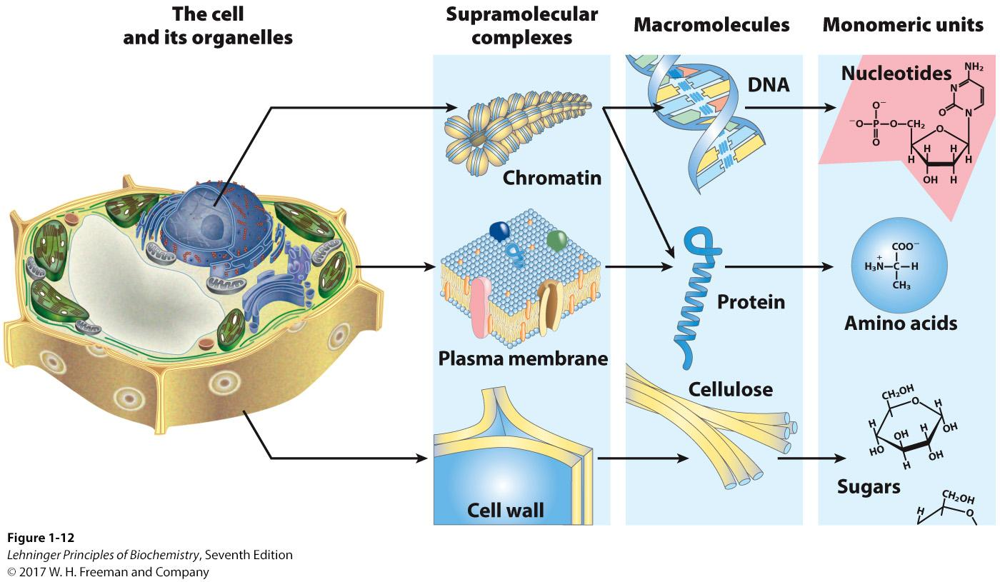{.r-stretch fig-align="center"}

<!-- Slide 28 -->

## Bioquímica: Papel Único do Carbono

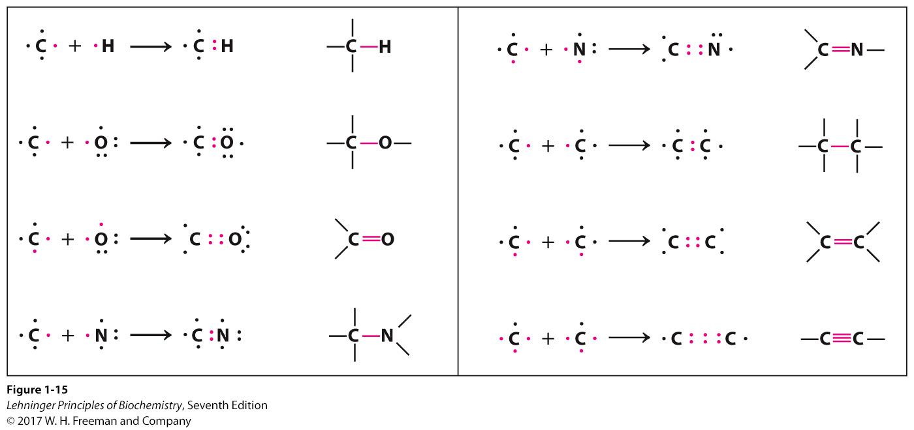{.r-stretch fig-align="center"}

<!-- Slide 29: texto no topo, tabela periódica embaixo -->

## 30 Elementos Essenciais para a Vida {.smaller}

- Além do carbono, os elementos H, O, N, P e S também são comuns.
- Íons metálicos (ex.: K+, Na+, Ca++, Mg++, Zn++, Fe++) desempenham papéis importantes no metabolismo.

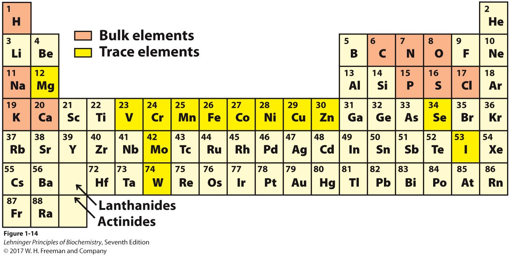{.r-stretch fig-align="center"}

<!-- Slide 30 -->

## Grupos Funcionais Comuns de Moléculas Biológicas

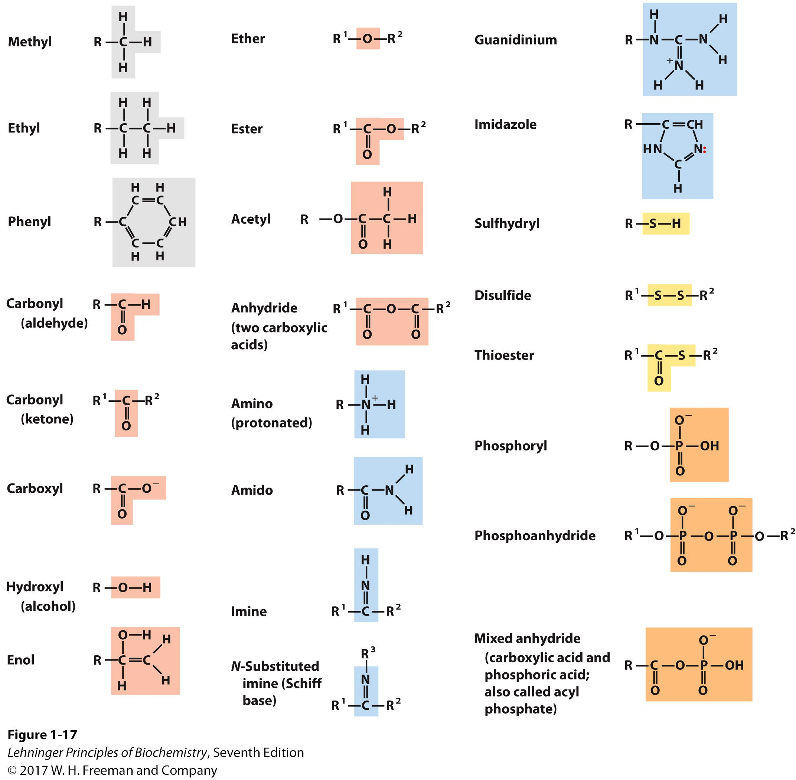{.r-stretch fig-align="center"}

<!-- Slide 31 -->

## Moléculas Biológicas Tipicamente Possuem Vários Grupos Funcionais

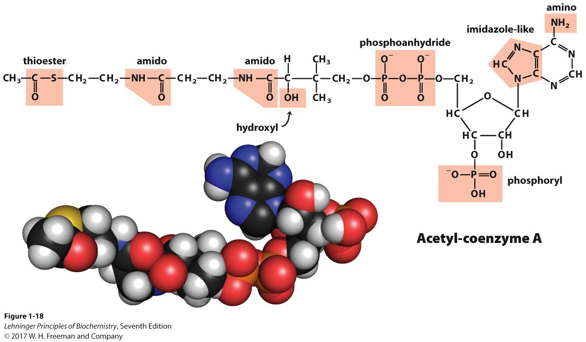{.r-stretch fig-align="center"}

<!-- Slide 32 -->

## O ABC da Vida

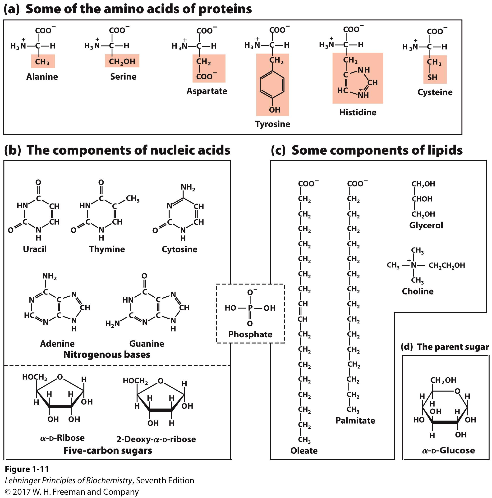{.r-stretch fig-align="center"}

<!-- Slide 33 -->

## A Função das Moléculas Depende Fortemente da Estrutura Tridimensional {.smaller}

- Estereoisômeros
    - têm propriedades físicas diferentes
- Isômeros geométricos (cis vs. trans)
    - têm propriedades físicas e químicas diferentes
- Enantiômeros (imagens especulares)
    - têm propriedades físicas idênticas (exceto em relação à luz polarizada) e reagem de forma idêntica com reagentes aquirais
- Diastereoisômeros
    - têm propriedades físicas e químicas diferentes

<!-- Slide 34 -->

## Cis vs. Trans

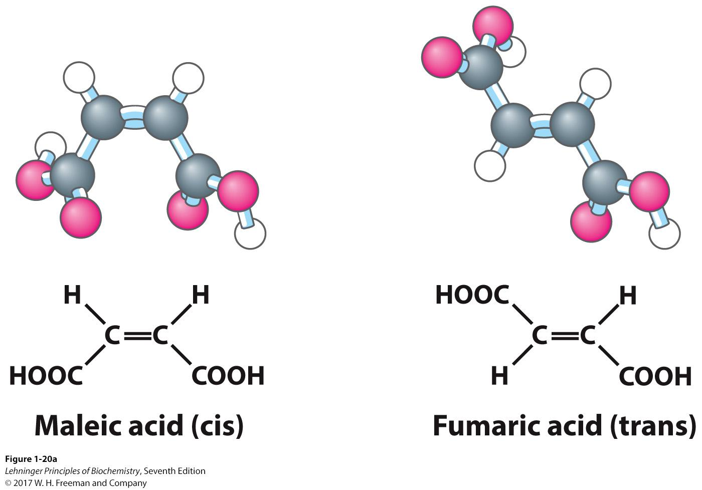{.r-stretch fig-align="center"}

<!-- Slide 35 -->

## Cis vs. Trans

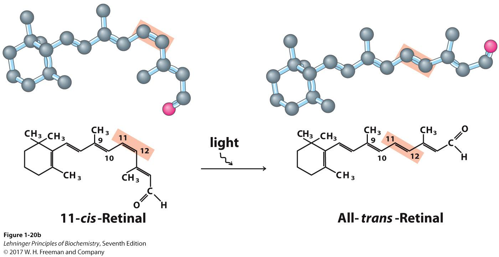{.r-stretch fig-align="center"}

<!-- Slide 36: rótulo + recorte do colchete (image32) + figura (image33) -->

## Enantiômeros e Diastereoisômeros

::: {.absolute left="336" top="173" width="317" style="font-size: .5em; font-weight: bold;"}
Diastereoisômeros (imagens não especulares)
:::

::: {.absolute left="332" top="196" width="272"}

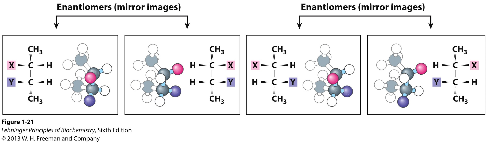

:::

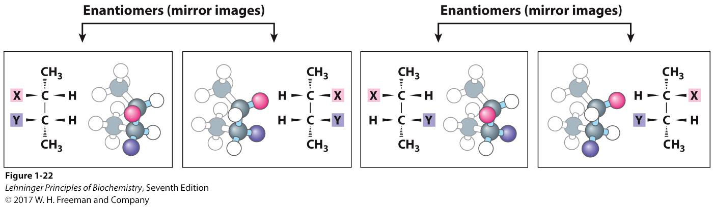{.absolute left=32 top=229 width=896}

<!-- Slide 37 -->

## Enantiômeros e Diastereoisômeros

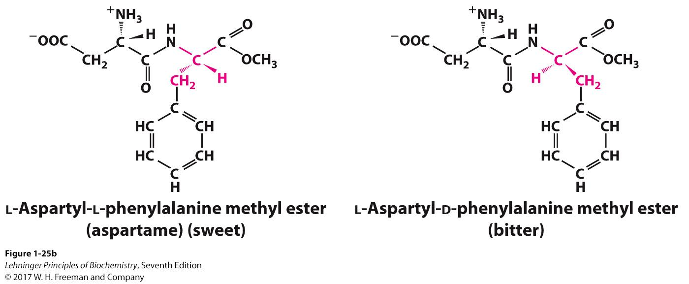{.r-stretch fig-align="center"}

<!-- Slide 38 -->

## As Interações Entre  Biomoléculas São Específicas

- Macromoléculas enovelam-se em estruturas 3D com bolsões de ligação exclusivos.
- Apenas certas moléculas se encaixam bem e podem se ligar.
- A ligação de biomoléculas quirais é estereoespecífica.

<!-- Slide 39 -->

## As Interações Entre  Biomoléculas São Específicas

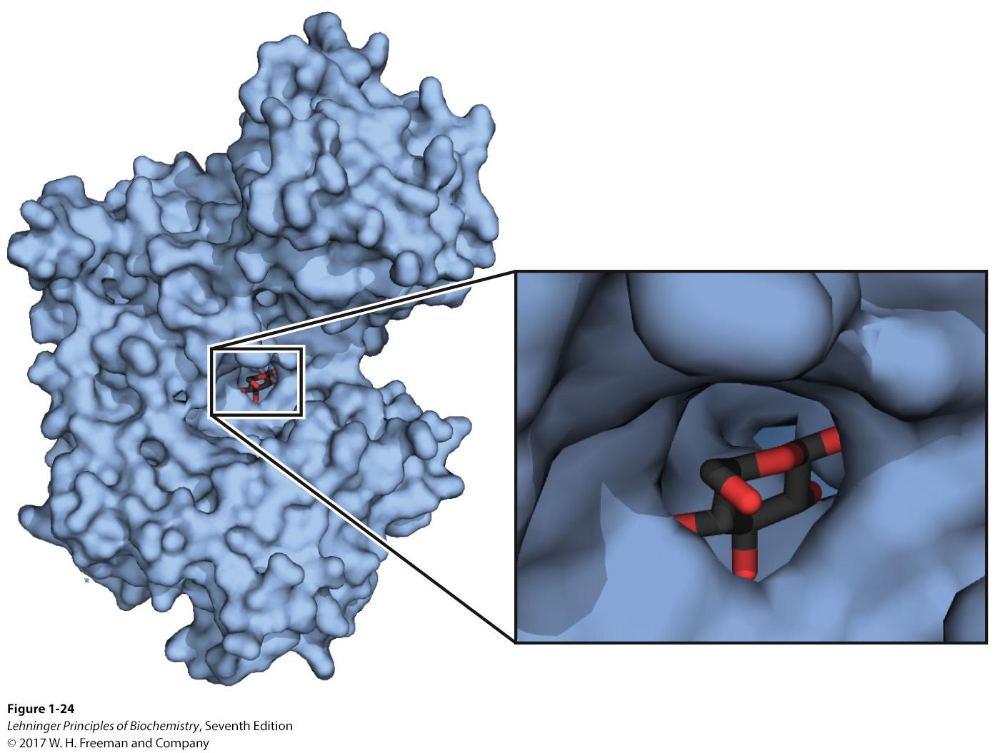{.r-stretch fig-align="center"}

<!-- Slide 40 -->

## Os Organismos Realizam Transduções de Energia para Realizar Trabalho e Permanecer Vivos {.smaller}

- Os organismos vivos existem em um estado estacionário dinâmico e nunca estão em equilíbrio com o ambiente.
- O acoplamento energético permite que os organismos vivos transformem matéria em energia.
- Catalisadores biológicos reduzem a necessidade energética para as reações enquanto oferecem especificidade.
- À medida que a entropia do universo aumenta, criar e manter a ordem requer trabalho e energia.

<!-- Slide 41 -->

## Os Organismos Realizam Transduções de Energia para Realizar Trabalho e Permanecer Vivos

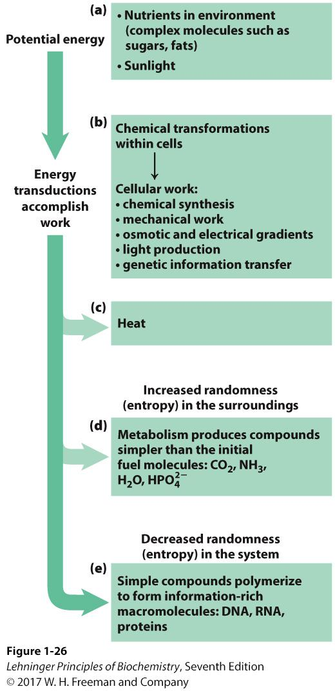{.r-stretch fig-align="center"}

<!-- Slide 42 -->

## Como Acelerar Reações

**Temperaturas mais altas**
- a estabilidade das macromoléculas é limitante

**Maior concentração de reagentes**
- custoso, pois é necessário mais material de partida valioso

**Alterar a reação acoplando-a a uma rápida**
- usado universalmente pelos organismos vivos

**Diminuir a barreira de ativação por catálise**
- usado universalmente pelos organismos vivos

<!-- Slide 43: equações (estavam no pptx, não no texto extraído) -->

## O Equilíbrio e o ΔG° Medem a Espontaneidade de uma Reação

Para a equação: $\quad aA + bB \leftrightarrow cC + dD$

$$K_{eq} = \frac{[C]_{eq}^{c}\,[D]_{eq}^{d}}{[A]_{eq}^{a}\,[B]_{eq}^{b}}$$

E

$$\Delta G^{\circ} = -RT\,\ln K_{eq}$$

<!-- Slide 44 -->

## Reações Desfavoráveis e Favoráveis {.smaller}

- A síntese de moléculas complexas e muitas outras reações metabólicas requerem energia (endergônicas).
    - Uma reação pode ser termodinamicamente desfavorável (ΔG° > 0).
        - Criar ordem requer trabalho e energia.
    - Uma reação metabólica pode ter uma barreira energética muito alta (ΔG‡ > 0).
        - O metabólito é cineticamente estável.
- A quebra de alguns metabólitos libera uma quantidade significativa de energia (exergônica).
    - Tais metabólitos (ATP, NADH, NADPH) podem ser sintetizados usando a energia da luz solar e de combustíveis.
    - Sua concentração celular é muito maior do que sua concentração de equilíbrio.

<!-- Slide 45: texto + figura recortada (ATP) + crédito recortado -->

## Acoplamento Energético {.smaller}

- O acoplamento químico de reações exergônicas e endergônicas permite reações que, de outra forma, seriam desfavoráveis.
- A molécula de “alta energia” (ATP) reage diretamente com o metabólito que precisa de “ativação”.

::: {.absolute left="191" top="352" width="624"}

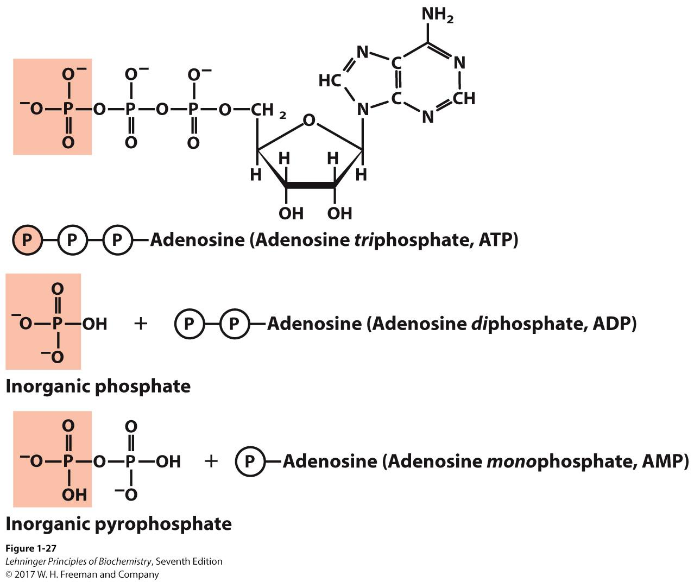

:::

::: {.absolute left="183" top="664" width="267"}

:::

<!-- Slide 46: figura em tela cheia, sem título -->

---

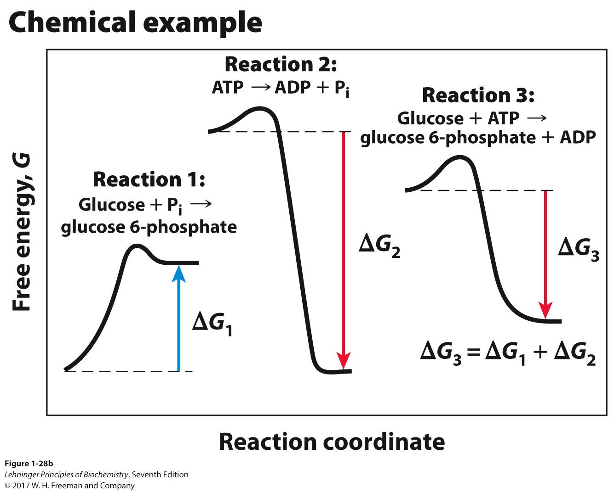{.r-stretch fig-align="center"}

<!-- Slide 47 -->

## Catálise

- Um catalisador é um composto que aumenta a velocidade de uma reação química.
- Catalisadores diminuem a energia livre de ativação ΔG‡.
- Catalisadores não alteram o ΔG°.
- A catálise enzimática oferece:
    - aceleração sob condições brandas
    - alta especificidade
    - possibilidade de regulação

<!-- Slide 48 -->

## Enzimas Diminuem a Energia de Ativação para Aumentar a Velocidade da Reação

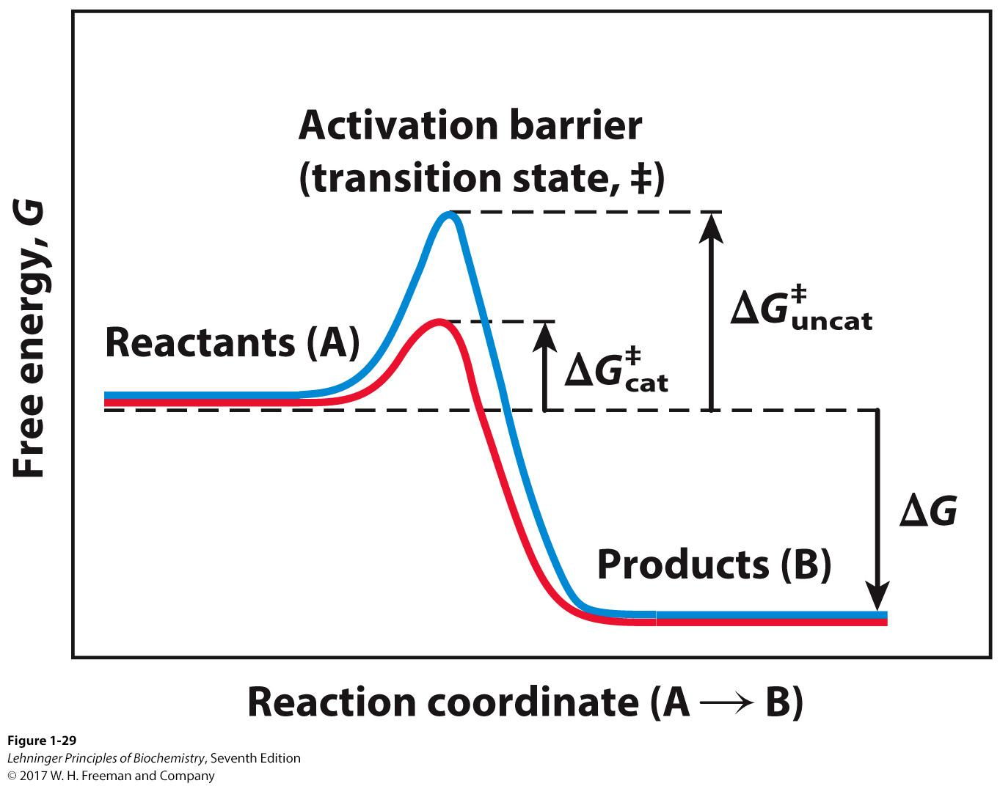{.r-stretch fig-align="center"}

<!-- Slide 49: figura no topo, texto embaixo -->

## Uma Série de Reações Relacionadas Catalisadas Enzimaticamente Forma uma Via

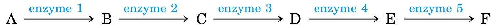{.r-stretch fig-align="center"}

::: {style="font-size: .7em;"}
Via metabólica

- produz energia ou materiais valiosos

Via de transdução de sinal

- transmite informação
:::

<!-- Slide 50: figura no meio, texto embaixo -->

## As Vias São Controladas para  Regular os Níveis de Metabólitos

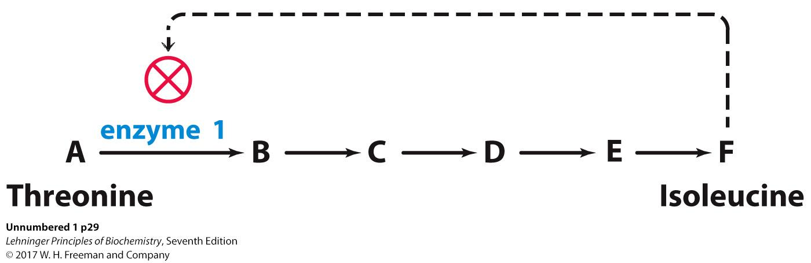{.r-stretch fig-align="center"}

::: {style="font-size: .6em;"}
Exemplo de regulação negativa:

::: {style="margin-left: 2em;"}
O produto da [enzima 5]{.azul} inibe a [enzima 1]{.azul} para evitar excesso de produtos desnecessários.
:::
:::

<!-- Slide 51 -->

## Fundamentos Genéticos e Evolutivos

- A vida na Terra surgiu há 3,5–3,8 bilhões de anos.
- A formação de moléculas autorreplicantes foi um passo fundamental.
- Poderia ter sido o DNA?
- Poderiam ter sido as proteínas?

<!-- Slide 52: figura em tela cheia, sem título -->

---

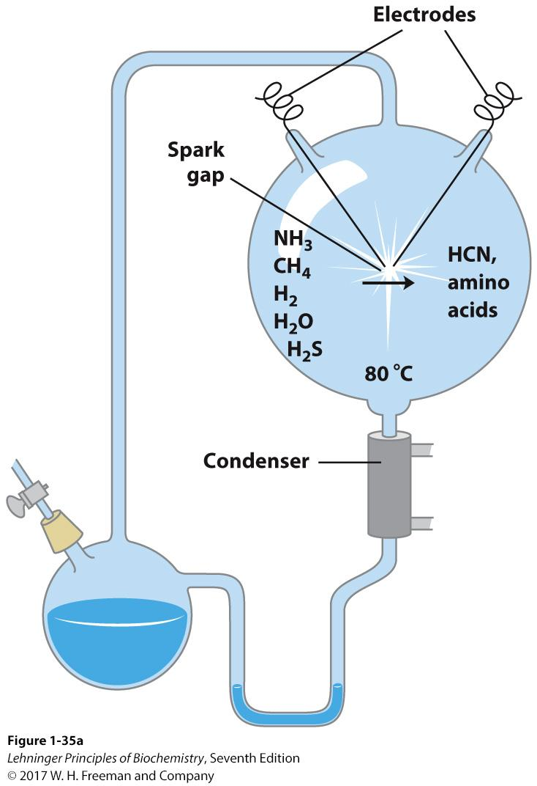{.r-stretch fig-align="center"}

<!-- Slide 53: texto + figura recortada (tRNA e pareamentos) + crédito recortado -->

## Mundo do RNA?

- O RNA pode atuar tanto como portador de informação quanto como biocatalisador.
- Alguns vírus usam o RNA como meio primário de informação genética.

::: {.absolute left="79" top="338" width="832"}

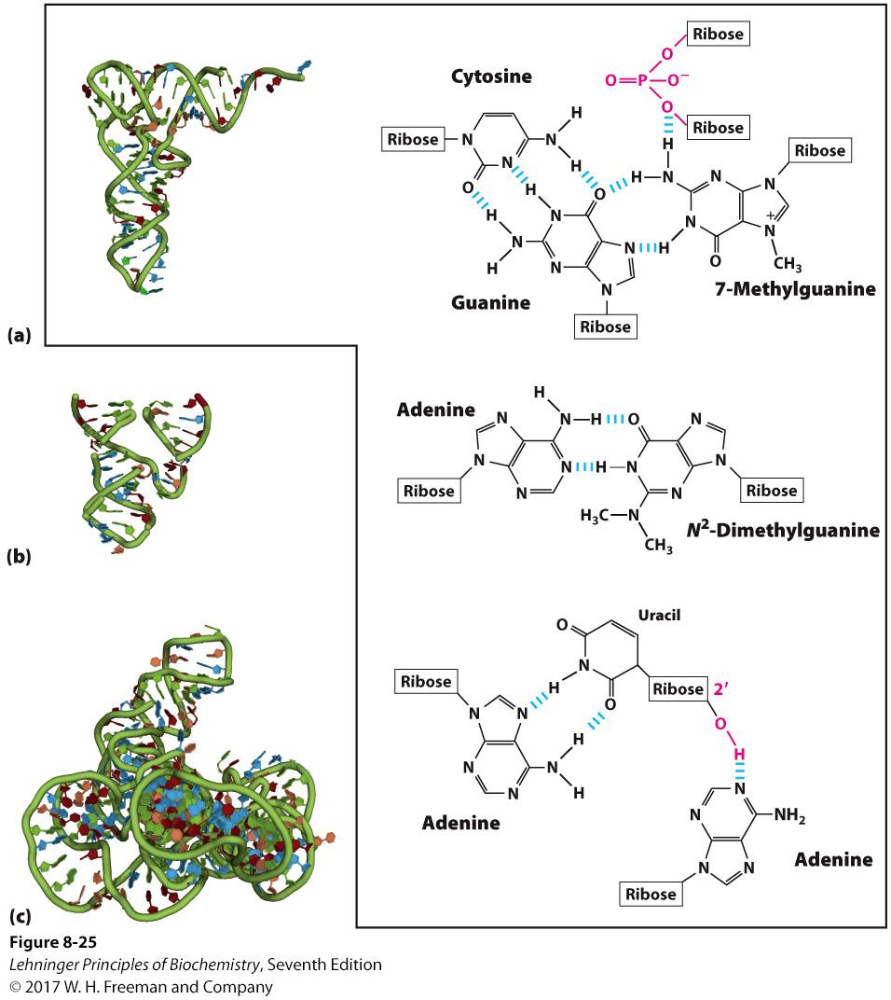

:::

::: {.absolute left="96" top="655" width="270"}

:::

<!-- Slide 54: figura em tela cheia, sem título -->

---

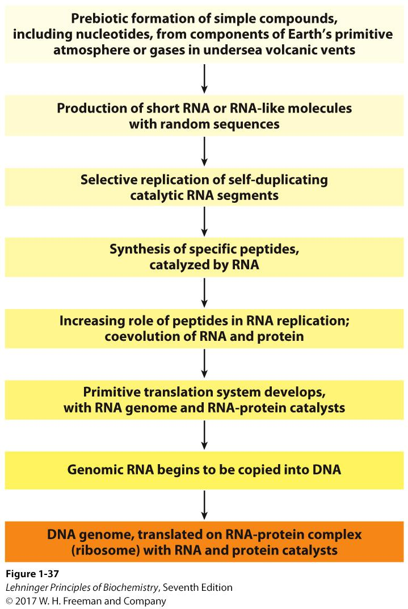{.r-stretch fig-align="center"}

<!-- Slide 55 -->

## A Complementaridade no DNA Permite a Replicação com Fidelidade Quase Perfeita

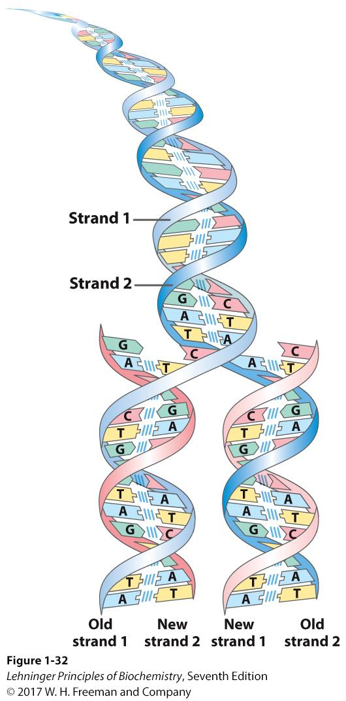{.r-stretch fig-align="center"}

<!-- Slide 56 -->

## O “Dogma” Central da Bioquímica: DNA → RNA → Proteína

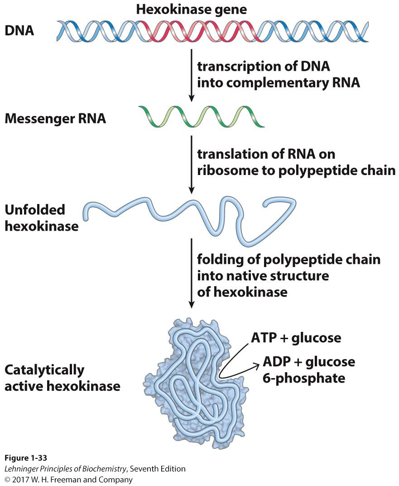{.r-stretch fig-align="center"}

<!-- Slide 57 -->

## A Seleção Natural Favorece Algumas Mutações

- As mutações ocorrem de forma mais ou menos aleatória no DNA e no RNA.
- Polinucleotídeos mutados podem ser transcritos e traduzidos em maquinaria molecular, como proteínas.
- Mutações que conferem aos organismos uma vantagem em um determinado ambiente têm maior probabilidade de serem propagadas.

<!-- Slide 58 -->

## A Seleção Natural Favorece Algumas Mutações

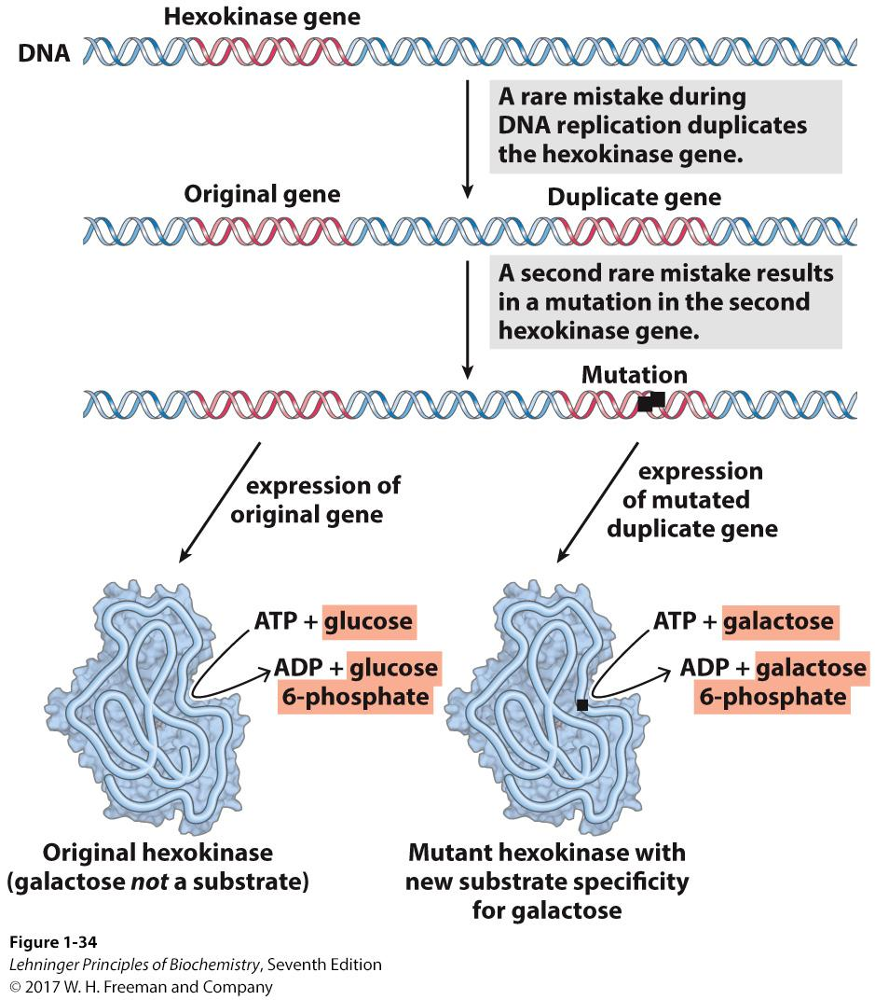{.r-stretch fig-align="center"}

<!-- Slide 59 -->

## A Evolução dos Eucariotos Também Pode Ter Sido Mediada por Endossimbiose

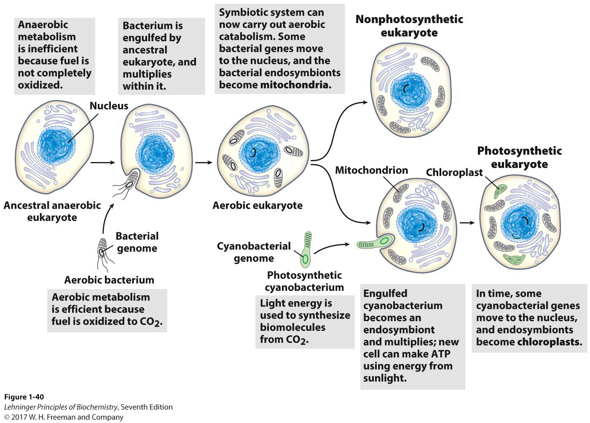{.r-stretch fig-align="center"}

<!-- Slide 60 -->

## Capítulo 1: Resumo

Neste capítulo, aprendemos a:

- compreender o que define os organismos vivos
- relacionar a estrutura e a função da célula
- perceber que a estrutura das biomoléculas frequentemente lhes confere funções específicas
- compreender os princípios da bioenergética
- revisar as forças por trás da evolução
