<!-- Slide 1 -->

::: {.absolute left=16 top=296 width=442 style="text-align:center; font-size:28px; font-weight:bold;"}
[2 | Água]{.azul}
:::

::: {.absolute left=24 top=478 width=420 style="font-size:14px; font-weight:bold;"}
[© 2017 W. H. Freeman and Company]{.azul}
:::

{.absolute left=458 top=42 width=462 height=628}

<!-- Slide 2 -->

## CAPÍTULO 2 Água {.smaller}

*Objetivos de aprendizagem:*

- Que tipos de interações ocorrem entre as moléculas
- Por que a água é um bom meio para a vida
- Por que porções apolares se agregam na água
- Como moléculas dissolvidas alteram as propriedades da água
- Como ácidos e bases fracos se comportam na água
- Como os tampões funcionam e por que precisamos deles
- Como a água participa das reações bioquímicas

<!-- Slide 3 -->

## A Água É o Meio para a Vida

- A vida evoluiu na água devido à proteção que ela oferece contra a luz UV.

- Os organismos contêm tipicamente 70–90% de água.

- As reações químicas ocorrem em meio aquoso.

- A água é um determinante crítico da estrutura e função de proteínas, ácidos nucleicos e membranas.

<!-- Slide 4 -->

## Estrutura da Molécula de Água {.smaller}

- A regra do octeto dita que existem quatro pares de elétrons ao redor de um átomo de oxigênio na água.
- Esses elétrons estão em quatro orbitais *sp*^3^.
- Dois desses pares ligam covalentemente dois átomos de hidrogênio a um átomo central de oxigênio.
- Os dois pares restantes permanecem não ligantes (pares isolados).
- A geometria da água é um tetraedro distorcido.
- A eletronegatividade do átomo de oxigênio induz um momento de dipolo resultante.
- Devido ao momento de dipolo, a água pode atuar tanto como doadora quanto como aceptora de ligações de hidrogênio.

<!-- Slide 5 -->

---

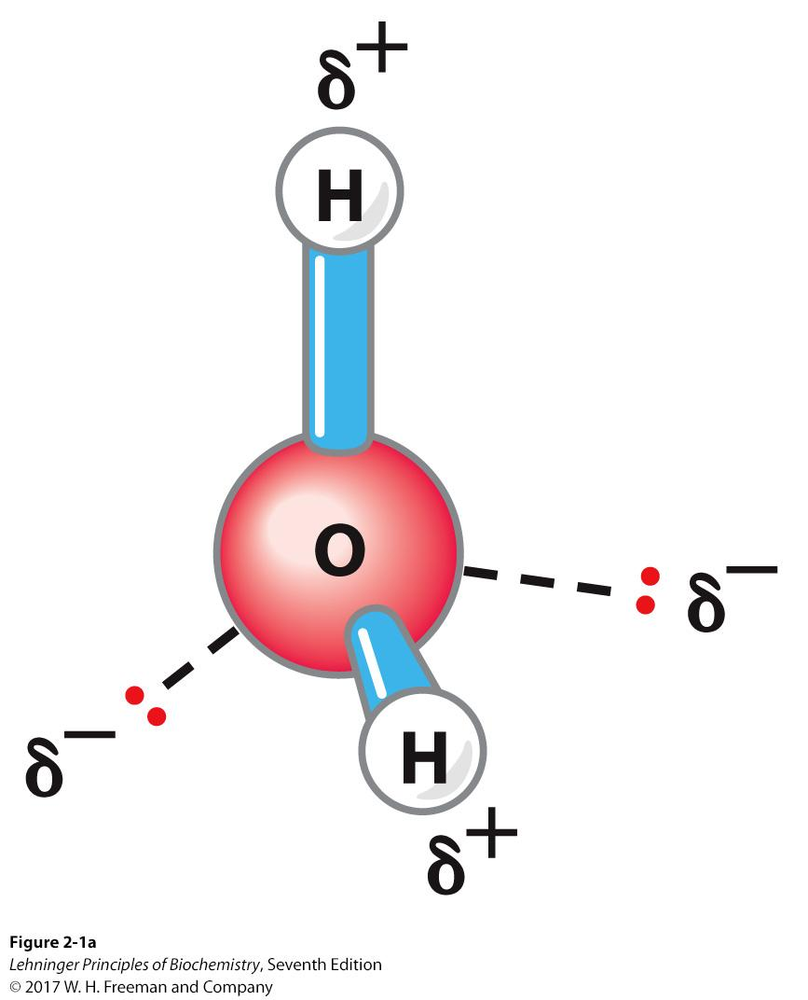{.r-stretch fig-align="center"}

<!-- Slide 6 -->

## Ligações de Hidrogênio

- Ligações de hidrogênio são fortes interações dipolo-dipolo ou carga-dipolo que surgem entre um hidrogênio ligado covalentemente e um par isolado de elétrons.
- Elas geralmente envolvem dois átomos eletronegativos (frequentemente nitrogênio e oxigênio).
- As ligações de hidrogênio são mais fortes quando as moléculas ligadas permitem padrões de ligação lineares.
- Idealmente, os três átomos envolvidos estão em linha reta.

<!-- Slide 7 -->

---

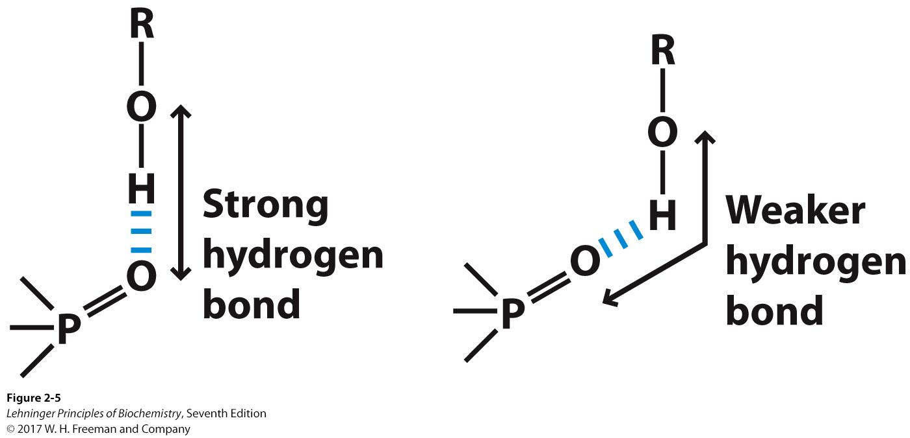{.r-stretch fig-align="center"}

<!-- Slide 8 -->

## Ligações de Hidrogênio na Água {.smaller}

- A água pode atuar tanto como:
  - doadora de H
  - aceptora de H
- Até quatro ligações de H por molécula de água conferem à água seu:
  - ponto de ebulição anomalamente alto
  - ponto de fusão anomalamente alto
  - tensão superficial excepcionalmente grande
- A ligação de hidrogênio na água é cooperativa.
- As ligações de hidrogênio entre moléculas vizinhas são fracas (20 kJ/mol) em relação às ligações covalentes H–O (420 kJ/mol).

<!-- Slide 9 -->

---

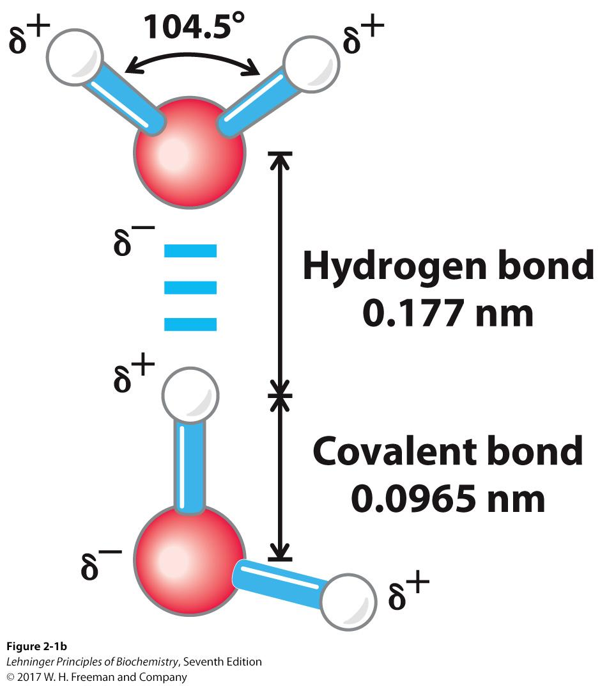{.r-stretch fig-align="center"}

<!-- Slide 10 -->

## Importância das Ligações de Hidrogênio {.smaller}

- Fonte das propriedades únicas da água
- Estrutura e função das proteínas
- Estrutura e função do DNA
- Estrutura e função dos polissacarídeos
- Ligação de substratos às enzimas
- Ligação de hormônios aos receptores
- Pareamento de mRNA e tRNA

*“Acredito que, à medida que os métodos da química estrutural forem aplicados a problemas fisiológicos, descobrir-se-á que a importância da ligação de hidrogênio para a fisiologia é maior do que a de qualquer outra característica estrutural isolada.”*

::: {style="text-align:right"}
–Linus Pauling, *A Natureza da Ligação Química*, 1939
:::

<!-- Slide 11 -->

## Relevância Biológica das Ligações de Hidrogênio

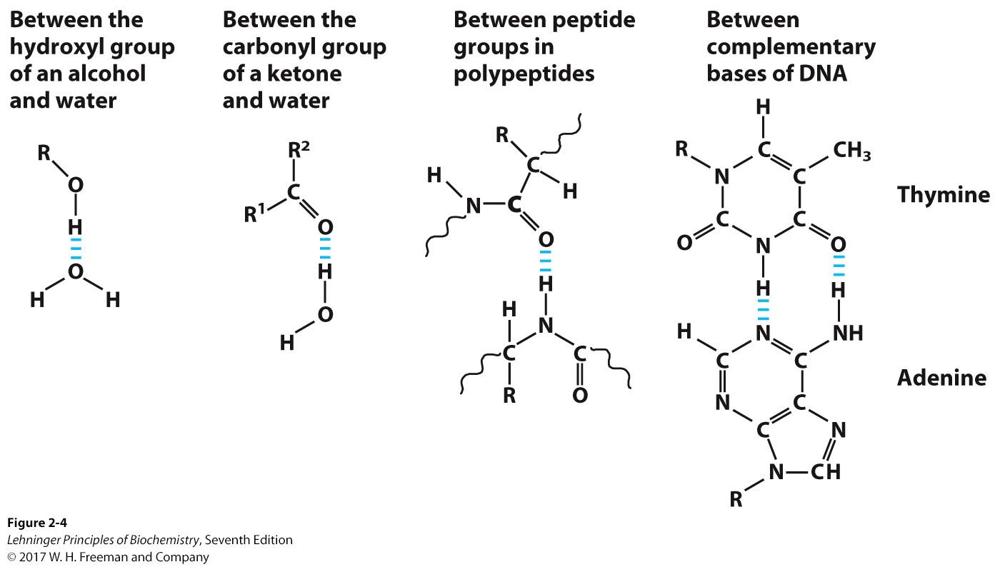{.r-stretch fig-align="center"}

<!-- Slide 12 -->

## Gelo: Água no Estado Sólido

- A água possui muitas formas cristalinas diferentes; o gelo hexagonal é o mais comum.
- O gelo hexagonal forma uma rede organizada e, portanto, tem baixa entropia.
- O gelo hexagonal contém o máximo de ligações de hidrogênio por molécula de água, forçando as moléculas de água a um arranjo equidistante. Assim:
  - o gelo tem densidade menor que a água líquida
  - o gelo flutua

<!-- Slide 13 -->

---

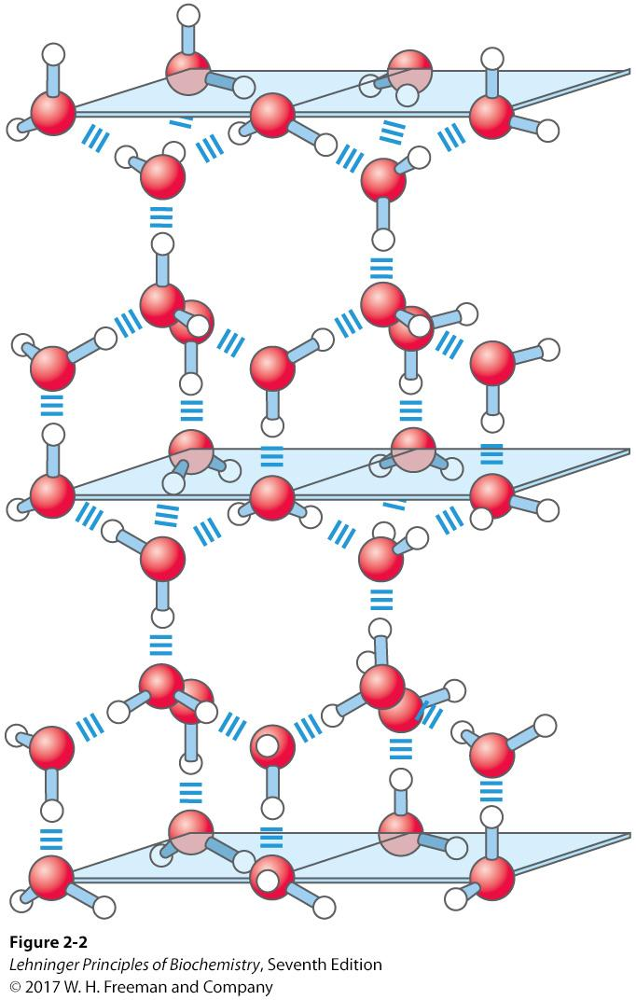{.r-stretch fig-align="center"}

<!-- Slide 14 -->

## Água como Solvente

- A água é um bom solvente para substâncias carregadas e polares:
  - aminoácidos e peptídeos
  - pequenos álcoois
  - carboidratos

- A água é um mau solvente para substâncias apolares:
  - gases apolares
  - porções aromáticas
  - cadeias alifáticas

<!-- Slide 15 -->

---

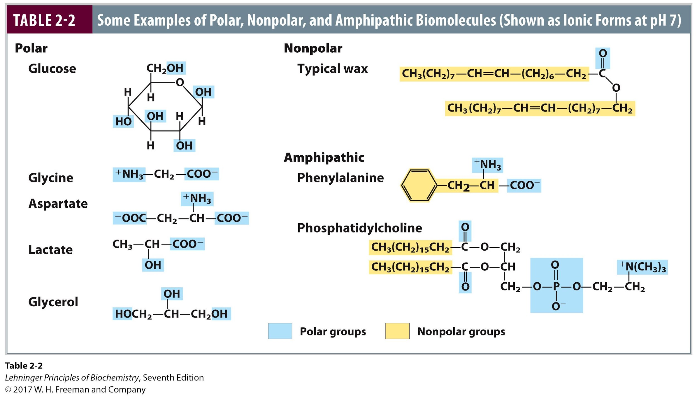{.r-stretch fig-align="center"}

<!-- Slide 16 -->

## Física das Interações Não Covalentes {.smaller}

Interações não covalentes não envolvem o compartilhamento de um par de elétrons. Com base em sua origem física, pode-se distinguir entre:

- Interações iônicas (Coulômbicas)
  - interações eletrostáticas entre espécies permanentemente carregadas, ou entre o íon e um dipolo permanente
- Interações dipolo
  - interações eletrostáticas entre moléculas não carregadas, mas polares
- Interações de van der Waals
  - interações fracas entre todos os átomos, independentemente da polaridade
  - componente atrativo (dispersão) e repulsivo (estérico)
- Efeito Hidrofóbico
  - fenômeno complexo associado à ordenação de moléculas de água ao redor de substâncias apolares

<!-- Slide 17 -->

## Exemplos de Interações Não Covalentes

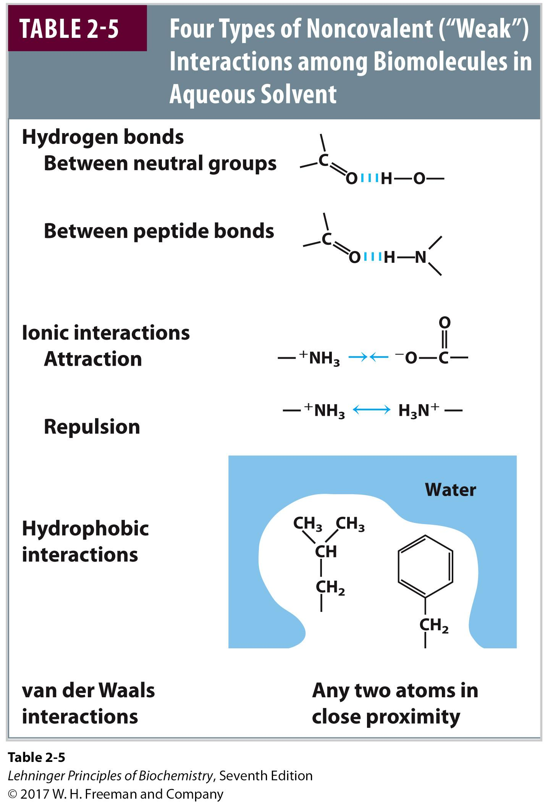{.r-stretch fig-align="center"}

<!-- Slide 18 -->

## Dissolver Sais Envolve Quebrar Interações Iônicas

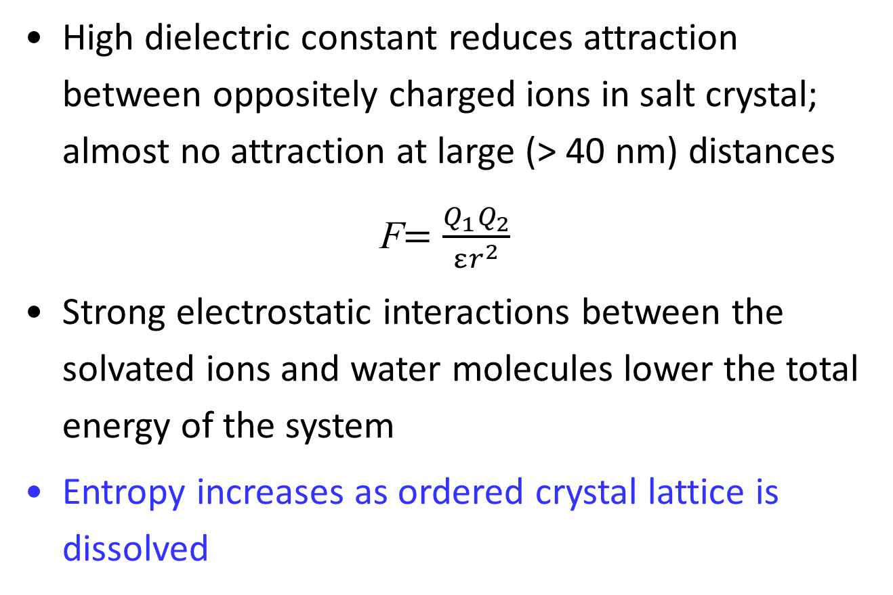{.r-stretch fig-align="center"}

<!-- Slide 19 -->

## Dissolver Sais Envolve Quebrar Interações Iônicas

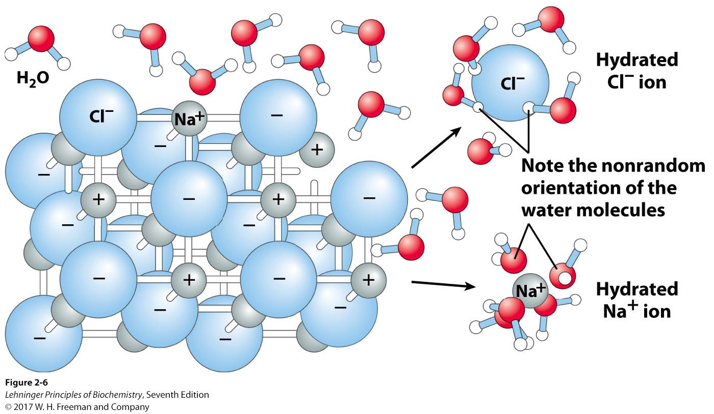{.r-stretch fig-align="center"}

<!-- Slide 20 -->

## Interações de van der Waals {.smaller}

- As interações de van der Waals têm dois componentes:
  - força atrativa (dispersão de London), que depende da polarizabilidade
  - força repulsiva (repulsão estérica), que depende do tamanho dos átomos
- A atração domina em distâncias maiores (tipicamente 0,4–0,7 nm).
- A repulsão domina em distâncias muito curtas.
- Existe uma distância de energia mínima (distância de contato de van der Waals).

<!-- Slide 21 -->

## Significado Bioquímico das  Interações de van der Waals

- Fracas individualmente
  - facilmente quebradas, reversíveis
- Universais
  - ocorrem entre quaisquer dois átomos que estejam próximos um do outro
- Importância
  - determinam a complementaridade estérica
  - estabilizam macromoléculas biológicas (empilhamento no DNA)
  - facilitam a ligação de ligantes polarizáveis

<!-- Slide 22 -->

## O Efeito Hidrofóbico {.smaller}

- Refere-se à associação ou interação de moléculas apolares ou componentes de moléculas em solução aquosa
- É um dos principais fatores por trás de:
  - enovelamento proteico
  - associação proteína-proteína
  - formação de micelas lipídicas
  - ligação de hormônios esteroides aos seus receptores
- Não surge devido a alguma força atrativa direta entre duas moléculas apolares

<!-- Slide 23 -->

## Solubilidade de Solutos Polares e Apolares

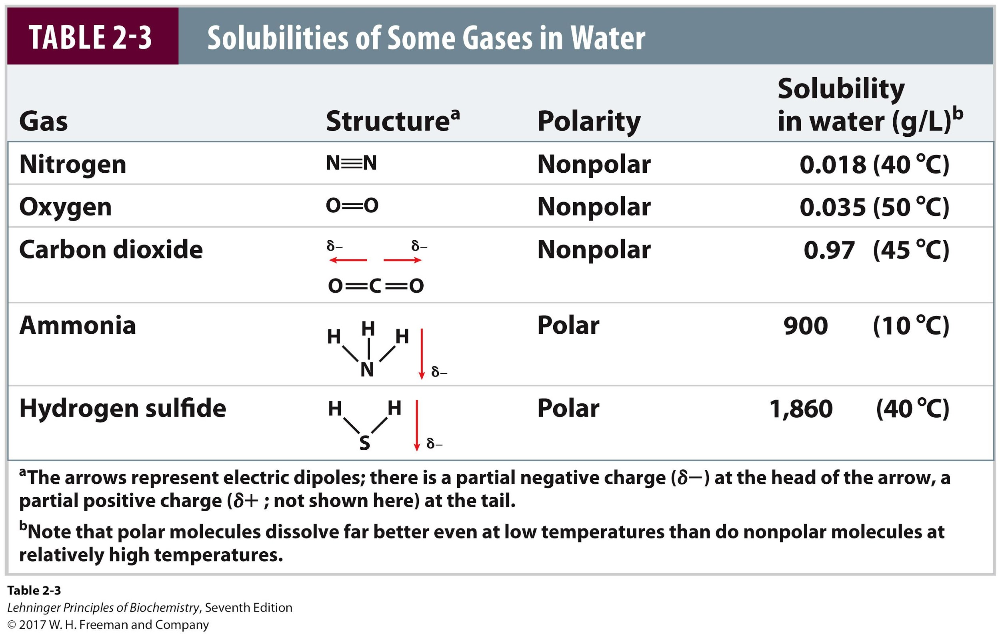{.r-stretch fig-align="center"}

[Por que moléculas apolares são pouco solúveis em água?]{.vermelho}

<!-- Slide 24 -->

## A Água ao Redor de Solutos Apolares Tem Menor Entropia

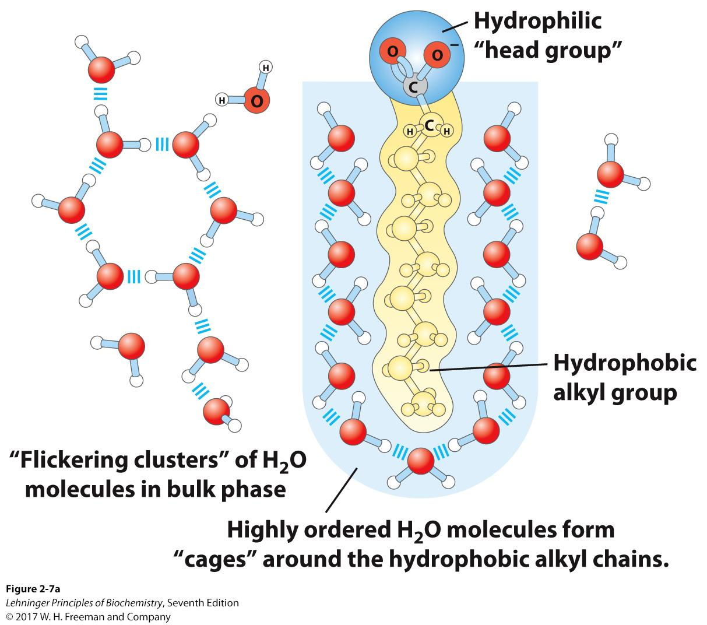{.absolute left=144 top=154 width=568 height=502}

::: {.absolute left=144 top=149 width=248 height=411 style="border:3px solid #e00; box-sizing:border-box;"}
:::

::: {.absolute left=182 top=149 width=185 style="color:#e00; font-weight:bold; font-size:22px;"}
Alta entropia
:::

<svg style="position:absolute; left:0; top:0; pointer-events:none;" width="960" height="720" viewBox="0 0 960 720"><path d="M712,149 H772 V648 H712" fill="none" stroke="#e00" stroke-width="3"/></svg>

::: {.absolute left=839 top=361 width=121 style="color:#e00; font-weight:bold; font-size:22px; text-align:center; line-height:1.2;"}
Baixa Entropia
:::

::: {.absolute left=39 top=643 width=888 style="color:#e00; font-size:22px; text-align:center;"}
Baixa entropia é termodinamicamente desfavorável, portanto solutos hidrofóbicos têm baixa solubilidade.
:::

<!-- Slide 25 -->

## Origem do Efeito Hidrofóbico {.smaller}

::: {.absolute left=24 top=160 width=522}
- Considere lipídios anfipáticos na água.
- Moléculas lipídicas dispersam-se na solução; as caudas apolares das moléculas lipídicas são cercadas por moléculas de água ordenadas.
- A entropia do sistema diminui.
- O sistema está agora em um estado desfavorável.
:::

::: {.recorte .absolute left=549 top=216 width=414 style="aspect-ratio:1.0833;"}
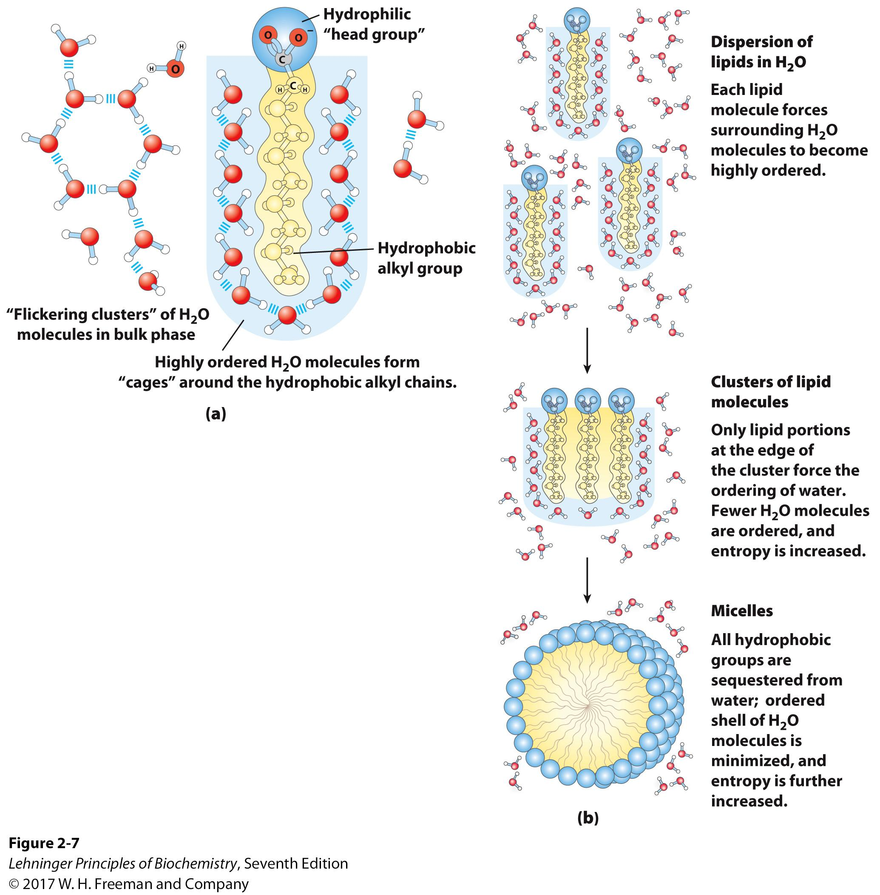
:::

<!-- Slide 26 -->

## Origem do Efeito Hidrofóbico {.smaller}

- Porções apolares da molécula anfipática agregam-se para que menos moléculas de água fiquem ordenadas e a entropia aumente.
- Todos os grupos apolares são sequestrados da água, e as moléculas de água liberadas aumentam ainda mais a entropia.
- Apenas os “grupos cabeça” polares ficam expostos.

::: {.recorte .absolute left=240 top=424 width=544 style="aspect-ratio:1.9696;"}

:::

<!-- Slide 27 -->

## Origem do Efeito Hidrofóbico

- Com concentração suficientemente alta de moléculas anfipáticas, é possível a agregação completa em micelas.

::: {.recorte .absolute left=320 top=320 width=534 style="aspect-ratio:1.6413;"}

:::

::: {.recorte .absolute left=320 top=637 width=275 style="aspect-ratio:5.768;"}

:::

<!-- Slide 28 -->

## O Efeito Hidrofóbico Favorece a Ligação de Ligantes

- Sítios de ligação em enzimas e receptores são frequentemente hidrofóbicos.

- Tais sítios podem ligar substratos e ligantes hidrofóbicos, como hormônios esteroides, que deslocam a água e aumentam a entropia do sistema.

- Muitos fármacos são projetados para tirar proveito do efeito hidrofóbico.

<!-- Slide 29 -->

---

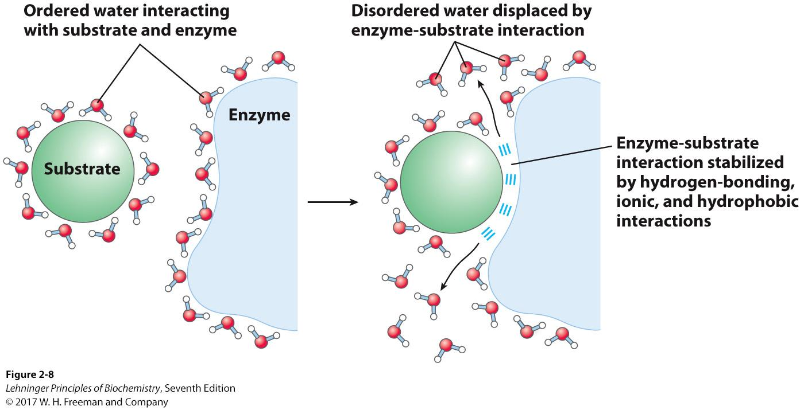{.r-stretch fig-align="center"}

<!-- Slide 30 -->

## Solutos Podem Alterar as Propriedades da Água {.smaller}

- Propriedades coligativas:
  - ponto de ebulição, ponto de fusão e osmolaridade
  - não dependem da natureza do soluto, apenas da concentração
- Propriedades não coligativas:
  - viscosidade, tensão superficial, sabor e cor
  - dependem da natureza química do soluto
- O citoplasma das células são soluções altamente concentradas e têm alta pressão osmótica devido aos solutos dissolvidos.

<!-- Slide 31 -->

## Pressão Osmótica {.smaller}

- A água move-se de áreas de alta concentração de água (baixa concentração de soluto) para áreas de baixa concentração de água (alta concentração de soluto).
- Pressão osmótica (*π*) é a força necessária para resistir a esse movimento.
- A pressão osmótica é influenciada pela concentração de cada soluto em solução.
- Componentes dissociados de um soluto influenciam individualmente a pressão osmótica.

<!-- Slide 32 -->

## Pressão Osmótica

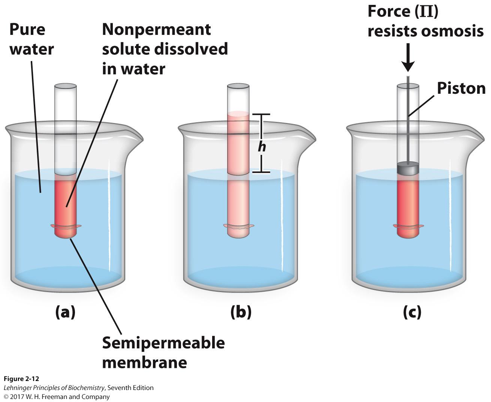{.r-stretch fig-align="center"}

<!-- Slide 33 -->

## Efeito da Pressão Osmótica nas Células

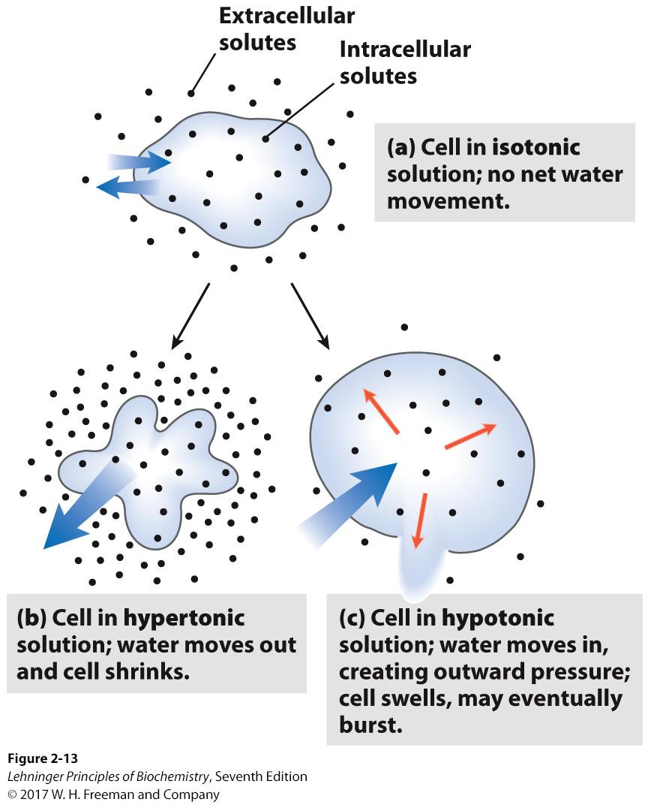{.r-stretch fig-align="center"}

<!-- Slide 34 -->

## Ionização da Água {.smaller}

$$\mathrm{H_2O} \rightleftharpoons \mathrm{H^+} + \mathrm{OH^-}$$

- Ligações O-H são polares e podem dissociar-se heteroliticamente.
- Os produtos são um próton (H^+^) e um íon hidróxido (OH^–^).
- A dissociação da água é um processo reversível rápido.
- A maioria das moléculas de água permanece não ionizada; assim, a água pura tem condutividade elétrica muito baixa (resistência: 18 MΩ•cm).
- O equilíbrio está fortemente deslocado para a esquerda (baixo *K*~eq~).
- A extensão da dissociação depende da temperatura.

<!-- Slide 35 -->

## Hidratação de Prótons {.smaller}

- Prótons não existem livres em solução.
- Eles são imediatamente hidratados para formar íons hidrônio (H~3~O^+^).

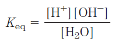{fig-align="center" width=282}

- Um íon hidrônio é uma molécula de água com um próton associado a um dos pares de elétrons não ligantes.
- Íons hidrônio são solvatados por moléculas de água próximas.
- As ligações covalentes e de hidrogênio são intercambiáveis. Isso permite uma mobilidade extremamente rápida de prótons na água via “salto de prótons” (*proton hopping*).

<!-- Slide 36 -->

## Salto de Prótons (*Proton Hopping*)

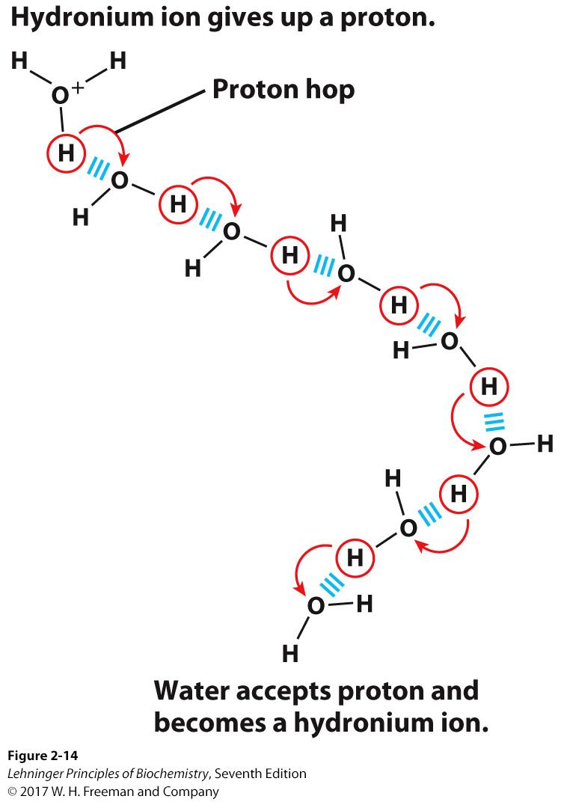{.r-stretch fig-align="center"}

<!-- Slide 37 -->

## Ionização da Água:  Tratamento Quantitativo {.smaller}

As concentrações das espécies participantes em um processo de equilíbrio não são independentes, mas estão relacionadas pela constante de equilíbrio:

$$\mathrm{H_2O} \rightleftharpoons \mathrm{H^+} + \mathrm{OH^-} \qquad\qquad K_{eq} = \frac{[\mathrm{H^+}] \cdot [\mathrm{OH^-}]}{[\mathrm{H_2O}]}$$

*K*~eq~ pode ser determinado experimentalmente, sendo 1,8 • 10^–16^ M a 25°C.

[H~2~O] pode ser determinado a partir da densidade da água, sendo 55,5 M.

- Produto iônico da água:

$$K_w = K_{eq} \cdot [\mathrm{H_2O}] = [\mathrm{H^+}][\mathrm{OH^-}] = 1 \cdot 10^{-14}\,\mathrm{M^2}$$

- Na água pura, [H^+^] = [OH^–^] = 10^–7^ M.

<!-- Slide 38 -->

## O Que É pH? {.smaller}

::::: {.columns}

:::: {.column width="48%"}

::: {.elipse style="width:328px; height:128px; margin:0 auto;"}
$\mathbf{pH = -\log[H^+]}$
:::

$$K_w = [\mathrm{H^+}][\mathrm{OH^-}] = 1 \cdot 10^{-14}\,\mathrm{M^2}$$

$$-\log[\mathrm{H^+}] - \log[\mathrm{OH^-}] = +14$$

$$\mathrm{pH} + \mathrm{pOH} = 14$$

::::

:::: {.column width="52%"}

- O pH é definido como o logaritmo negativo da concentração de íons hidrogênio.
- Simplifica equações
- O pH e o pOH devem sempre somar 14.
- Em solução neutra, [H^+^] = [OH^–^] e o pH é 7.
- O pH pode ser negativo ([H^+^] = 6 M).

::::

:::::

<!-- Slide 39 -->

## A Escala de pH É Logarítmica:  1 unidade = 10 vezes

::: {.tabela-ph}

| [H^+^] (M) | pH | [OH^–^] (M) | pOH^a^ |
|:---:|:---:|:---:|:---:|
| 10^0^ (1) | 0 | 10^–14^ | 14 |
| 10^–1^ | 1 | 10^–13^ | 13 |
| 10^–2^ | 2 | 10^–12^ | 12 |
| 10^–3^ | 3 | 10^–11^ | 11 |
| 10^–4^ | 4 | 10^–10^ | 10 |
| 10^–5^ | 5 | 10^–9^ | 9 |
| 10^–6^ | 6 | 10^–8^ | 8 |
| 10^–7^ | 7 | 10^–7^ | 7 |
| 10^–8^ | 8 | 10^–6^ | 6 |
| 10^–9^ | 9 | 10^–5^ | 5 |
| 10^–10^ | 10 | 10^–4^ | 4 |
| 10^–11^ | 11 | 10^–3^ | 3 |
| 10^–12^ | 12 | 10^–2^ | 2 |
| 10^–13^ | 13 | 10^–1^ | 1 |
| 10^–14^ | 14 | 10^0^ (1) | 0 |

: TABELA 2-6 A Escala de pH {tbl-colwidths="[25,25,25,25]"}

::: {.nota}
^a^A expressão pOH é às vezes usada para descrever a basicidade, ou concentração de OH^–^, de uma solução; pOH é definido pela expressão pOH = −log [OH^–^], que é análoga à expressão para pH. Observe que em todos os casos, pH + pOH = 14.
:::

:::

<!-- Slide 40 -->

## pH de Alguns Líquidos Comuns

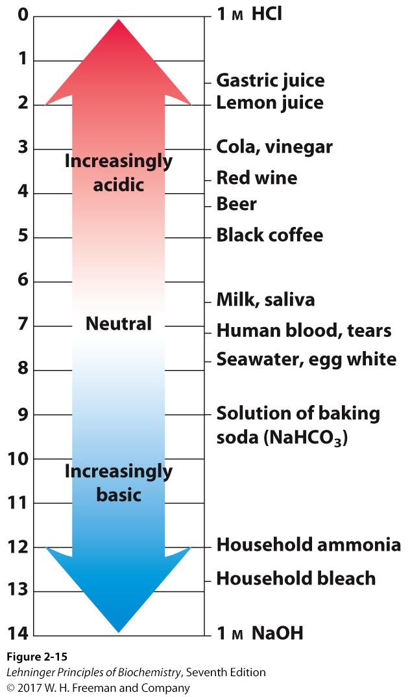{.r-stretch fig-align="center"}

<!-- Slide 41 -->

## Dissociação de Eletrólitos Fracos:  Princípio {.smaller}

::: {.columns}

::: {.column width="50%"}
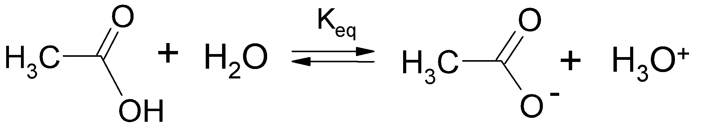{width=440}

$$K_a = \frac{[\mathrm{H^+}][\mathrm{CH_3COO^-}]}{[\mathrm{CH_3COOH}]} = 1{,}74 \cdot 10^{-5}\,\mathrm{M}$$
:::

::: {.column width="50%"}
- Eletrólitos fracos dissociam-se apenas parcialmente na água.

- A extensão da dissociação é determinada pela constante de dissociação ácida *K*~a~.

- Podemos calcular o pH se o *K*~a~ for conhecido. Mas é necessária alguma álgebra!
:::

:::

<!-- Slide 42 -->

## Dissociação de Eletrólitos Fracos: Exemplo {.smaller}

[Qual é o pH final de uma solução quando 0,1 mol de ácido acético é adicionado à água para um volume final de 1 L?]{.vermelho}

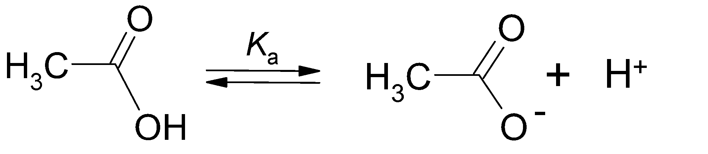{.absolute left=96 top=260 width=472}

::: {.absolute left=108 top=372}
0,1 – x
:::

::: {.absolute left=374 top=372}
x
:::

::: {.absolute left=504 top=372}
x
:::

::: {.absolute left=136 top=432 width=440}
$\displaystyle K_a = \frac{[x][x]}{[0{,}1 - x]} = 1{,}74 \cdot 10^{-5}\,\mathrm{M}$
:::

::: {.absolute left=96 top=528 width=480}
$x^2 = 1{,}74 \cdot 10^{-6} - 1{,}74 \cdot 10^{-5}\,x$
:::

::: {.absolute left=96 top=584 width=480}
$x^2 + 1{,}74 \cdot 10^{-5}\,x - 1{,}74 \cdot 10^{-6} = 0$
:::

::: {.absolute left=96 top=648 width=480 style="color:#00f;"}
x = 0,001310,     pH = 2,883
:::

::: {.absolute left=576 top=264 width=328}
- Assumimos que a única fonte de H^+^ é o ácido fraco.

- Para encontrar [H^+^], uma equação quadrática deve ser resolvida.
:::

<!-- Slide 43 -->

## Dissociação de Eletrólitos Fracos: Simplificação {.smaller}

{.absolute left=56 top=227 width=456}

::: {.absolute left=65 top=326 style="font-style:italic;"}
0,1 – x
:::

::: {.absolute left=324 top=326 style="font-style:italic;"}
x
:::

::: {.absolute left=444 top=326 style="font-style:italic;"}
x
:::

::: {.absolute left=96 top=366 style="font-style:italic; color:#dc080d;"}
0,1
:::

::: {.absolute left=324 top=366 style="font-style:italic; color:#dc080d;"}
x
:::

::: {.absolute left=444 top=366 style="font-style:italic; color:#dc080d;"}
x
:::

::: {.absolute left=91 top=434 width=440}
$\displaystyle K_a = \frac{[x][x]}{[0{,}1]} = 1{,}74 \cdot 10^{-5}\,\mathrm{M}$
:::

::: {.absolute left=124 top=526 width=380}
$x^2 = 1{,}74 \cdot 10^{-6}$
:::

::: {.absolute left=120 top=616 width=380 style="color:#00f; font-style:italic;"}
x = 0,00132,     pH = 2,880
:::

::: {.absolute left=528 top=208 width=400}
- A equação pode ser simplificada se a quantidade de espécies dissociadas for muito menor do que a quantidade de ácido não dissociado.
- A aproximação funciona para ácidos e bases suficientemente fracos.
- Verifique se *x* < [ácido total].
:::

<!-- Slide 44 -->

## p*K*~a~ Mede a Acidez

::: {.vermelho style="font-weight:bold; text-align:center;"}
p*K*~a~ = –log *K*~a~
:::

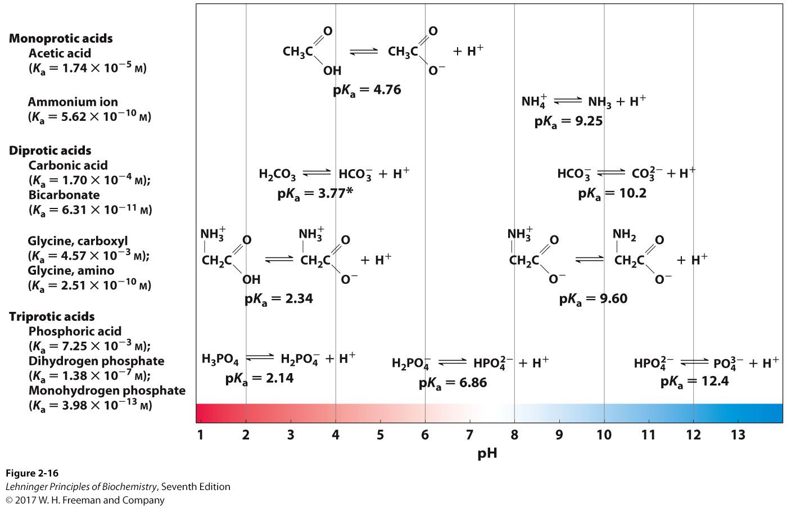{.r-stretch fig-align="center"}

<!-- Slide 45 -->

## Tampões São Misturas de Ácidos Fracos e Seus Ânions (Base Conjugada) {.smaller}

- Tampões resistem a mudanças no pH.
- Em pH = p*K*~a~, há uma mistura 50:50 das formas ácida e aniônica do composto.
- A capacidade tamponante do sistema ácido/ânion é máxima em pH = p*K*~a~.
- A capacidade tamponante é perdida quando o pH difere do p*K*~a~ em mais de 1 unidade de pH.

<!-- Slide 46 -->

---

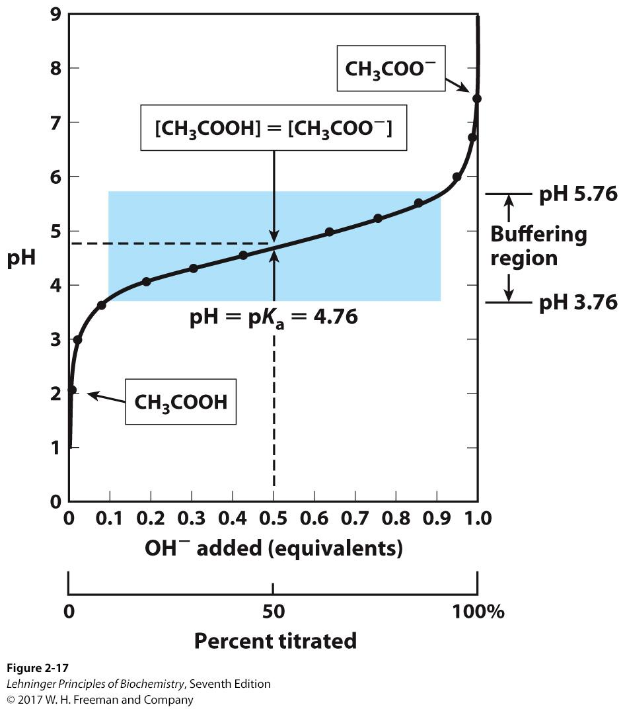{.r-stretch fig-align="center"}

<!-- Slide 47 -->

## Ácidos Fracos Têm Diferentes p*K*~a~s

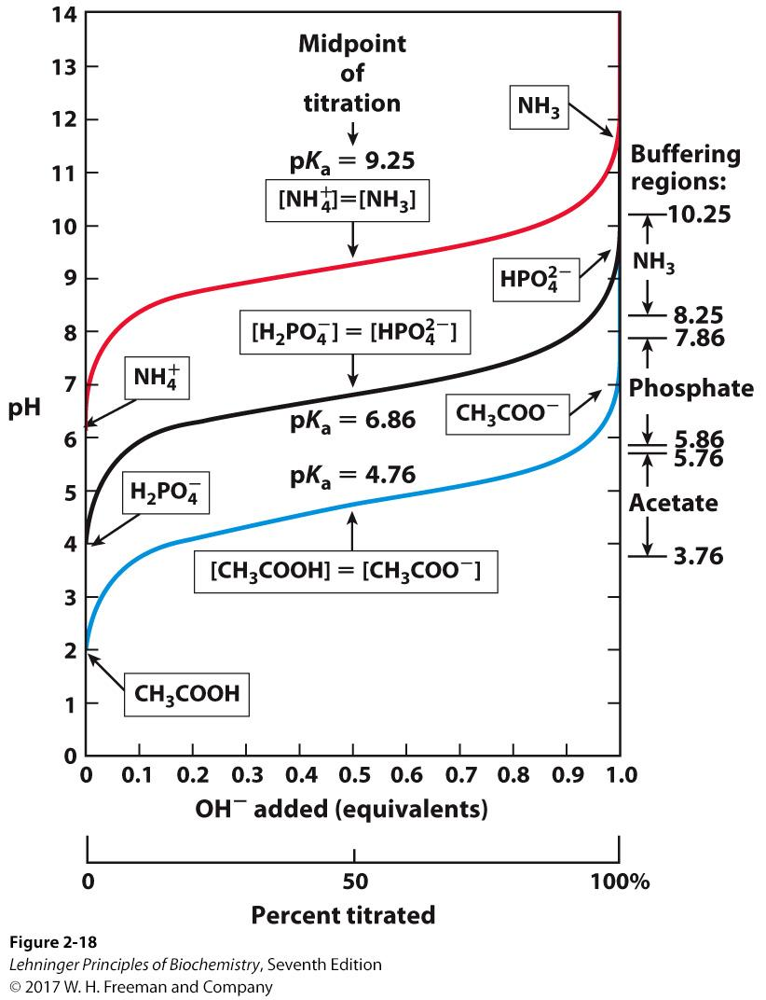{.r-stretch fig-align="center"}

<!-- Slide 48 -->

## Equação de Henderson–Hasselbalch: Derivação

::: {.absolute left=100 top=164 width=290 style="text-align:center;"}
$\mathrm{HA} \rightleftharpoons \mathrm{H^+} + \mathrm{A^-}$
:::

::: {.absolute left=560 top=144 width=290 style="text-align:center;"}
$\displaystyle K_a = \frac{[\mathrm{H^+}][\mathrm{A^-}]}{[\mathrm{HA}]}$
:::

::: {.absolute left=206 top=248 width=500 style="text-align:center;"}
$\displaystyle [\mathrm{H^+}] = K_a \frac{[\mathrm{HA}]}{[\mathrm{A^-}]}$
:::

::: {.absolute left=206 top=363 width=500 style="text-align:center;"}
$\displaystyle -\log[\mathrm{H^+}] = -\log K_a - \log\frac{[\mathrm{HA}]}{[\mathrm{A^-}]}$
:::

<svg style="position:absolute; left:0; top:0; pointer-events:none;" width="960" height="720" viewBox="0 0 960 720"><defs><marker id="seta" markerWidth="8" markerHeight="8" refX="4" refY="4" orient="auto"><path d="M0,0 L8,4 L0,8 z" fill="#000"/></marker></defs><line x1="456" y1="340" x2="456" y2="372" stroke="#000" stroke-width="3" marker-end="url(#seta)"/><line x1="456" y1="436" x2="456" y2="506" stroke="#000" stroke-width="3" marker-end="url(#seta)"/></svg>

::: {.absolute .elipse left=206 top=488 width=500 height=208 style="font-size:1.2em;"}
$\displaystyle \mathrm{pH} = \mathrm{p}K_a + \log\frac{[\mathrm{A^-}]}{[\mathrm{HA}]}$
:::

<!-- Slide 49 -->

## Equação de Henderson–Hasselbalch: Exemplo

::: {.vermelho}
Um tampão é composto por 0,1 M de ácido acético (CH~3~COOH, p*K*~a~ = 4,76) e 0,05 M de acetato de sódio (CH~3~COONa). Qual é o pH final do tampão?

$$\mathrm{pH} = 4{,}76 + \log \frac{[0{,}05]}{[0{,}1]}$$

::: {style="text-align:center;"}
pH final do tampão = 4,45
:::
:::

<!-- Slide 50 -->

## Sistemas Tampão Biológicos {.smaller}

- A manutenção do pH intracelular é vital para todas as células.
  - Reações catalisadas por enzimas têm pH ótimo.
  - A solubilidade de moléculas polares depende de doadores e aceptores de ligações de H.
  - O equilíbrio entre o gás CO~2~ e o HCO~3~^–^ dissolvido depende do pH.
- Sistemas tampão *in vivo* são baseados principalmente em:
  - fosfato, concentração na faixa milimolar
  - bicarbonato, importante para o plasma sanguíneo
  - histidina, tampão eficiente em pH neutro
- Sistemas tampão *in vitro* são frequentemente baseados em ácidos sulfônicos de aminas cíclicas.
  - HEPES
  - PIPES
  - CHES

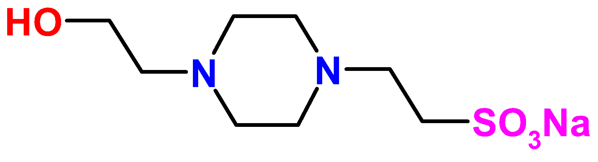{.absolute left=344 top=584 width=319 height=87}

<!-- Slide 51 -->

## A Água Ligada a Proteínas É  Essencial para Sua Função

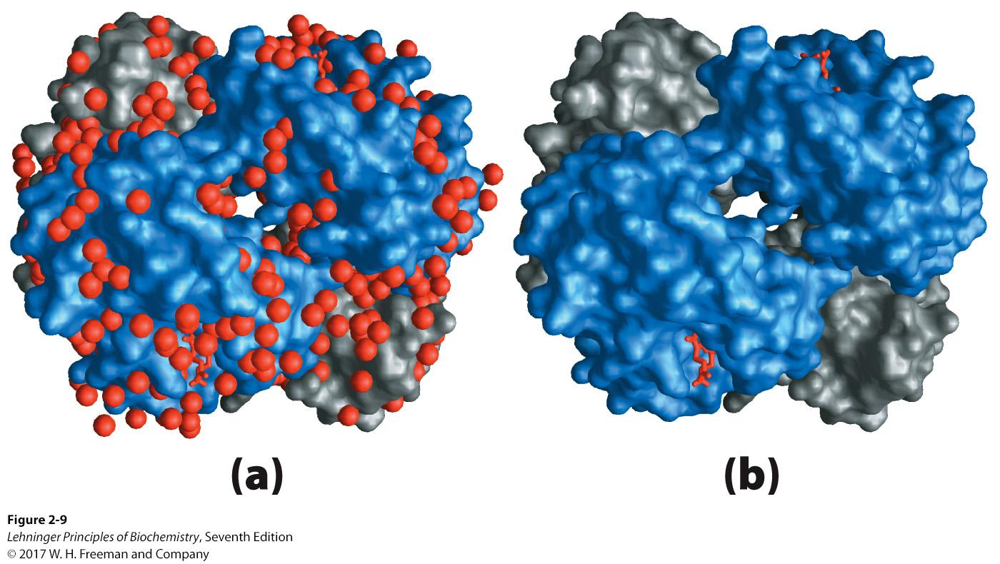{.r-stretch fig-align="center"}

<!-- Slide 52 -->

## A Água Ligada a Proteínas É  Essencial para Sua Função

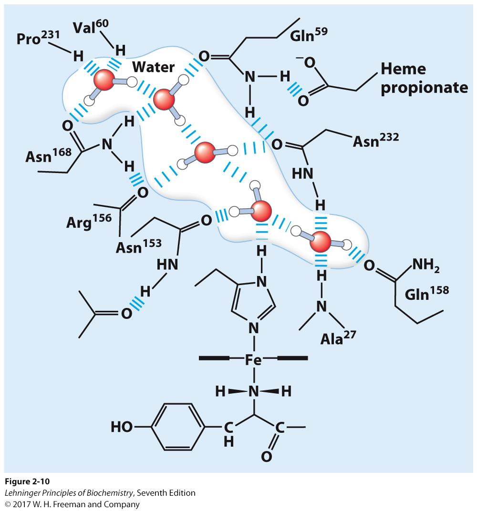{.r-stretch fig-align="center"}

<!-- Slide 53 -->

## A Água Ligada a Proteínas É  Essencial para Sua Função

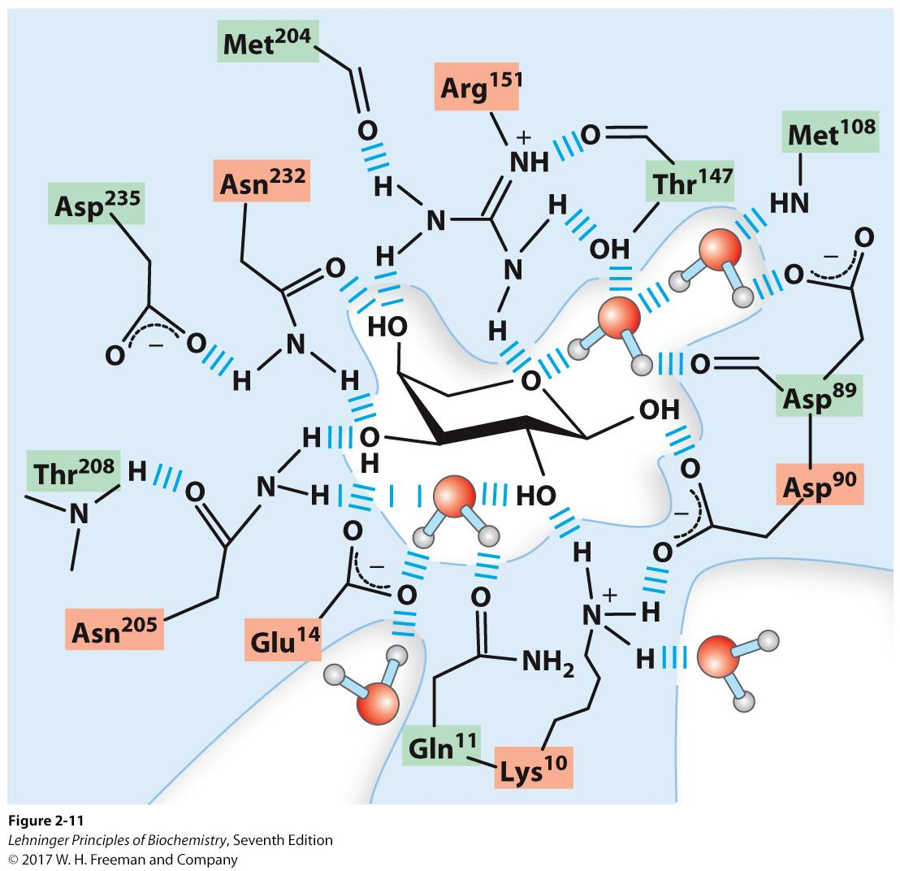{.r-stretch fig-align="center"}

<!-- Slide 54 -->

## Capítulo 2: Resumo

Neste capítulo, aprendemos sobre a:

- natureza das forças intermoleculares
- propriedades e estrutura da água líquida
- comportamento de ácidos e bases fracos na água
- maneira como a água pode participar de reações bioquímicas
