<!-- Slide 1 -->

::::: columns
:::: {.column width="46%"}
::: {style="text-align:center"}
**3 | Aminoácidos, Peptídeos e Proteínas**

::: subtitulo
**© 2017 W. H. Freeman and Company**
:::
:::
::::
:::: {.column width="54%"}
{width=462 fig-align="center"}
::::
:::::

<!-- Slide 2 -->

# CAPÍTULO 3<br>Aminoácidos, Peptídeos<br>e Proteínas

*Objetivos de aprendizagem:*

- Estrutura e nomenclatura de aminoácidos
- Estrutura e propriedades de peptídeos
- Comportamento de ionização de aminoácidos e peptídeos
- Métodos para caracterizar peptídeos e proteínas

<!-- Slide 3 -->

# Proteínas:<br>Principais Agentes da Função Biológica {.smaller}

- Catálise
  - enolase (na via glicolítica)
  - DNA polimerase (na replicação do DNA)
- Transporte
  - hemoglobina (transporta O2 no sangue)
  - lactose permease (transporta lactose através da membrana celular)
- Estrutura
  - colágeno (tecido conjuntivo)
  - queratina (cabelos, unhas, penas, chifres)
- Movimento
  - miosina (tecido muscular)
  - actina (tecido muscular, motilidade celular)

<!-- Slide 4 -->

# As Proteínas Desempenham uma Ampla Gama de<br>Funções Biológicas

{.r-stretch fig-align="center"}

<!-- Slide 5 -->

# Aminoácidos:<br>Blocos Construtores das Proteínas

- Proteínas são heteropolímeros lineares de α-aminoácidos.
- Os aminoácidos têm propriedades bem adequadas para realizar uma variedade de funções biológicas:
  - capacidade de polimerizar
  - propriedades ácido-base úteis
  - propriedades físicas variadas
  - funcionalidade química variada

<!-- Slide 6 -->

# Aminoácidos Compartilham Muitas Características, Diferindo Apenas no Substituinte R

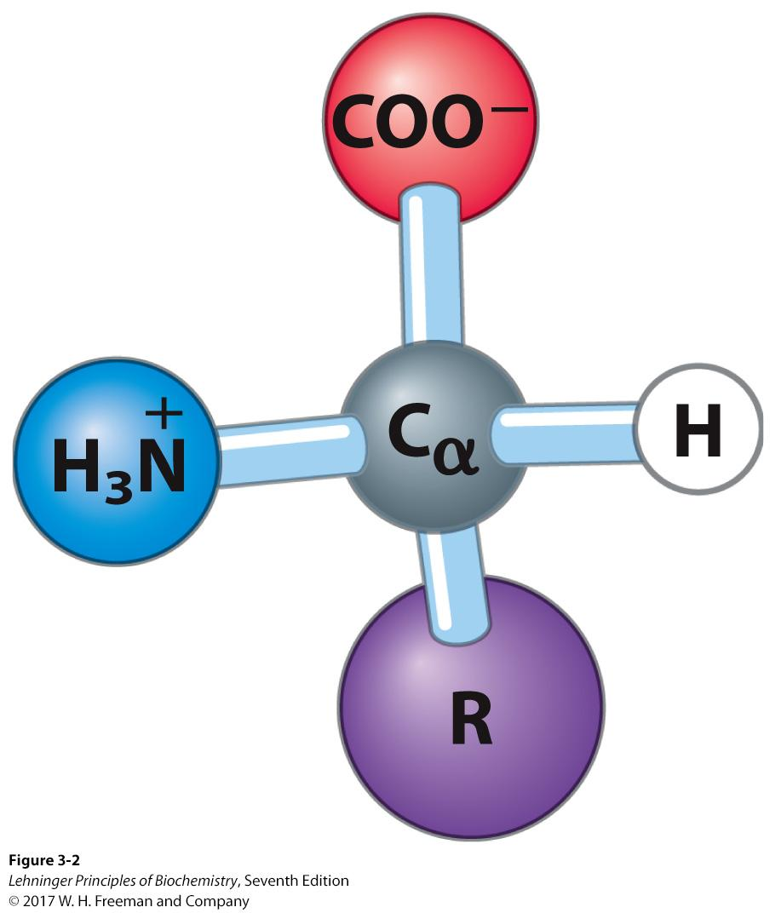{.r-stretch fig-align="center"}

<!-- Slide 7 -->

# Aminoácidos Têm Três Grupos Funcionais Comuns Ligados ao Carbono α

- O carbono α sempre tem quatro substituintes e é tetraédrico.
- Todos (exceto a prolina) têm:
  - um grupo carboxila ácido ligado ao carbono α
  - um grupo amino básico ligado ao carbono α
  - um hidrogênio α ligado ao carbono α
- O quarto substituinte (R) é único na glicina, o aminoácido mais simples. O quarto substituinte também é hidrogênio.

<!-- Slide 8 -->

# Todos os Aminoácidos São Quirais (Exceto a Glicina)<br><span class="subtitulo">As proteínas contêm apenas L-aminoácidos</span>

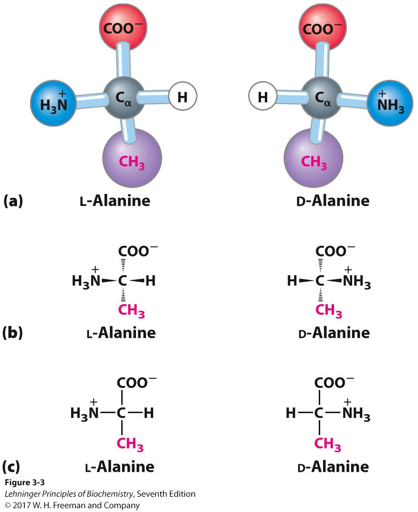{.r-stretch fig-align="center"}

<!-- Slide 9 -->

# Aminoácidos: Classificação

Os aminoácidos comuns podem ser colocados em cinco grupos básicos dependendo de seus substituintes R:

- apolares, alifáticos (7)
- aromáticos (3)
- polares, não carregados (5)
- carregados positivamente (3)
- carregados negativamente (2)

---

<!-- Slide 10 -->

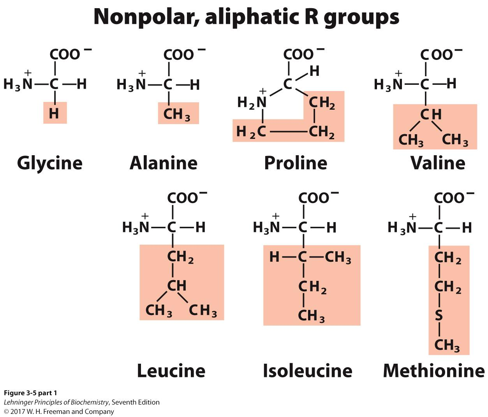{.r-stretch fig-align="center"}

---

<!-- Slide 11 -->

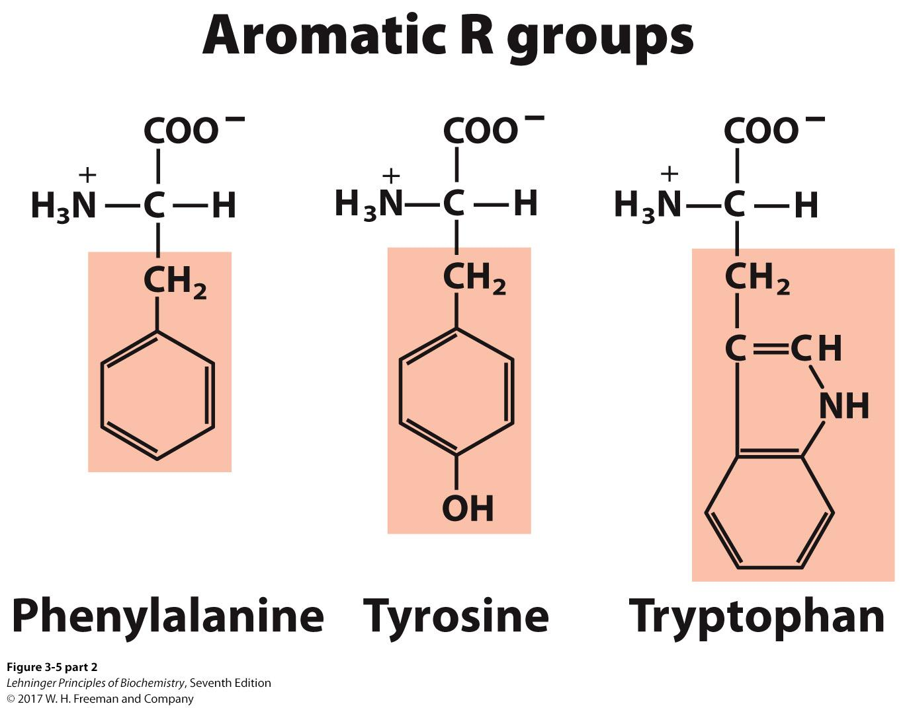{.absolute left=41 top=17 width=877}

::: {.absolute .rotulo left=0 top=623 width=960}
Estas cadeias laterais de aminoácidos absorvem luz UV em 270–280 nm
:::

---

<!-- Slide 12 -->

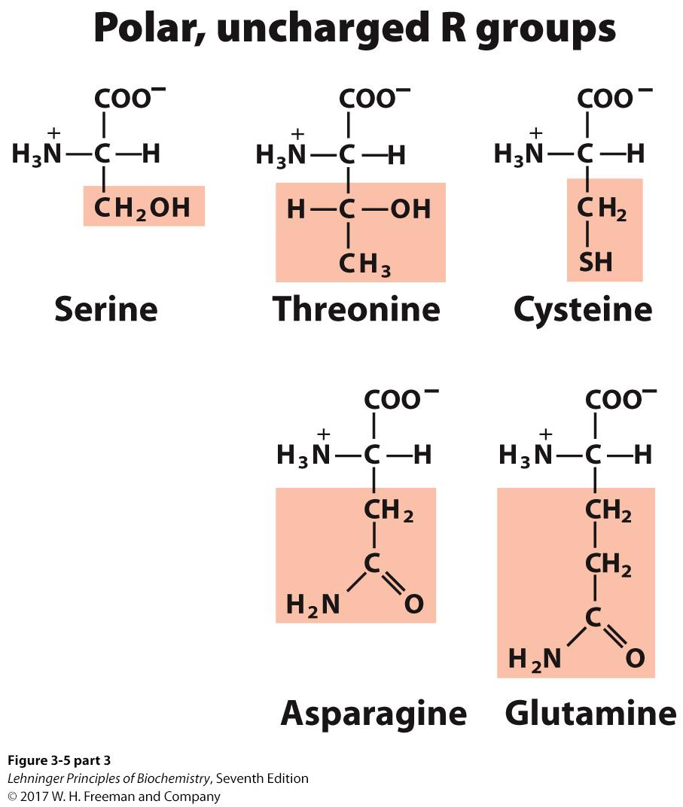{.absolute left=232 top=24 width=480}

::: {.absolute .rotulo left=24 top=609 width=912}
Estas cadeias laterais de aminoácidos podem formar ligações de hidrogênio.

A cisteína pode formar ligações dissulfeto.
:::

---

<!-- Slide 13 -->

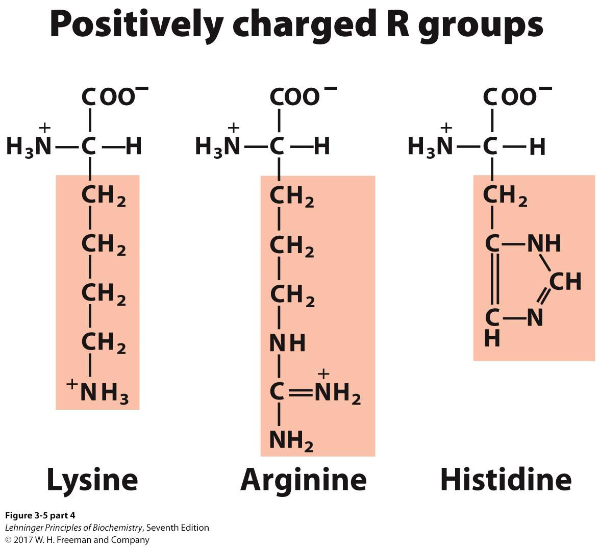{.r-stretch fig-align="center"}

---

<!-- Slide 14 -->

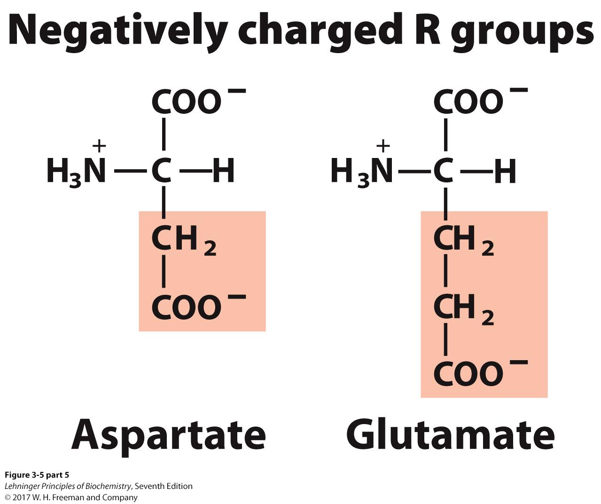{.r-stretch fig-align="center"}

<!-- Slide 15 -->

# Ionização de Aminoácidos

- Aminoácidos contêm pelo menos dois prótons ionizáveis, cada um com seu próprio pKa.
- O ácido carboxílico tem um pKa ácido e estará protonado em pH ácido (baixo):

−COOH ↔ COO− + H+

- O grupo amino tem um pKa básico e estará protonado até que se atinja um pH básico (alto):

−NH4+ ↔ NH3 + H+

<!-- Slide 16 -->

# O Ambiente Químico Afeta os Valores de pKa

*O grupo α-carboxila é muito mais ácido do que nos ácidos carboxílicos.*

*O grupo α-amino é ligeiramente menos básico do que nas aminas.*

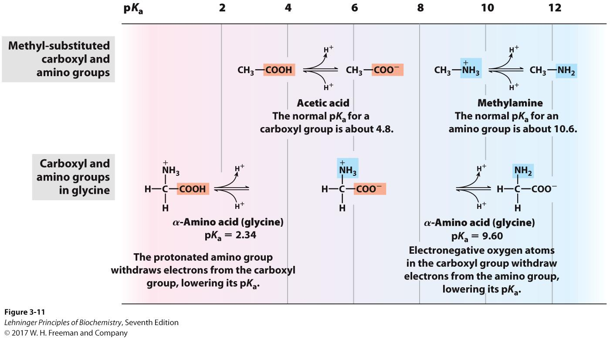{.r-stretch fig-align="center"}

<!-- Slide 17 -->

# Ionização de Aminoácidos

- Em pH baixo, o aminoácido existe em uma forma carregada positivamente (cátion).
- Em pH alto, o aminoácido existe em uma forma carregada negativamente (ânion).
- Entre o pKa de cada grupo, o aminoácido existe em uma forma zwitteriônica, na qual uma única molécula possui carga positiva e negativa.

---

<!-- Slide 18 -->

::: {.absolute .rotulo left=288 top=32 width=440}
Cátion →  Zwitterion  →  Ânion
:::

::: {.absolute left=256 top=81 width=448}
::: {.recorte style="aspect-ratio:0.7164"}
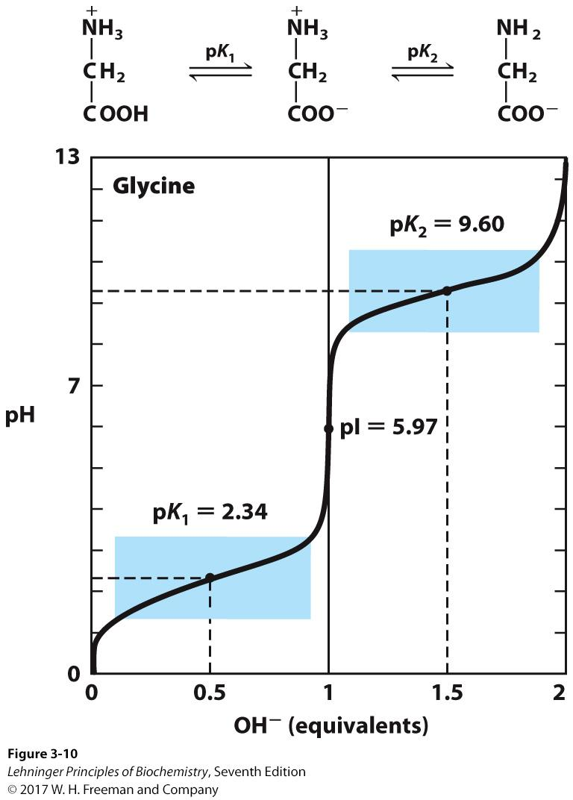{style="width:100%;left:0%;top:0%"}
:::
:::

<!-- Slide 19 -->

# Aminoácidos Carregam uma Carga Líquida Zero<br>em um pH Específico (o pI) {.smaller}

- Zwitterions predominam em valores de pH entre os valores de pKa dos grupos amino e carboxila.
- Para aminoácidos sem cadeias laterais ionizáveis, o [Ponto Isoelétrico]{.azul} (ponto de equivalência, [pI]{.azul}) é:

$$pI = \frac{pK_1 + pK_2}{2}$$

- Neste ponto, a carga líquida é zero.
  - O AA é menos solúvel em água.
  - O AA não migra em campo elétrico.

<!-- Slide 20 -->

# Aminoácidos Podem Atuar como Tampões

Aminoácidos com cadeias laterais não carregadas, como a glicina, têm dois valores de pKa:

- O pKa do grupo α-carboxila é 2,34.
- O pKa do grupo α-amino é 9,6.

Como os tampões evitam alterações no pH próximas ao pKa, a glicina pode atuar como tampão em duas faixas de pH.

---

<!-- Slide 21 -->

::: {.absolute left=203 top=16 width=494}
::: {.recorte style="aspect-ratio:0.7164"}
{style="width:100%;left:0%;top:0%"}
:::
:::

```{=html}
<svg style="position:absolute;left:0;top:0;pointer-events:none" width="960" height="720" viewBox="0 0 960 720" xmlns="http://www.w3.org/2000/svg">
  <defs>
    <marker id="seta-tampao" markerWidth="12" markerHeight="10" refX="11" refY="5" orient="auto" markerUnits="userSpaceOnUse">
      <path d="M0,0 L12,5 L0,10 L3,5 z" fill="#000"/>
    </marker>
  </defs>
  <line x1="776" y1="400" x2="648" y2="280" stroke="#000" stroke-width="2" marker-end="url(#seta-tampao)"/>
  <line x1="776" y1="400" x2="448" y2="520" stroke="#000" stroke-width="2" marker-end="url(#seta-tampao)"/>
</svg>
```

::: {.absolute .rotulo left=776 top=361 width=128}
Regiões<br>Tamponantes
:::

<!-- Slide 22 -->

# Cadeias Laterais Ionizáveis Também Têm pKa e Atuam como Tampões

- Cadeias laterais ionizáveis influenciam o pI do aminoácido.
- Cadeias laterais ionizáveis também podem ser tituladas.
- As curvas de titulação agora são mais complexas, pois cada pKa possui uma zona tamponante de 2 unidades de pH.

---

<!-- Slide 23 -->

::: {.absolute left=175 top=17 width=610}
::: {.recorte style="aspect-ratio:0.8890"}
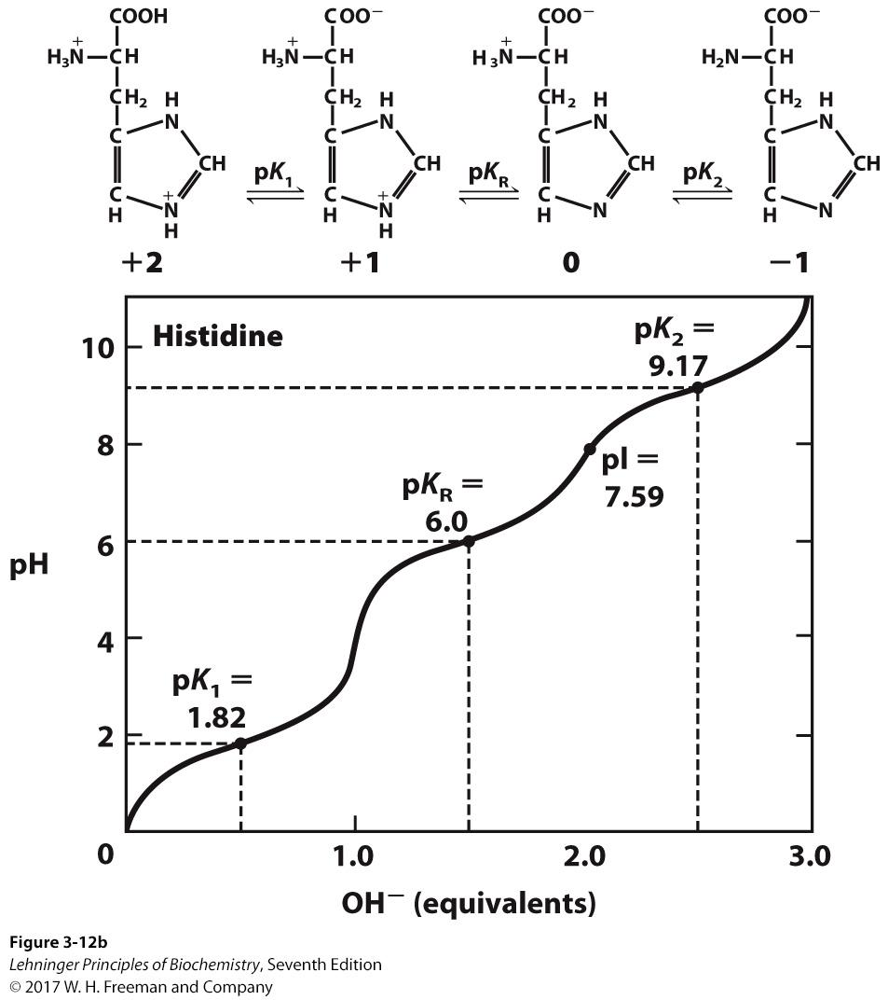{style="width:100%;left:0%;top:0%"}
:::
:::

<!-- Slide 24 -->

# Como Calcular o pI Quando a Cadeia Lateral É Ionizável {.smaller}

- Identifique a espécie que carrega carga líquida zero.

::: {.recorte style="width:582px;aspect-ratio:2.912;margin:0 auto"}
{style="width:105.263%;left:-5.263%;top:0%"}
:::

- Identifique o valor de pKa que define a força ácida deste zwitterion: (pKR).
- Identifique o valor de pKa que define a força básica deste zwitterion: (pK2).
- Calcule a média desses dois valores de pKa.

*Qual é o pI da histidina?*

<!-- Slide 25 -->

# Aminoácidos Polimerizam para Formar Peptídeos

- Peptídeos são pequenos produtos de condensação de aminoácidos.
- Eles são “pequenos” comparados às proteínas (MM < 10 kDa).

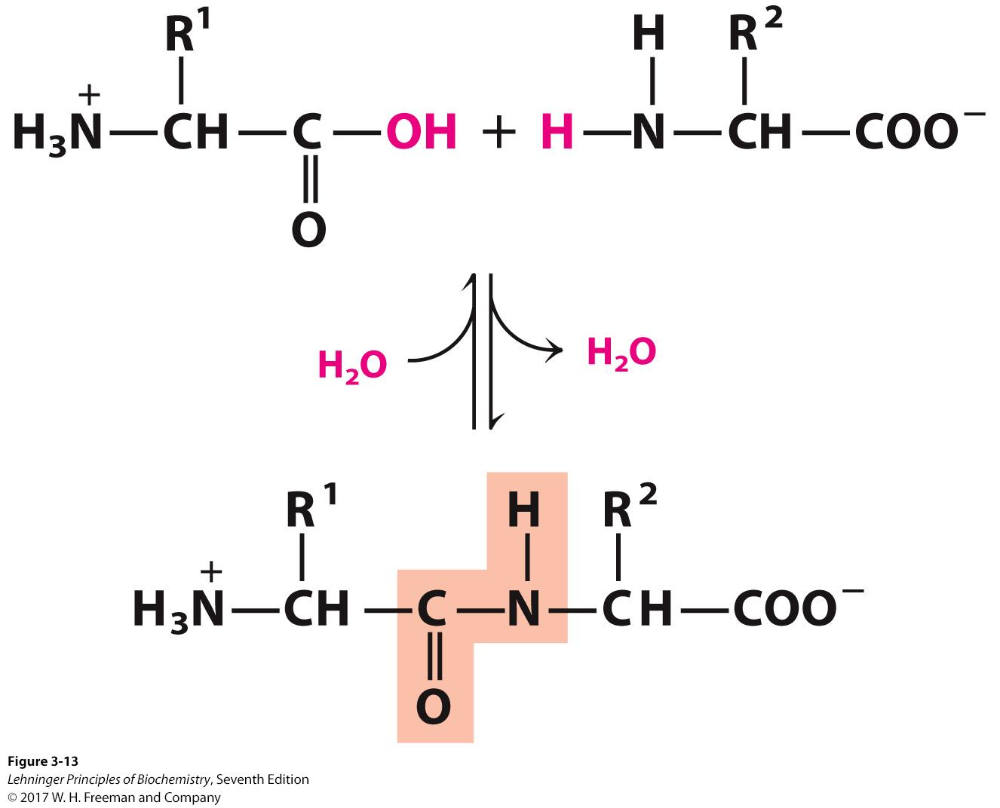{.r-stretch fig-align="center"}

<!-- Slide 26 -->

# As Extremidades dos Peptídeos Não São Iguais

::: {.absolute .rotulo left=8 top=103 width=952}
A numeração (e nomenclatura) começa a partir do terminal amino (N-terminal).
:::

::: {.absolute .rotulo-e left=152 top=157 width=685}
AA1           AA2           AA3            AA4           AA5
:::

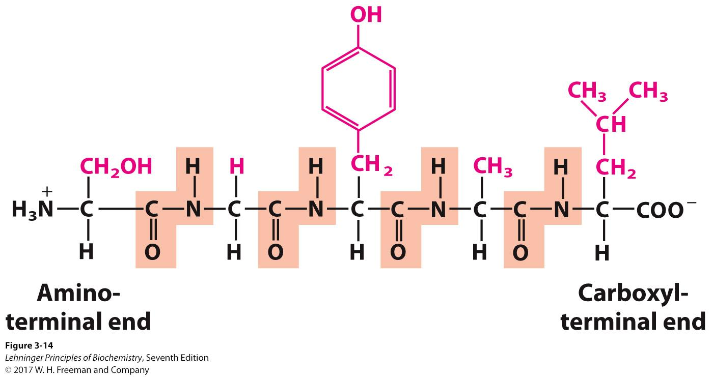{.absolute left=32 top=232 width=896}

<!-- Slide 27 -->

# Nomeando Peptídeos:<br>Comece no N-terminal

- Usando nomes completos dos aminoácidos:
  - serilgliciltirosilalanilleucina
- Usando a abreviação do código de três letras:
  - Ser-Gly-Tyr-Ala-Leu
- Para peptídeos mais longos (como proteínas), pode-se usar o código de uma letra:
  - SGYAL

<!-- Slide 28 -->

# Peptídeos: Uma Variedade de Funções {.smaller}

- Hormônios e feromônios
  - insulina (metabolismo de açúcares)
  - ocitocina (parto)
  - peptídeo sexual (acasalamento de drosófilas)
- Neuropeptídeos
  - substância P (mediador da dor)
- Antibióticos
  - polimixina B (para bactérias Gram –)
  - bacitracina (para bactérias Gram +)
- Proteção, ex.: toxinas
  - amanitina (cogumelos)
  - conotoxina (caramujos cônicos)
  - clorotoxina (escorpiões)

<!-- Slide 29 -->

# Proteínas São Compostas de: {.smaller}

- Polipeptídeos (α-aminoácidos ligados covalentemente) + possivelmente:
  - cofatores
    - componente funcional não aminoácido
    - íons metálicos ou moléculas orgânicas
  - coenzimas
    - cofatores orgânicos
    - NAD+ na lactato desidrogenase
  - grupos prostéticos
    - cofatores ligados covalentemente
    - heme na mioglobina
  - outras modificações (modificações pós-traducionais)

<!-- Slide 30 -->

# Aminoácidos Incomuns em Proteínas

- Não incorporados pelos ribossomos
  - exceto a selenocisteína
- Surgem por modificações pós-traducionais de proteínas
- Modificações reversíveis, especialmente fosforilação, são importantes na regulação e sinalização.

<!-- Slide 31 -->

# Aminoácidos Modificados Encontrados em Proteínas

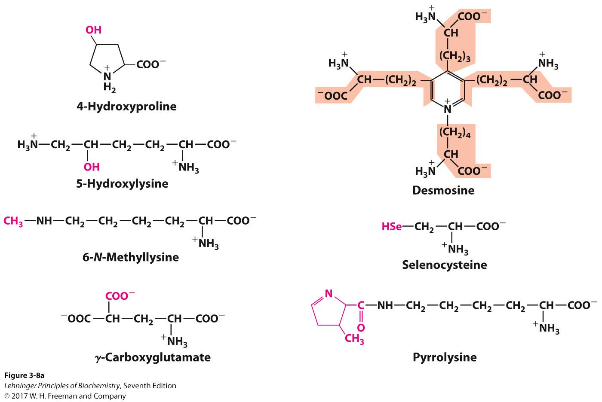{.r-stretch fig-align="center"}

<!-- Slide 32 -->

# Modificações Reversíveis de Aminoácidos

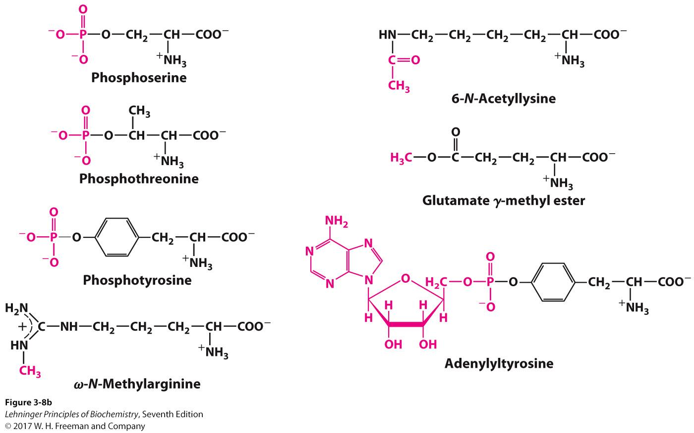{.r-stretch fig-align="center"}

<!-- Slide 33 -->

# O Tamanho e o Número de Polipeptídeos<br>Variam Muito nas Proteínas {.smaller}

| Proteína | Massa molecular | Número de resíduos | Número de cadeias polipeptídicas |
|:---------|:---------------:|:------------------:|:--------------------------------:|
| Citocromo c (humano) | 12.400 | 104 | 1 |
| Ribonuclease A (pâncreas bovino) | 13.700 | 124 | 1 |
| Lisozima (clara de ovo de galinha) | 14.300 | 129 | 1 |
| Mioglobina (coração equino) | 16.700 | 153 | 1 |
| Quimotripsina (pâncreas bovino) | 25.700 | 245 | 1 |
| Quimotripsinogênio (bovino) | 25.700 | 245 | 1 |
| Hemoglobina (humana) | 64.500 | 574 | 4 |
| Albumina sérica (humana) | 66.000 | 609 | 1 |
| Hexoquinase (levedura) | 107.900 | 972 | 2 |
| RNA polimerase (E. coli) | 450.000 | 4.158 | 5 |
| Apolipoproteína B (humana) | 513.000 | 4.536 | 1 |
| Glutamina sintetase (E. coli) | 619.000 | 5.628 | 12 |
| Titina (humana) | 2.993.000 | 26.926 | 1 |

: TABELA 3-2 Dados Moleculares de Algumas Proteínas {tbl-colwidths="[45,15,15,25]"}

<!-- Slide 34 -->

# Proteínas Conjugadas Estão Ligadas Covalentemente a uma Entidade Não Proteica {.smaller}

| Classe | Grupo prostético | Exemplo |
|:-------|:-----------------|:--------|
| Lipoproteínas | Lipídios | β1-Lipoproteína do sangue |
| Glicoproteínas | Carboidratos | Imunoglobulina G |
| Fosfoproteínas | Grupos fosfato | Caseína do leite |
| Hemoproteínas | Heme (porfirina de ferro) | Hemoglobina |
| Flavoproteínas | Nucleotídeos de flavina | Succinato desidrogenase |
| Metaloproteínas | Ferro<br>Zinco<br>Cálcio<br>Molibdênio<br>Cobre | Ferritina<br>Álcool desidrogenase<br>Calmodulina<br>Dinitrogenase<br>Plastocianina |

: TABELA 3-4 Proteínas Conjugadas {tbl-colwidths="[30,35,35]"}

<!-- Slide 35 -->

# Perguntas Comuns Sobre Peptídeos e Proteínas

Qual é a sua sequência e composição?

Qual é a sua estrutura tridimensional?

Como ela encontra seu enovelamento nativo?

Como ela desempenha seu papel bioquímico?

Como a sua função é regulada?

Como ela interage com outras macromoléculas?

Como ela está relacionada a outras proteínas?

Onde ela está localizada dentro da célula?

Quais são suas propriedades físico-químicas?

<!-- Slide 36 -->

# Estudar Proteínas e Peptídeos Às Vezes Requer Purificação a Partir de uma Mistura {.smaller}

- Polipeptídeos contêm sequências de aminoácidos diferentes.
- A sequência e o arranjo de aminoácidos conferem ao polipeptídeo um caráter químico (ou seja, carregado, polar, hidrofóbico, etc.).
- Alguns polipeptídeos ligam-se a alvos específicos, o que pode ser usado para “pescá-los” de uma mistura complexa.

<!-- Slide 37 -->

# Uma Mistura de Proteínas Pode Ser Separada {.smaller}

- A separação baseia-se em diferenças nas propriedades físicas e químicas:
  - carga
  - tamanho
  - afinidade por um ligante
  - solubilidade
  - hidrofobicidade
  - estabilidade térmica
- A cromatografia é comumente usada para separação preparativa, na qual a proteína frequentemente consegue permanecer totalmente enovelada.

<!-- Slide 38 -->

# Cromatografia em Coluna

::::: columns
:::: {.column width="52%"}
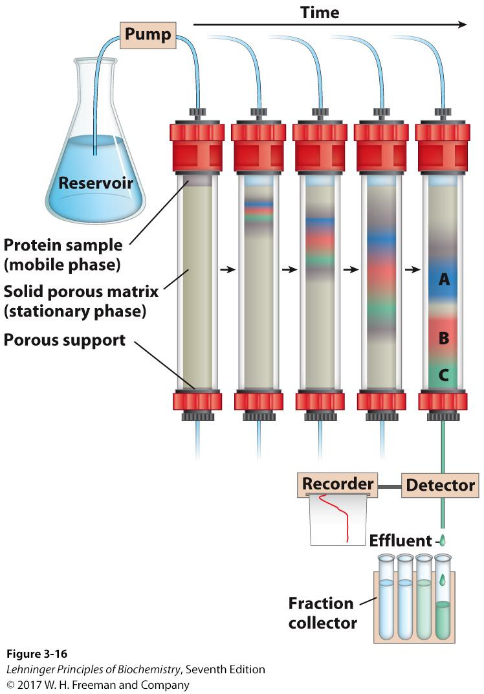{width=416 fig-align="center"}
::::
:::: {.column width="48%"}
- A cromatografia em coluna permite a separação de uma mistura de proteínas sobre uma fase sólida (matriz porosa) usando uma fase líquida para mobilizar as proteínas.
- Proteínas com menor afinidade pela fase sólida serão eluídas primeiro; proteínas com maior afinidade ficarão retidas na coluna por mais tempo e serão eluídas depois.
::::
:::::

<!-- Slide 39 -->

# Separação por Carga: Troca Iônica

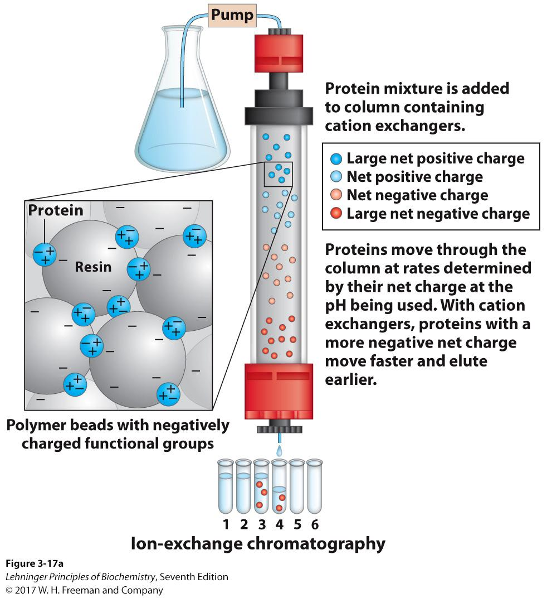{.r-stretch fig-align="center"}

<!-- Slide 40 -->

# Separação por Tamanho: Exclusão por Tamanho

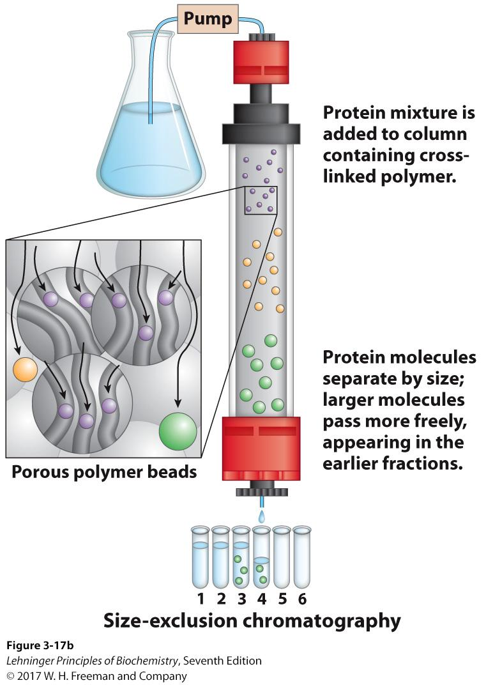{.r-stretch fig-align="center"}

<!-- Slide 41 -->

# Separação por Ligação: Afinidade

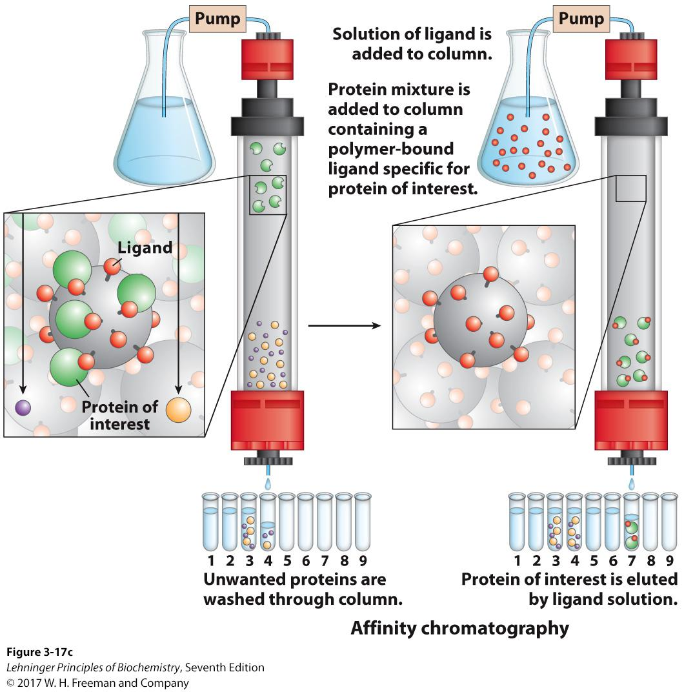{.r-stretch fig-align="center"}

<!-- Slide 42 -->

# Eletroforese para Análise de Proteínas {.smaller}

A separação em escala analítica é comumente feita por eletroforese.

- O campo elétrico puxa as proteínas de acordo com sua carga.
- A matriz de gel dificulta a mobilidade das proteínas de acordo com seu tamanho e forma.
- O gel é comumente de poliacrilamida, então a separação de proteínas via eletroforese é frequentemente chamada de eletroforese em gel de poliacrilamida, ou PAGE.

---

<!-- Slide 43 -->

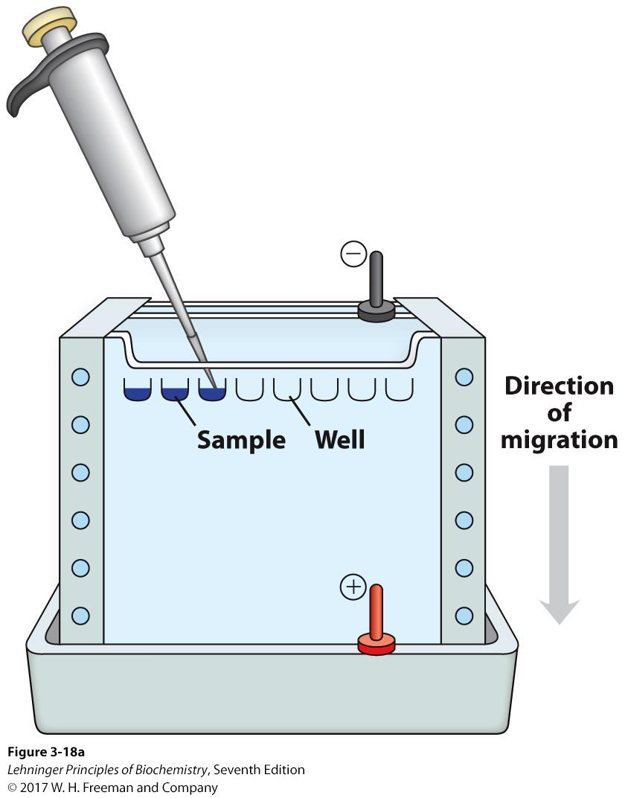{.r-stretch fig-align="center"}

<!-- Slide 44 -->

# SDS-PAGE Separa Proteínas por Massa Molecular {.smaller}

- SDS – dodecil sulfato de sódio – um detergente

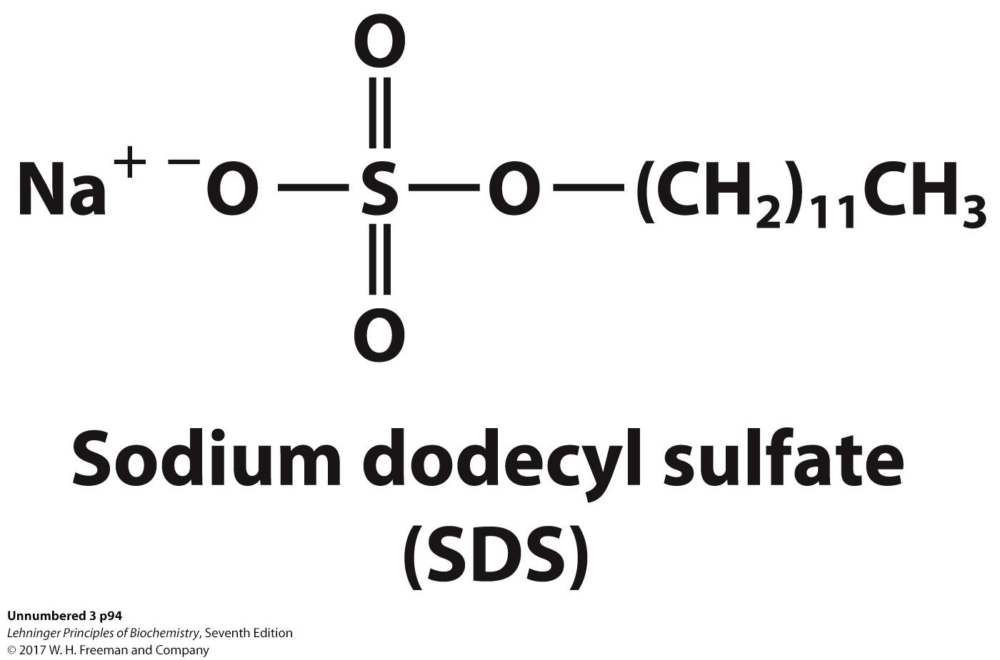{width=296 fig-align="center"}

- Micelas de SDS ligam-se às proteínas e facilitam o desenovelamento.
  - O SDS confere a todas as proteínas uma carga uniformemente negativa.
  - A forma nativa das proteínas não importa.
  - A velocidade de migração dependerá apenas do tamanho: proteínas pequenas mover-se-ão mais rápido.

---

<!-- Slide 45 -->

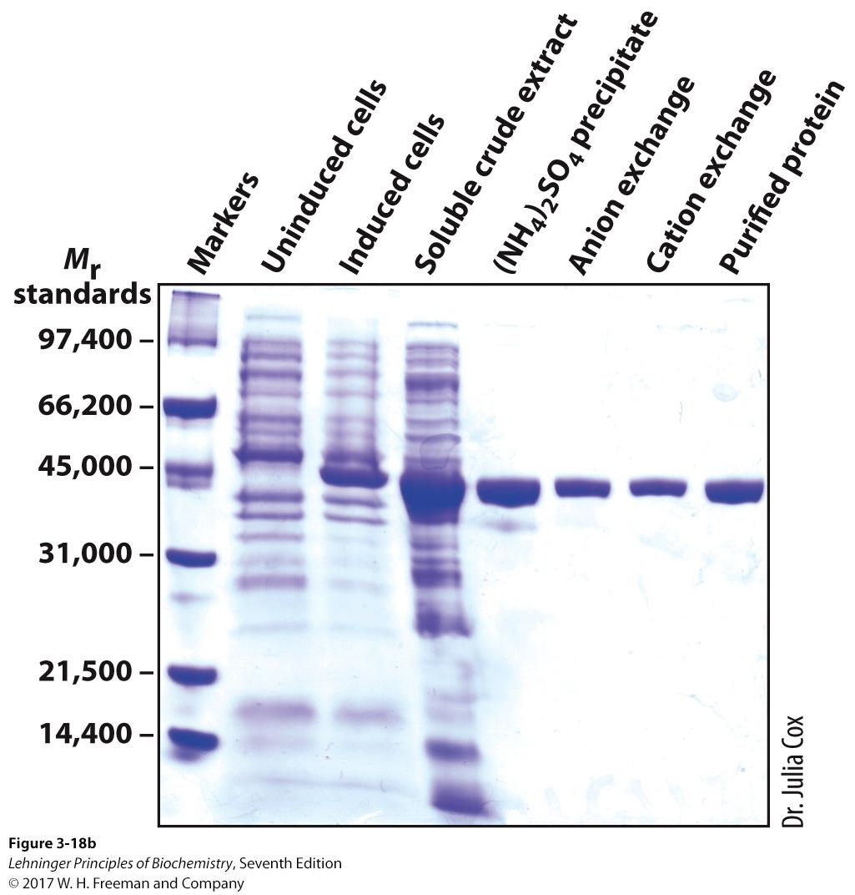{.r-stretch fig-align="center"}

<!-- Slide 46 -->

# SDS-PAGE Pode Ser Usada para Calcular a Massa Molecular de uma Proteína

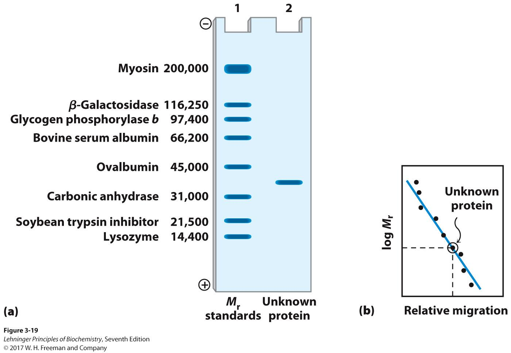{.r-stretch fig-align="center"}

<!-- Slide 47 -->

# Focalização Isoelétrica Pode Ser Usada para Determinar o pI de uma Proteína

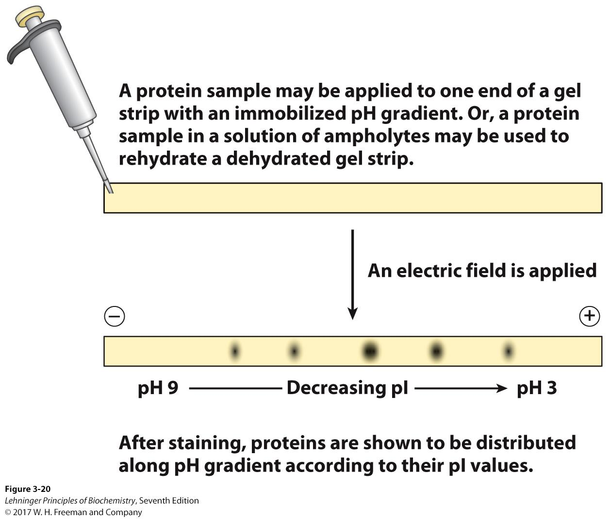{.r-stretch fig-align="center"}

<!-- Slide 48 -->

# Focalização Isoelétrica e SDS-PAGE São Combinadas na Eletroforese 2D

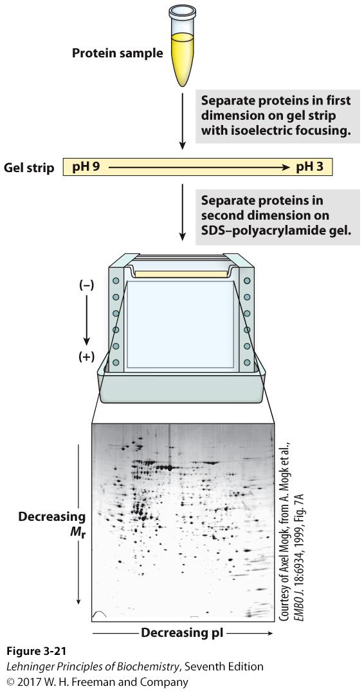{.r-stretch fig-align="center"}

<!-- Slide 49 -->

# Aminoácidos Aromáticos Absorvem Luz de Maneira Dependente da Concentração

- Os aminoácidos aromáticos absorvem luz na região UV.
- As proteínas tipicamente têm máximos de absorbância UV em torno de 275–280 nm.
- Triptofano e tirosina são os cromóforos mais fortes.
- Para proteínas e peptídeos com coeficientes de extinção (ou sequências) conhecidos, a concentração pode ser determinada por espectrofotometria UV-visível usando a lei de Lambert-Beer: A = εcl

---

<!-- Slide 50 -->

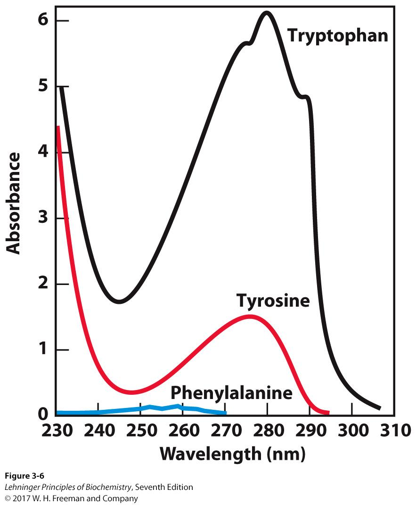{.r-stretch fig-align="center"}

<!-- Slide 51 -->

# Atividade Específica Descreve a Pureza da Proteína de Interesse {.smaller}

- Proteínas em uma mistura complexa frequentemente requerem mais de uma purificação para isolar completamente a proteína de interesse.
- Durante a purificação, a determinação da localização da proteína de interesse pode ser realizada acompanhando seu comportamento.
- Se uma proteína tem uma função específica (ex.: ligar insulina), a fração que melhor liga insulina após cada etapa de purificação conterá a maior parte da proteína de interesse.
- A função da proteína é chamada de “atividade”.
- A razão entre a atividade e a concentração total de proteína é chamada de “atividade específica”.

<!-- Slide 52 -->

# Atividade Específica Descreve a Pureza da Proteína de Interesse

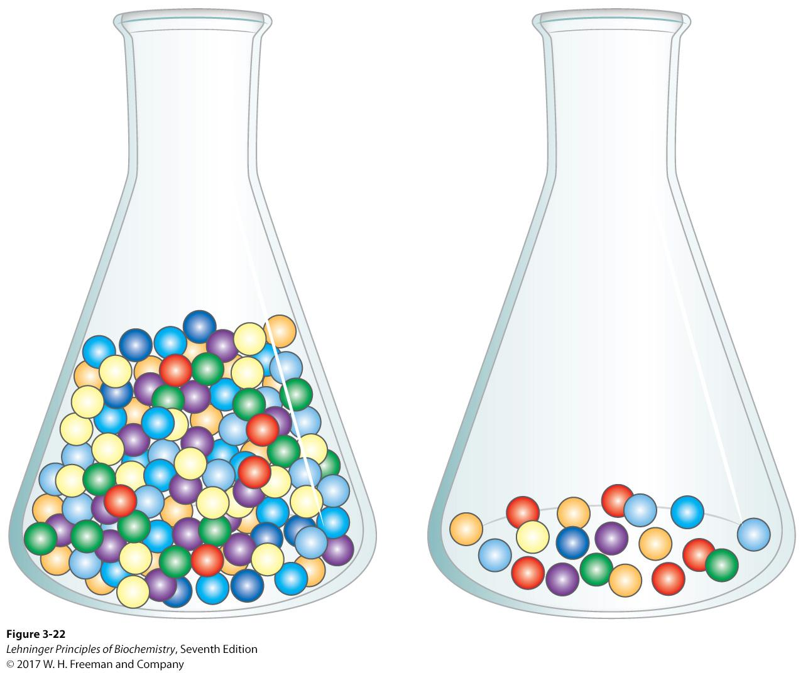{.r-stretch fig-align="center"}

<!-- Slide 53 -->

# Sequenciamento de Proteínas {.smaller}

- É essencial para análises bioquímicas posteriores que conheçamos a sequência da proteína que estamos estudando.
- A sequência real é geralmente determinada a partir da sequência de DNA.
- Degradação de Edman (método clássico):
  - rodadas sucessivas de modificação N-terminal, clivagem e identificação
  - pode ser usada para identificar proteína com sequência conhecida
- Espectrometria de massas (método moderno):
  - MALDI-MS e ESI-MS podem identificar com precisão a massa de um peptídeo e, assim, a sequência de aminoácidos
  - pode ser usada para determinar modificações pós-traducionais

<!-- Slide 54 -->

# Degradação de Edman para Sequenciamento de Proteínas

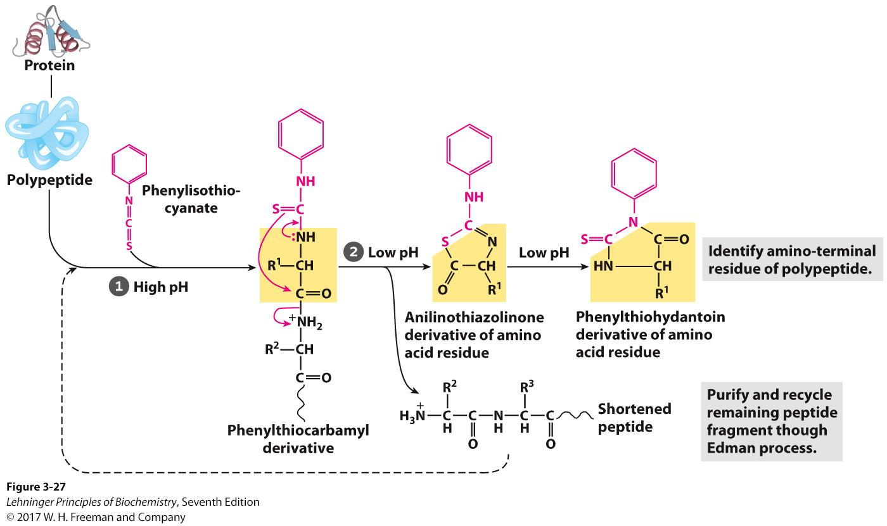{.r-stretch fig-align="center"}

<!-- Slide 55 -->

# MALDI-MS para Sequenciamento de Proteínas

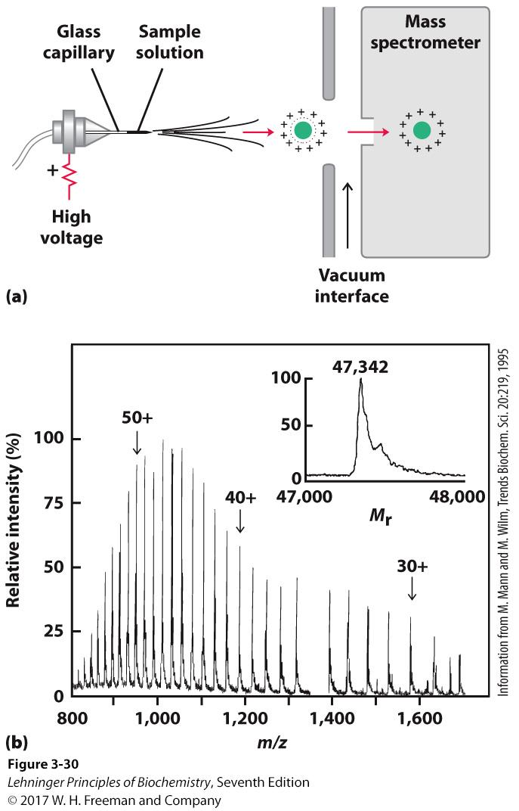{.absolute left=48 top=95 width=400}

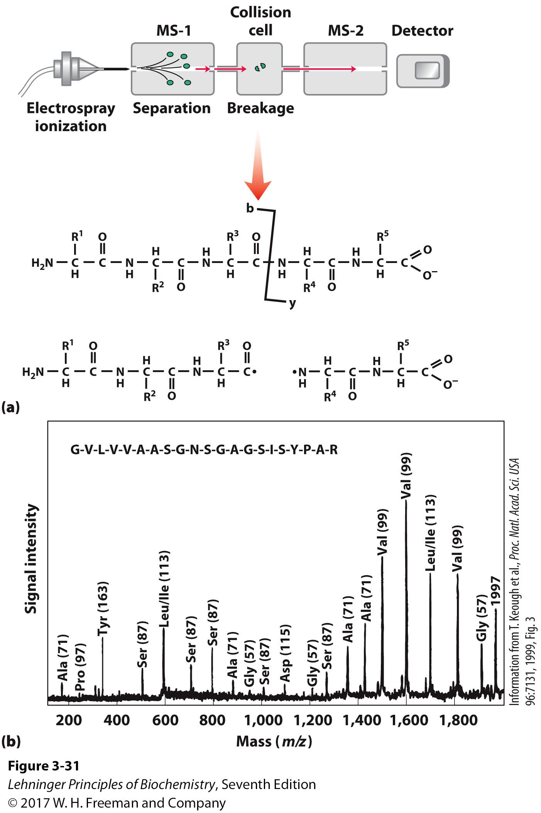{.absolute left=488 top=95 width=416}

<!-- Slide 56 -->

# Sequências de Proteínas como Pistas para Relações Evolutivas

- Sequências de proteínas com funções idênticas de uma ampla gama de espécies podem ser alinhadas e analisadas quanto às diferenças.
- As diferenças indicam divergências evolutivas.
- A análise de múltiplas famílias de proteínas pode indicar relações evolutivas entre organismos e, em última instância, a história da vida na Terra.

<!-- Slide 57 -->

# Capítulo 3: Resumo

Neste capítulo, aprendemos sobre:

- muitas funções biológicas de peptídeos e proteínas
- estruturas e nomes de aminoácidos encontrados nas proteínas
- propriedades de ionização de aminoácidos e peptídeos
- métodos para separação e análise de proteínas
