# 4 | A Estrutura Tridimensional das Proteínas

<!-- Slide 1 -->

:::: {.columns}
::: {.column width="48%"}
© 2017 W. H. Freeman and Company
:::
::: {.column width="52%"}
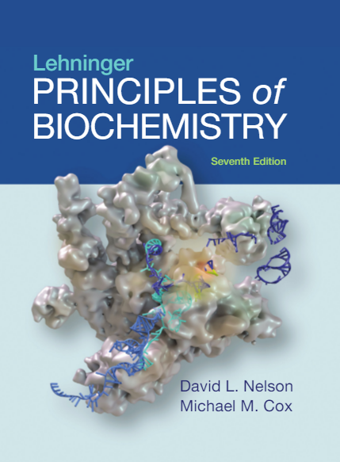{width=462}
:::
::::

<!-- Slide 2 -->

# CAPÍTULO 4 A Estrutura Tridimensional das Proteínas {.smaller}

*Objetivos de aprendizagem:*

- Estrutura e propriedades da ligação peptídica
- Hierarquia estrutural nas proteínas
- Estrutura e função das proteínas fibrosas
- Análise estrutural das proteínas globulares
- Enovelamento e desnaturação de proteínas

<!-- Slide 3 -->

# Estrutura das Proteínas {.smaller}

- Ao contrário da maioria dos polímeros orgânicos, as moléculas de proteínas adotam uma conformação tridimensional específica.
- Essa estrutura é capaz de cumprir uma função biológica específica.
- Essa estrutura é chamada de enovelamento nativo.
- O enovelamento nativo possui um grande número de interações favoráveis dentro da proteína.
- Há um custo entrópico para enovelar a proteína em um enovelamento nativo específico.

<!-- Slide 4 -->

# Interações Favoráveis nas Proteínas {.smaller}

- **Efeito hidrofóbico**
    - A liberação de moléculas de água da camada de solvatação estruturada ao redor da molécula à medida que a proteína se enovela aumenta a entropia líquida.
- **Ligações de hidrogênio**
    - A interação de N−H e C=O da ligação peptídica leva a estruturas regulares locais, como α-hélices e folhas β.
- **Dispersão de London**
    - A atração fraca de médio alcance entre todos os átomos contribui significativamente para a estabilidade no interior da proteína.
- **Interações eletrostáticas**
    - interações fortes de longo alcance entre grupos permanentemente carregados
    - Pontes salinas, especialmente aquelas enterradas no ambiente hidrofóbico, estabilizam fortemente a proteína.

<!-- Slide 5 -->

# Quatro Níveis de Estrutura Proteica

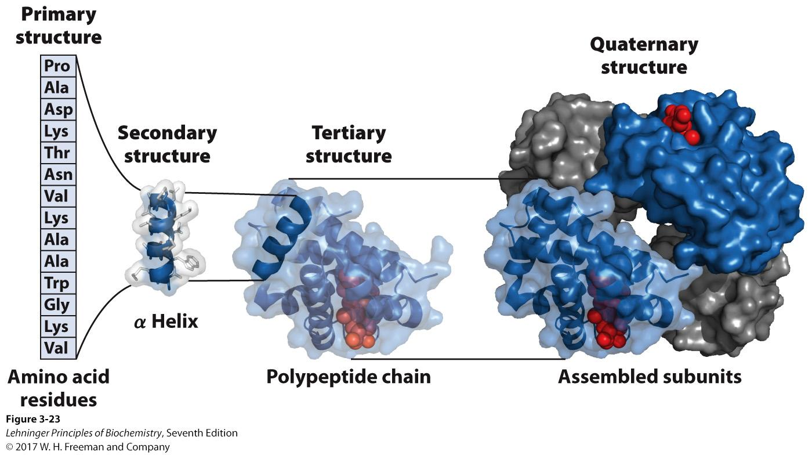{.r-stretch fig-align="center"}

<!-- Slide 6 -->

# Estrutura Primária: A Ligação Peptídica {.smaller}

- A estrutura da proteína é parcialmente ditada pelas propriedades da ligação peptídica.
- A ligação peptídica é um híbrido de ressonância de duas estruturas canônicas.
- A ressonância faz com que as ligações peptídicas:
    - sejam menos reativas em comparação com ésteres, por exemplo
    - sejam bastante rígidas e quase planares
    - exibam um grande momento de dipolo na configuração trans favorecida

<!-- Slide 7 -->

# Ressonância na Ligação Peptídica

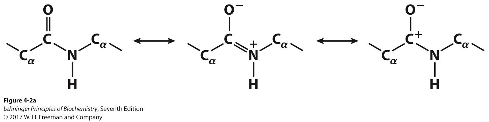{.r-stretch fig-align="center"}

<!-- Slide 8 -->

# O Plano Peptídico Rígido e as Rotações Parcialmente Livres {.smaller}

- A rotação em torno da ligação peptídica não é permitida devido à estrutura de ressonância.
- A rotação em torno das ligações conectadas ao carbono α é permitida.
    - φ (phi): ângulo em torno da ligação carbono α—nitrogênio amídico
    - ψ (psi): ângulo em torno da ligação carbono α—carbono carbonílico
- Em um polipeptídeo totalmente estendido, tanto ψ quanto φ são 180°.

**A organização em torno da ligação peptídica, aliada à identidade dos grupos R, determina a estrutura secundária da proteína.**

<!-- Slide 9 -->

# O Polipeptídeo É Composto de uma Série de Planos Ligados nos Carbonos α

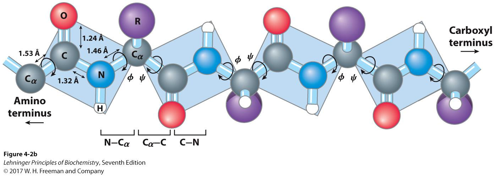{.r-stretch fig-align="center"}

<!-- Slide 10 -->

# Distribuição dos Ângulos Diedros φ e ψ {.smaller}

- Algumas combinações de φ e ψ são muito desfavoráveis devido ao impedimento estérico dos átomos da cadeia principal com outros átomos da cadeia principal ou cadeias laterais.
- Algumas combinações de φ e ψ são mais favoráveis devido à chance de formar interações de ligação de H favoráveis ao longo da cadeia principal.
- Um gráfico de Ramachandran mostra a distribuição dos ângulos diedros φ e ψ encontrados em uma proteína:
    - mostra os elementos comuns de estrutura secundária
    - revela regiões com estrutura incomum da cadeia principal

<!-- Slide 11 -->

---

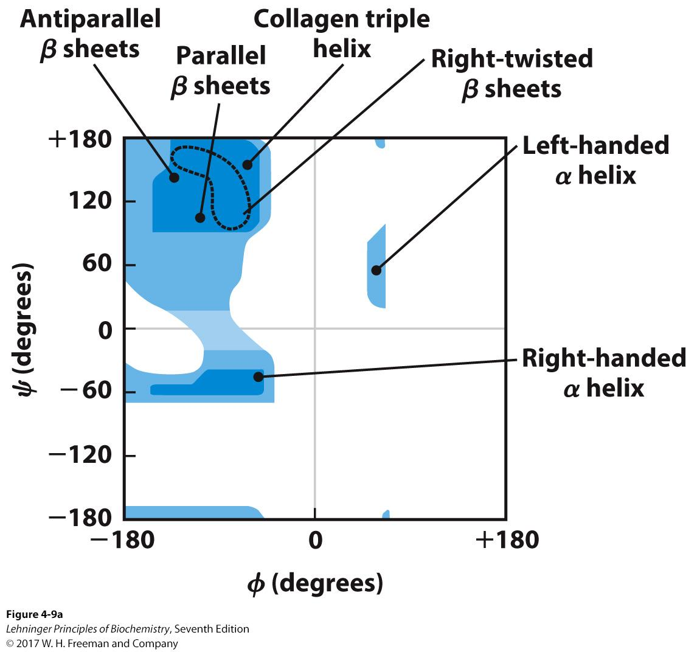{.r-stretch fig-align="center"}

<!-- Slide 12 -->

# Gráfico de Ramachandran

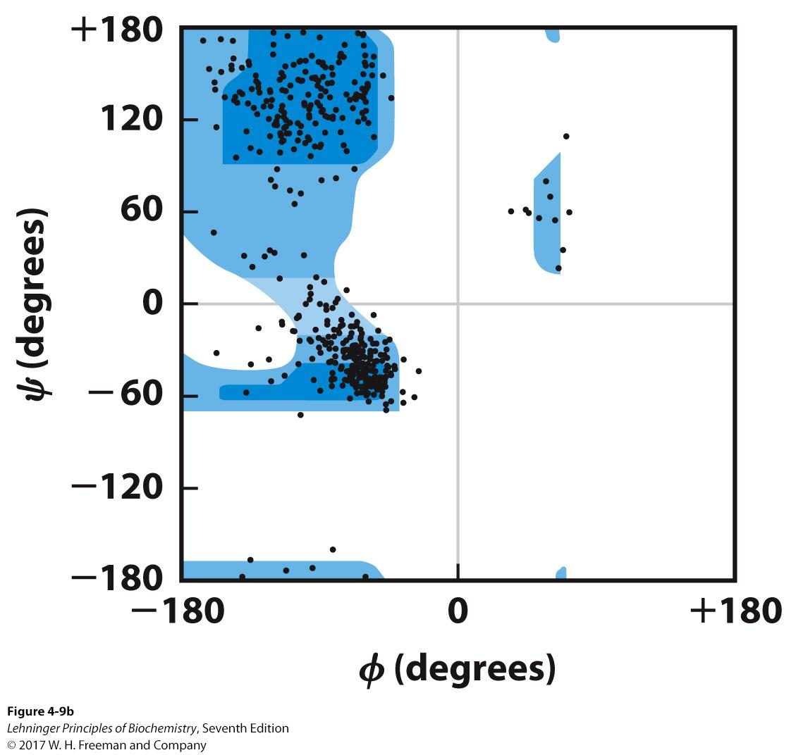{.r-stretch fig-align="center"}

<!-- Slide 13 -->

# Estruturas Secundárias {.smaller}

- Estrutura secundária refere-se a um arranjo espacial local da cadeia principal polipeptídica.
- Dois arranjos regulares são comuns:
- a α-hélice
    - estabilizada por ligações de hidrogênio entre resíduos próximos
- a folha β
    - estabilizada por ligações de hidrogênio entre segmentos adjacentes que podem não estar próximos
- O arranjo irregular da cadeia polipeptídica é chamado de enovelamento aleatório (*random coil*).

<!-- Slide 14 -->

---

| Estrutura | φ | ψ |
|:--|:-:|:-:|
| α-Hélice | –57˚ | –47˚ |
| Conformação β |  |  |
| Antiparalela | –139˚ | +135˚ |
| Paralela | –119˚ | +113˚ |
| Tripla hélice do colágeno | –51˚ | +153˚ |
| Volta β tipo I |  |  |
| i + 1a | –60˚ | –30˚ |
| i + 2a | –90˚ | 0˚ |
| Volta β tipo II |  |  |
| i + 1 | –60˚ | +120˚ |
| i + 2 | +80˚ | 0˚ |

: **TABELA 4.1** Ângulos φ e ψ Idealizados para Estruturas Secundárias Comuns em Proteínas {tbl-colwidths="[48,26,26]"}

<!-- Slide 15 -->

# A α-Hélice

::: {.absolute .smaller left=40 top=136 width=496}
- A cadeia principal helicoidal é mantida unida por ligações de hidrogênio entre as amidas da cadeia principal de um aminoácido n e n + 4.
- É uma hélice destrogira com 3,6 resíduos (5,4 Å) por volta.
- As ligações peptídicas estão alinhadas aproximadamente paralelas ao eixo helicoidal.
- As cadeias laterais apontam para fora e são aproximadamente perpendiculares ao eixo helicoidal.
:::

::: {.recorte .absolute left=552 top=147 width=352 style="aspect-ratio: 0.7435;"}
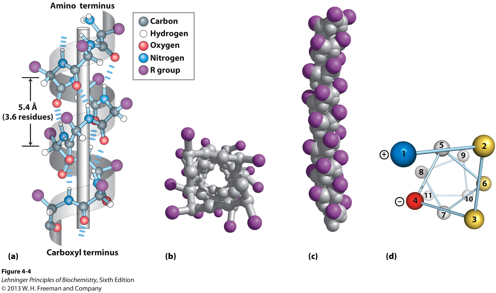{style="width:250%; left:0%; top:0%;"}
:::

{.absolute left=559 top=646 width=242}

<em>n</em> + 4

<em>n</em>

<svg style="position:absolute; left:0; top:0; width:960px; height:720px; pointer-events:none;" viewBox="0 0 960 720" xmlns="http://www.w3.org/2000/svg"><defs><marker id="seta" markerWidth="6" markerHeight="6" refX="5" refY="3" orient="auto"><path d="M0,0 L6,3 L0,6 z" fill="red"/></marker></defs><line x1="680" y1="442" x2="827" y2="368" stroke="red" stroke-width="4" marker-end="url(#seta)"/><line x1="680" y1="495" x2="864" y2="488" stroke="red" stroke-width="4" marker-end="url(#seta)"/></svg>

<!-- Slide 16 -->

# O Que É uma Hélice Destrogira?

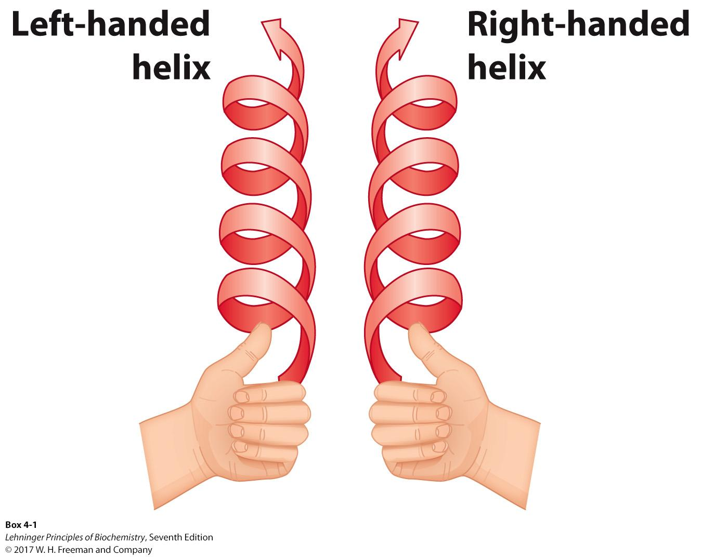{.r-stretch fig-align="center"}

<!-- Slide 17 -->

---

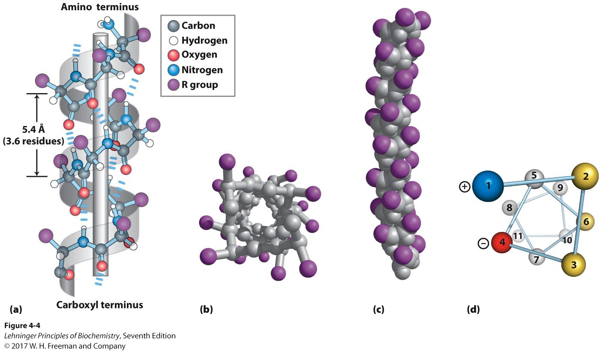{.r-stretch fig-align="center"}

<!-- Slide 18 -->

# A α-Hélice: Vista Superior {.smaller}

- O diâmetro interno da hélice (sem cadeias laterais) é de cerca de 4–5 Å.
    - muito pequeno para qualquer coisa caber “dentro”
- O diâmetro externo da hélice (com cadeias laterais) é de 10–12 Å.
    - encaixa-se bem no sulco maior do dsDNA
- Os aminoácidos #1 e #8 alinham-se perfeitamente um sobre o outro.
    - Que tipo de sequência gera uma α-hélice com uma face hidrofóbica?

<!-- Slide 19 -->

# A Sequência Afeta a Estabilidade da Hélice {.smaller}

- Nem todas as sequências polipeptídicas adotam estruturas em α-hélice.
- Resíduos hidrofóbicos pequenos, como Ala e Leu, são fortes formadores de hélice.
- Pro atua como um quebrador de hélice porque a rotação em torno da ligação N-Cα (ângulo φ) é impossível.
- Gly atua como um quebrador de hélice porque o grupo R minúsculo suporta outras conformações.
- Interações atrativas ou repulsivas entre cadeias laterais distantes de 3 a 4 aminoácidos afetarão a formação.

<!-- Slide 20 -->

---

| Aminoácido | ΔΔG° (kJ/mol)^a^ | Aminoácido | ΔΔG° (kJ/mol)^a^ |  |
|:--|:-:|:--|:-:|
| Ala | 0 | Leu | 0,79 |  |
| Arg | 0,3 | Lys | 0,63 |  |
| Asn | 3 | Met | 0,88 |  |
| Cys | 3 | Pro | >4 |  |
| Gln | 1,3 | Ser | 2,2 |  |
| Glu | 1,4 | Thr | 2,4 |  |
| Gly | 4,6 | Tyr | 2,0 |  |
| His | 2,6 | Trp | 2,0 |  |
| Ile | 1,4 | Val | 2,1 |  |

: **TABELA 4-2** Propensão de Resíduos de Aminoácidos para Adotar uma Conformação em α-Hélice {tbl-colwidths="[27,27,24,22]"}

::: {.smaller}
Fontes: Dados (exceto prolina) de J. W. Bryson et al., Science 270:935, 1995. Dados da prolina de J. K. Myers et al., Biochemistry 36:10,923, 1997.

^a^ΔΔG° é a diferença na variação de energia livre, em relação à da alanina, necessária para que o resíduo de aminoácido adote a conformação em α-hélice. Números maiores refletem maior dificuldade em adotar a estrutura em α-hélice. Os dados são uma composição derivada de múltiplos experimentos e sistemas experimentais.
:::

<!-- Slide 21 -->

# O Dipolo da Hélice {.smaller}

- Lembre-se de que a ligação peptídica tem um forte momento de dipolo.
    - C−O (carbonila) negativo
    - N−H (amida) positivo
- Todas as ligações peptídicas na α-hélice têm uma orientação semelhante.
- A α-hélice possui um grande momento de dipolo macroscópico que é reforçado por amidas e carbonilas não pareadas próximas às extremidades da hélice.
- Resíduos carregados negativamente frequentemente ocorrem próximos à extremidade positiva do dipolo da hélice.

<!-- Slide 22 -->

---

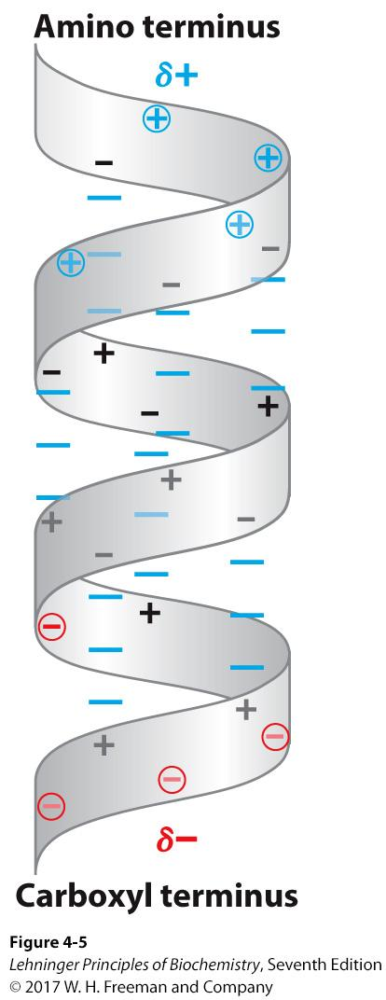{.r-stretch fig-align="center"}

<!-- Slide 23 -->

# Folhas β {.smaller}

- A planaridade da ligação peptídica e a geometria tetraédrica do carbono α criam uma estrutura semelhante a uma folha pregueada.
- O arranjo em folha da cadeia principal é mantido unido por ligações de hidrogênio entre as amidas da cadeia principal em diferentes fitas.
- As cadeias laterais projetam-se da folha, alternando em direção para cima e para baixo.

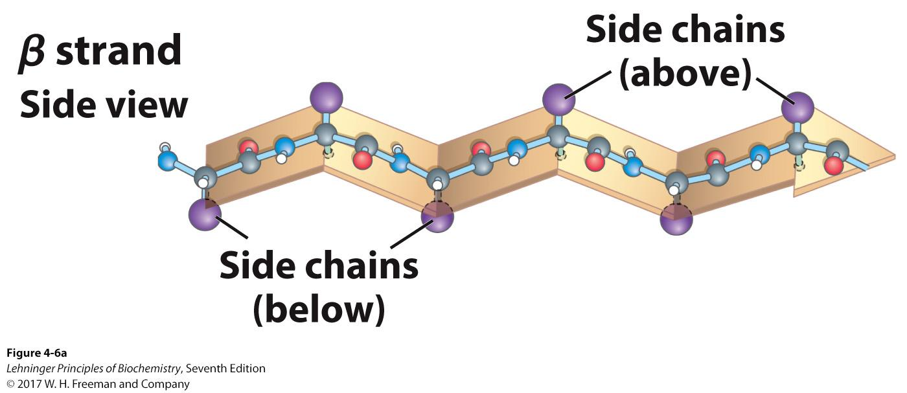{.r-stretch fig-align="center"}

<!-- Slide 24 -->

# Folhas β Paralelas e Antiparalelas {.smaller}

- Interações de múltiplas fitas β são chamadas de folhas.
- As folhas são mantidas unidas pela ligação de hidrogênio dos grupos amida e carbonila da ligação peptídica de fitas opostas.
- Duas orientações principais das folhas β são determinadas pela direcionalidade das fitas dentro delas:
    - Folhas paralelas têm fitas orientadas na mesma direção.
    - Folhas antiparalelas têm fitas orientadas em direções opostas.

<!-- Slide 25 -->

---

::: {.absolute .smaller left=40 top=24 width=888}
Em folhas β paralelas, as fitas ligadas por H correm na mesma direção.

- As ligações de hidrogênio entre as fitas são inclinadas (mais fracas).
:::

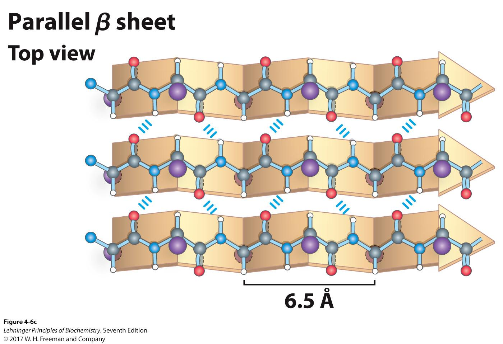{.absolute left=109 top=184 width=741}

<!-- Slide 26 -->

---

::: {.absolute .smaller left=40 top=26 width=888}
Em folhas β antiparalelas, as fitas ligadas por H correm em direções opostas.

- As ligações de hidrogênio entre as fitas são lineares (mais fortes).
:::

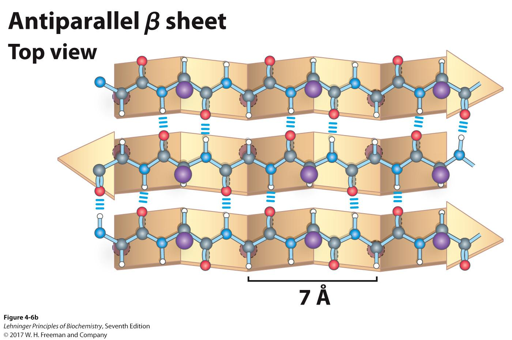{.absolute left=92 top=190 width=748}

<!-- Slide 27 -->

# Voltas β {.smaller}

- Voltas β ocorrem frequentemente sempre que as fitas nas folhas β mudam de direção.
- A volta de 180° é realizada ao longo de quatro aminoácidos.
- A volta é estabilizada por uma ligação de hidrogênio de um oxigênio carbonílico ao próton amídico três resíduos adiante na sequência.
- Prolina na posição 2 ou glicina na posição 3 são comuns em voltas β.

<!-- Slide 28 -->

---

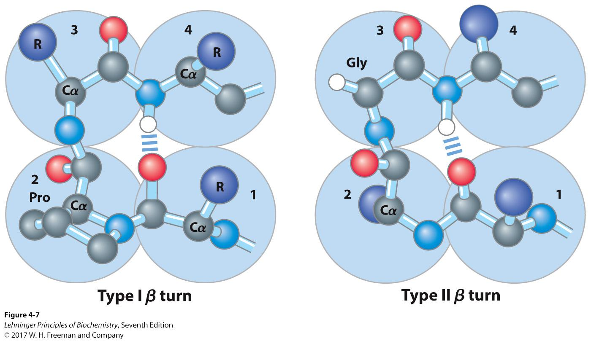{.r-stretch fig-align="center"}

<!-- Slide 29 -->

# Isômeros de Prolina {.smaller}

- A maioria das ligações peptídicas que não envolvem prolina está na configuração trans (>99,95%).
- Para ligações peptídicas envolvendo prolina, cerca de 6% estão na configuração cis. A maioria desses 6% envolve voltas β.
- A isomerização da prolina é catalisada por prolina isomerases.

<!-- Slide 30 -->

---

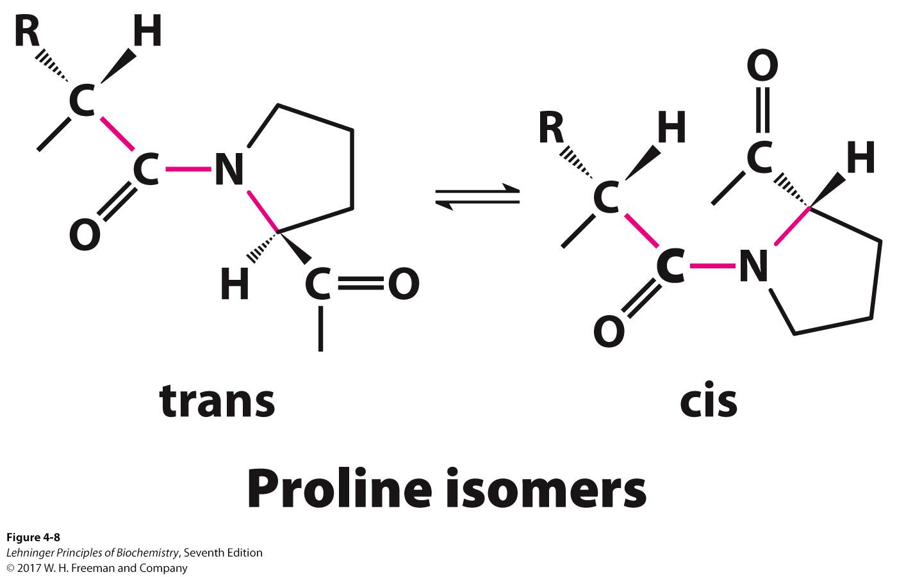{.r-stretch fig-align="center"}

<!-- Slide 31 -->

# Determinação da Estrutura Secundária: Análise de Dicroísmo Circular (CD) {.smaller}

- O CD mede a diferença de absorção molar $\Delta\varepsilon$ da luz circularmente polarizada à esquerda e à direita: $\Delta\varepsilon = \varepsilon_L - \varepsilon_R$.
- Cromóforos no ambiente quiral produzem sinais característicos.
- Os sinais de CD das ligações peptídicas dependem da conformação da cadeia.

<!-- Slide 32 -->

---

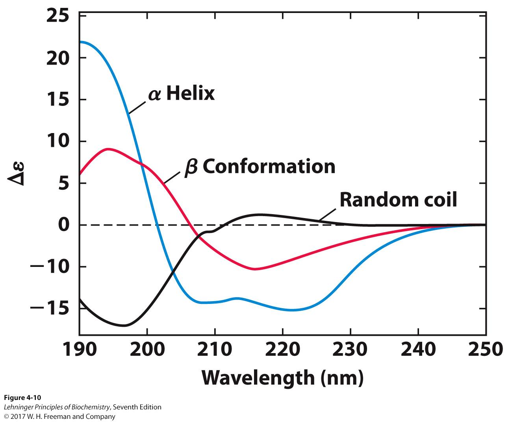{.r-stretch fig-align="center"}

<!-- Slide 33 -->

# Estrutura Terciária de Proteínas {.smaller}

- Estrutura terciária refere-se ao arranjo espacial global dos átomos em uma proteína.
- Estabilizada por inúmeras interações fracas entre cadeias laterais de aminoácidos
    - em grande parte interações hidrofóbicas e polares
    - pode ser estabilizada por ligações dissulfeto
- Os aminoácidos que interagem não estão necessariamente próximos uns dos outros na sequência primária.
- Duas classes principais:
    - fibrosas e globulares (solúveis em água ou lipídios)

<!-- Slide 34 -->

# Proteínas Fibrosas

::: {.recorte .absolute left=248 top=112 width=496 style="aspect-ratio: 0.8386;"}
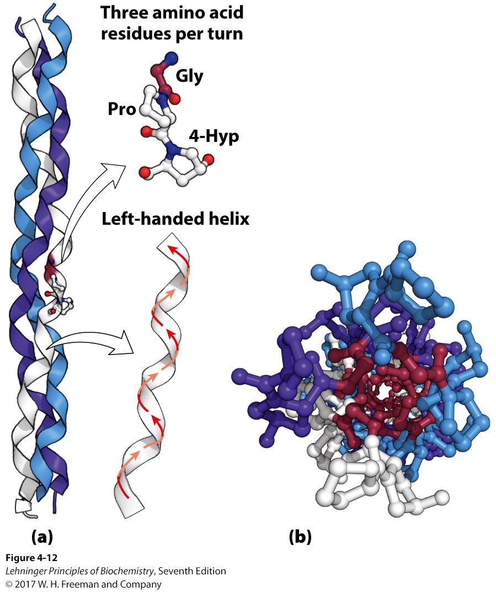{style="width:100%; left:0%; top:0%;"}
:::

<!-- Slide 35 -->

# Proteínas Fibrosas: Da Estrutura à Função

| Estrutura | Características | Exemplos de ocorrência |  |
|:--|:--|:--|
| α-Hélice, reticulada por ligações dissulfeto | Estruturas protetoras resistentes e insolúveis de dureza e flexibilidade variadas | α-Queratina de cabelos, penas, unhas |  |
| Conformação β | Filamentos macios e flexíveis | Fibroína da seda |  |
| Tripla hélice do colágeno | Alta resistência à tração, sem elasticidade | Colágeno de tendões, matriz óssea |  |

: **TABELA 4-3** Estruturas Secundárias e Propriedades de Algumas Proteínas Fibrosas {tbl-colwidths="[30,35,35]"}

<!-- Slide 36 -->

---

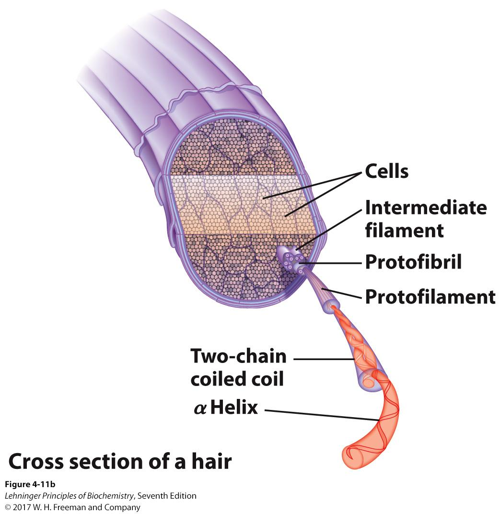{.r-stretch fig-align="center"}

<!-- Slide 37 -->

# Estrutura da α-Queratina no Cabelo

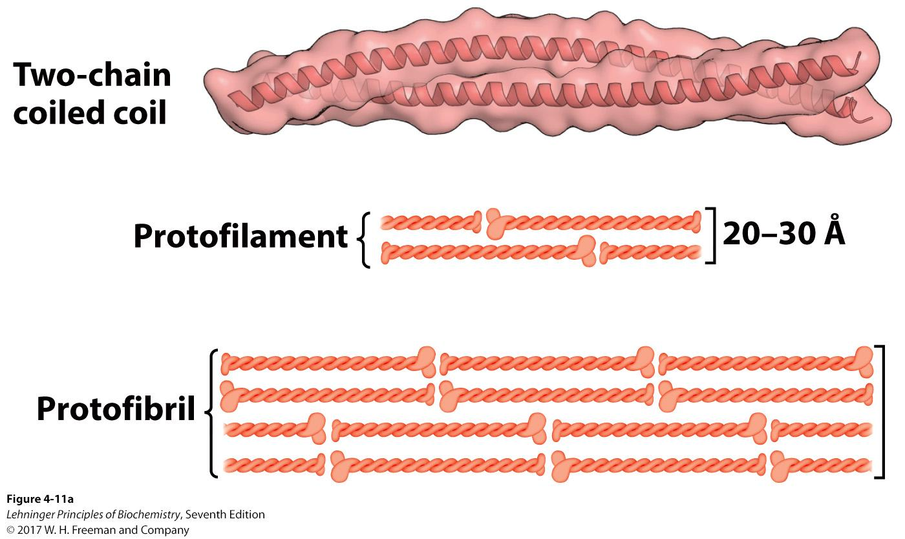{.r-stretch fig-align="center"}

<!-- Slide 38 -->

# Química do Ondulado Permanente

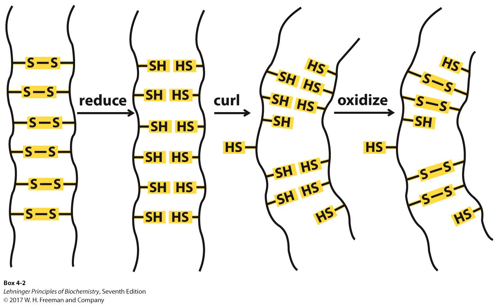{.r-stretch fig-align="center"}

<!-- Slide 39 -->

# Estrutura do Colágeno {.smaller}

- O colágeno é um constituinte importante do tecido conjuntivo: tendões, cartilagem, ossos, córnea do olho.
- Cada cadeia de colágeno é uma longa hélice levogira rica em Gly e Pro.
- Três cadeias de colágeno entrelaçam-se em uma tripla hélice super-helicoidal destrogira.
- A tripla hélice tem maior resistência à tração do que um fio de aço de igual seção transversal.
- Muitas triplas hélices unem-se para formar uma fibrila de colágeno.

<!-- Slide 40 -->

---

::: {.recorte .absolute left=192 top=4 width=584 style="aspect-ratio: 0.8386;"}
{style="width:100%; left:0%; top:0%;"}
:::

<!-- Slide 41 -->

# 4-Hidroxiprolina no Colágeno {.smaller}

- Força o anel da prolina a uma dobra (*pucker*) favorável
- Oferece mais ligações de hidrogênio entre as três fitas de colágeno
- O processamento pós-traducional é catalisado pela prolil hidroxilase e requer α-cetoglutarato, oxigênio molecular e ascorbato (vitamina C).

<!-- Slide 42 -->

---

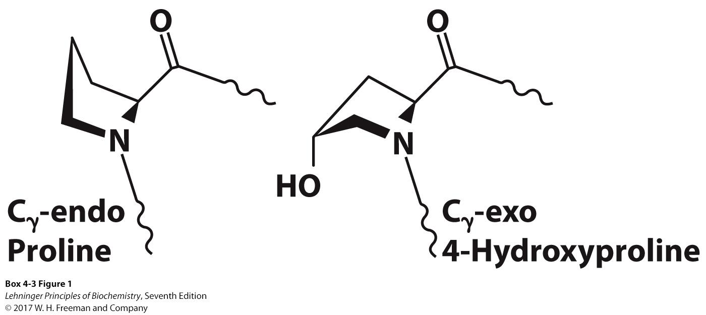{.r-stretch fig-align="center"}

<!-- Slide 43 -->

# A Vitamina C na Prolil 4-Hidroxilase Restaura o Estado Fe^2+^

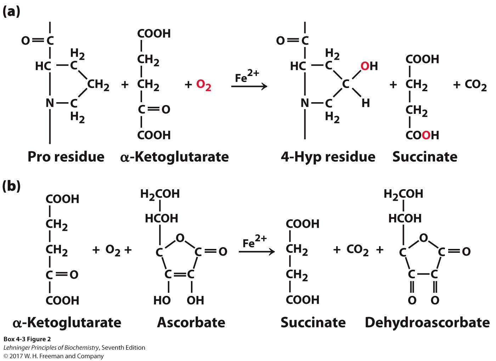{.r-stretch fig-align="center"}

<!-- Slide 44 -->

# Fibrilas de Colágeno {.smaller}

:::: {.columns}
::: {.column width="50%"}
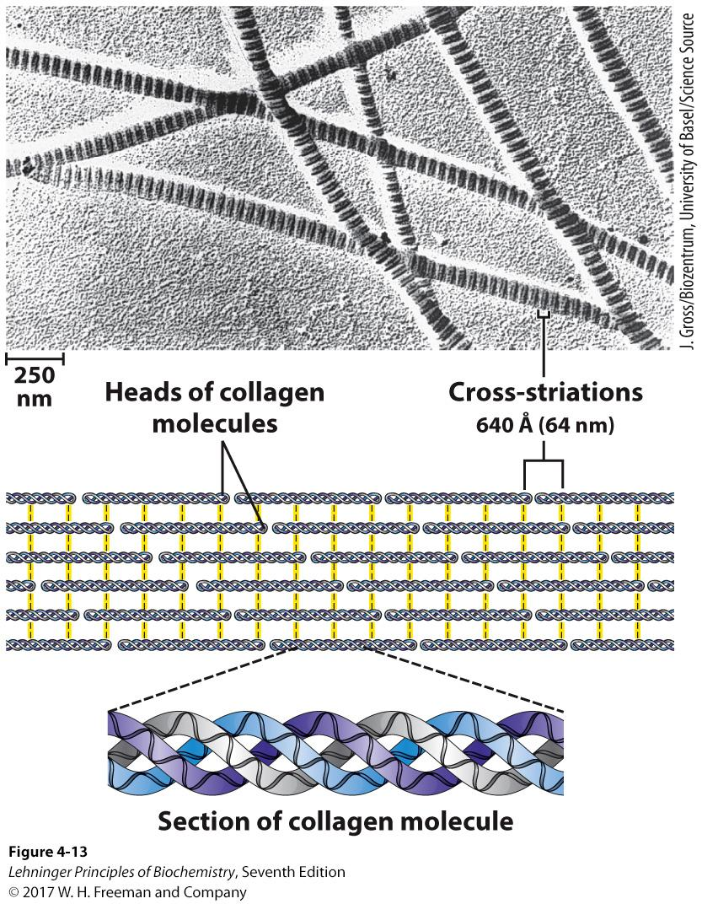{width=462}
:::
::: {.column width="50%"}
- Superestruturas de colágeno são formadas pela reticulação (*cross-linking*) de triplas hélices de colágeno para formar fibrilas de colágeno.
- As ligações cruzadas são ligações covalentes entre resíduos de aminoácidos Lys ou HyLys, ou His.
:::
::::

<!-- Slide 45 -->

# Fibroína da Seda {.smaller}

- A fibroína é a principal proteína da seda de mariposas e aranhas.
- Estrutura de folha β antiparalela
- Cadeias laterais pequenas (Ala e Gly) permitem o empacotamento próximo das folhas.
- A estrutura é estabilizada por:
    - ligações de hidrogênio dentro das folhas
    - interações de dispersão de London entre as folhas

<!-- Slide 46 -->

---

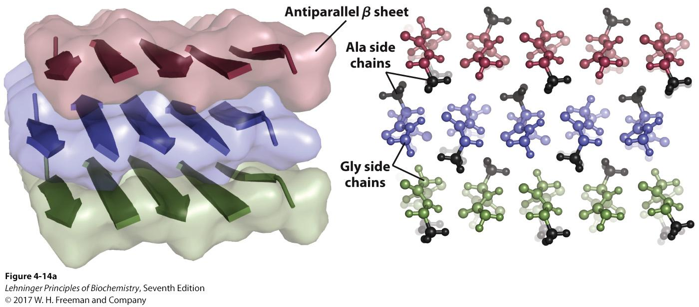{.r-stretch fig-align="center"}

<!-- Slide 47 -->

# Seda de Aranha {.smaller}

- Usada para teias, sacos de ovos e para envolver presas
- Material extremamente resistente
    - mais forte que o aço
    - pode esticar muito antes de quebrar
- Um material compósito
    - partes cristalinas (ricas em fibroína)
    - partes elásticas semelhantes à borracha

<!-- Slide 48 -->

# Proteínas Globulares Solúveis em Água

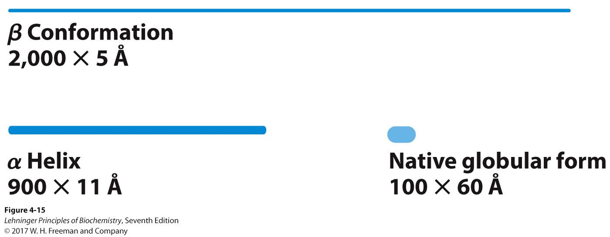{.absolute left=24 top=117 width=808}

::: {.recorte .absolute left=360 top=432 width=440 style="aspect-ratio: 1.599;"}
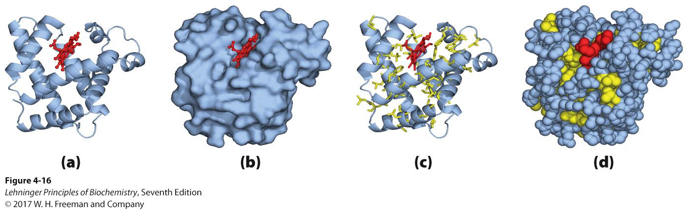{style="width:204.08%; left:0%; top:0%;"}
:::

<!-- Slide 49 -->

# Motivos (Enovelamentos) {.smaller}

- Arranjo específico de vários elementos de estrutura secundária
    - toda α-hélice
    - toda folha β
    - ambos
- Motivos podem ser encontrados como estruturas recorrentes em inúmeras proteínas.
- Proteínas globulares são compostas de diferentes motivos enovelados juntos.

<!-- Slide 50 -->

# Motivos (Enovelamentos)

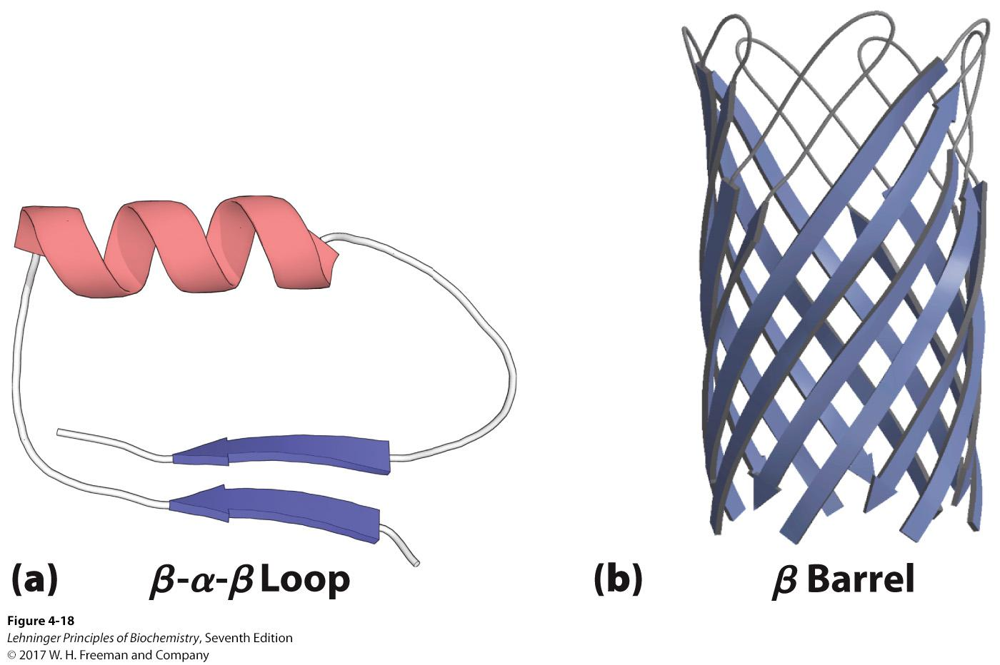{.r-stretch fig-align="center"}

<!-- Slide 51 -->

# Motivos Repetidos Contribuem para o Enovelamento Final

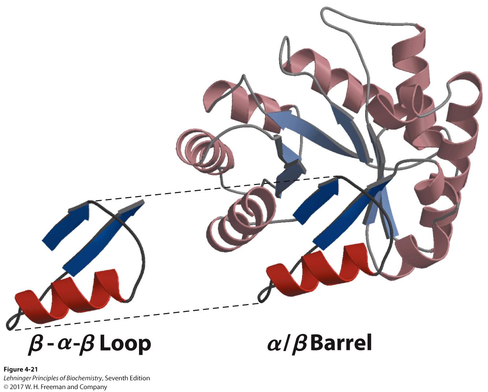{.r-stretch fig-align="center"}

<!-- Slide 52 -->

# Proteínas Intrinsecamente Desordenadas {.smaller}

- Contêm segmentos proteicos que carecem de estrutura definível
- Compostas por aminoácidos cuja maior concentração força uma estrutura menos definida
    - Lys, Arg, Glu e Pro
- Regiões desordenadas podem conformar-se a muitas proteínas diferentes, facilitando a interação com inúmeras proteínas parceiras distintas.

<!-- Slide 53 -->

# Proteínas Intrinsecamente Desordenadas

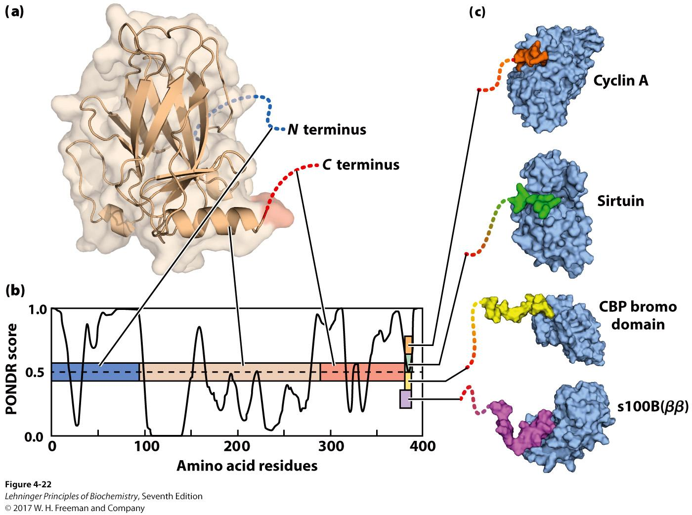{.r-stretch fig-align="center"}

<!-- Slide 54 -->

# Estrutura Quaternária

Uma estrutura quaternária é formada pela montagem de polipeptídeos individuais em um agrupamento funcional maior.

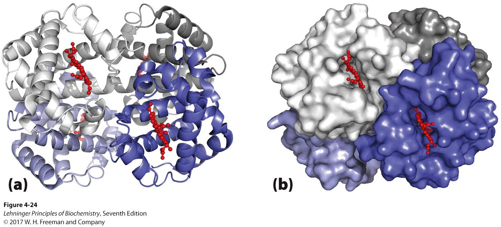{.r-stretch fig-align="center"}

<!-- Slide 55 -->

# Métodos de Determinação Estrutural de Proteínas: Cristalografia de Raios X {.smaller}

Etapas necessárias

- purificar a proteína
- cristalizar a proteína
- coletar dados de difração
- calcular a densidade eletrônica
- ajustar resíduos de aminoácidos conhecidos na densidade

Prós

- sem limites de tamanho
- bem estabelecido

Contras

- difícil para proteínas de membrana
- não consegue resolver (ver) hidrogênios

<!-- Slide 56 -->

---

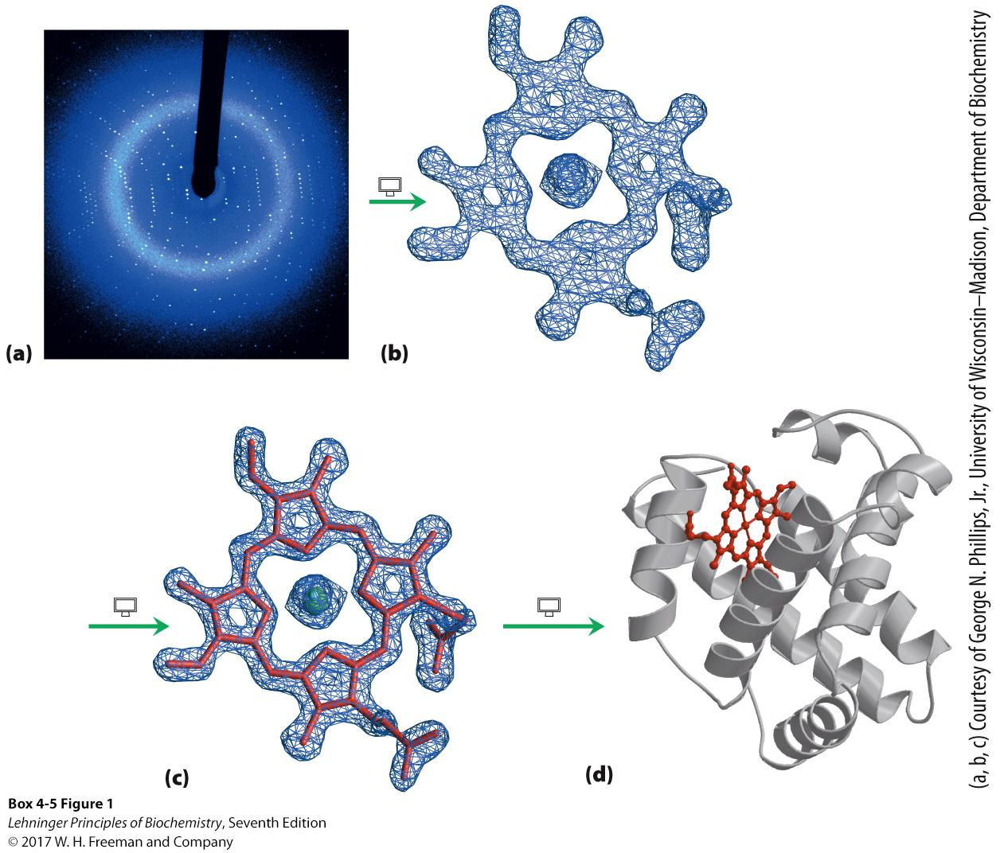{.r-stretch fig-align="center"}

<!-- Slide 57 -->

# Métodos de Determinação Estrutural de Proteínas: RMN Biomolecular {.smaller}

Etapas necessárias

- purificar a proteína
- dissolver a proteína
- coletar dados de RMN
- atribuir sinais de RMN
- calcular a estrutura

Prós

- sem necessidade de cristalizar a proteína
- consegue ver muitos hidrogênios

Contras

- difícil para proteínas insolúveis
- funciona melhor com proteínas pequenas

<!-- Slide 58 -->

---

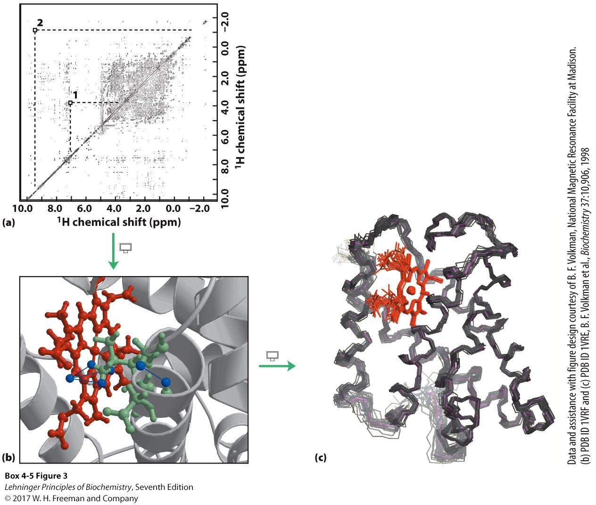{.r-stretch fig-align="center"}

<!-- Slide 59 -->

# Proteostase: Síntese, Montagem e Degradação de Proteínas in vivo

:::: {.columns}
::: {.column width="52%"}
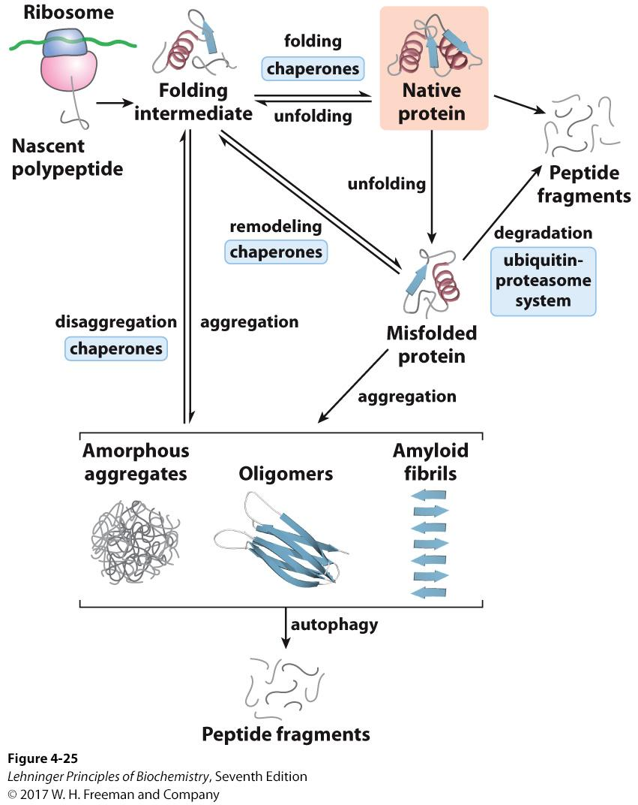{width=424}
:::
::: {.column width="48%"}
A manutenção da atividade proteica celular é realizada pela coordenação de muitas vias diferentes.
:::
::::

<!-- Slide 60 -->

# Estabilidade e Enovelamento de Proteínas {.smaller}

- A função de uma proteína depende de sua estrutura 3D.
- A perda da integridade estrutural com perda concomitante de atividade é chamada de desnaturação.
- As proteínas podem ser desnaturadas por:
    - calor ou frio
    - extremos de pH
    - solventes orgânicos
    - agentes caotrópicos: ureia e cloridrato de guanidínio

<!-- Slide 61 -->

---

::::: {.columns}
::: {.column width="50%"}
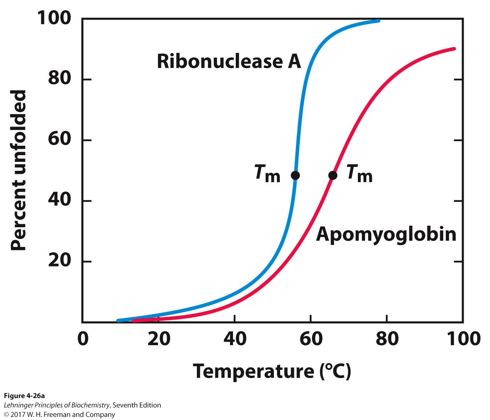{width=480}
:::
::: {.column width="50%"}
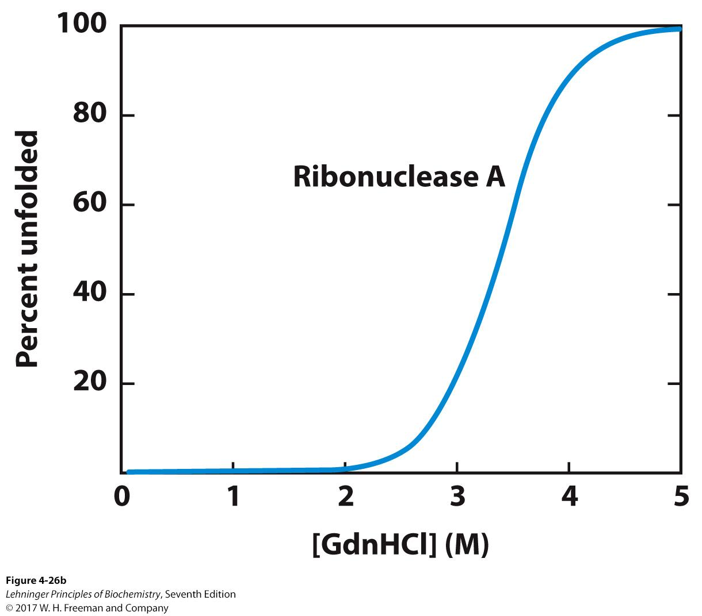{width=469}
:::
:::::

<!-- Slide 62 -->

# Experimento de Reenovelamento da Ribonuclease {.smaller}

- A ribonuclease é uma pequena proteína que contém oito cisteínas ligadas por quatro pontes dissulfeto.
- A ureia na presença de 2-mercaptoetanol desnatura totalmente a ribonuclease.
- Quando a ureia e o 2-mercaptoetanol são removidos, a proteína se reenovela espontaneamente e as pontes dissulfeto corretas são reformadas.
- A sequência por si só determina a conformação nativa.
- O experimento é bastante “simples”, mas tão importante que rendeu a Chris Anfinsen o Prêmio Nobel de Química de 1972.

<!-- Slide 63 -->

---

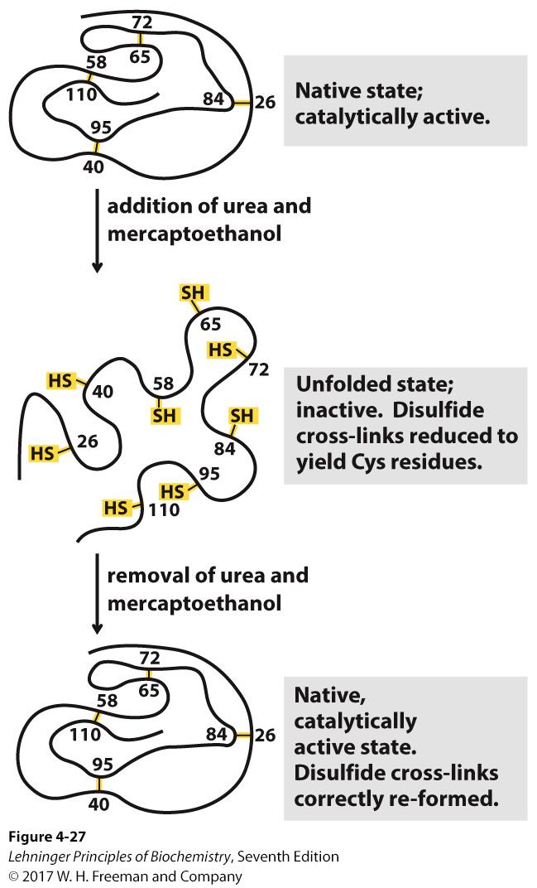{.r-stretch fig-align="center"}

<!-- Slide 64 -->

# O Enovelamento de Proteínas Segue um Caminho Distinto

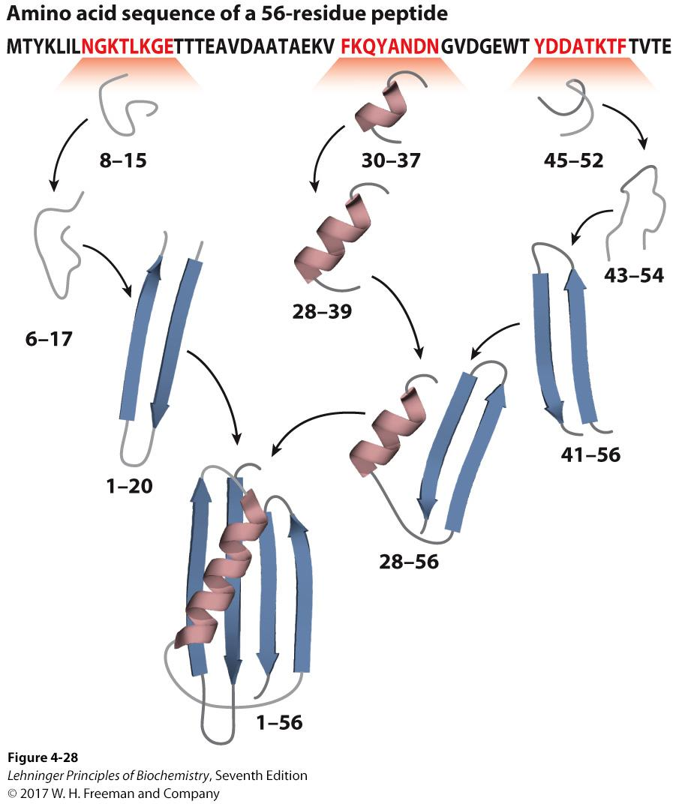{.r-stretch fig-align="center"}

<!-- Slide 65 -->

# Como as Proteínas Podem Se Enovelar Tão Rápido? {.smaller}

- As proteínas enovelam-se na estrutura de menor energia em escalas de tempo de microssegundos a segundos. Como elas encontram o enovelamento certo tão rápido?
- É matematicamente impossível que o enovelamento proteico ocorra tentando aleatoriamente cada conformação até que a de menor energia seja encontrada (paradoxo de Levinthal).
- A busca pelo mínimo não é aleatória porque a direção em direção à estrutura nativa é termodinamicamente mais favorável.

<!-- Slide 66 -->

# Modelo do Funil de Energia Livre do Enovelamento Proteico Depende da Estabilidade dos Motivos Dentro da Proteína

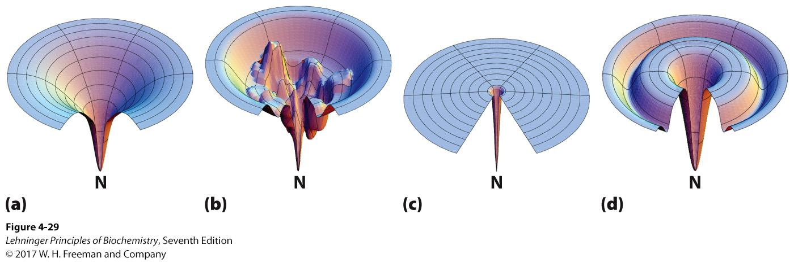{.absolute left=40 top=416 width=888}

Múltiplas vias levando a um resultado estável

Múltiplos intermediários estáveis levando ao enovelamento final

Enovelamento imediato para um resultado estável

Intermediários significativamente estáveis a serem superados antes do enovelamento final

<svg style="position:absolute; left:0; top:0; width:960px; height:720px; pointer-events:none;" viewBox="0 0 960 720" xmlns="http://www.w3.org/2000/svg"><defs><marker id="seta" markerWidth="6" markerHeight="6" refX="5" refY="3" orient="auto"><path d="M0,0 L6,3 L0,6 z" fill="#000"/></marker></defs><line x1="144" y1="352" x2="144" y2="416" stroke="#000" stroke-width="2" marker-end="url(#seta)"/><line x1="368" y1="336" x2="368" y2="400" stroke="#000" stroke-width="2" marker-end="url(#seta)"/><line x1="592" y1="360" x2="592" y2="424" stroke="#000" stroke-width="2" marker-end="url(#seta)"/><line x1="816" y1="352" x2="816" y2="416" stroke="#000" stroke-width="2" marker-end="url(#seta)"/></svg>

<!-- Slide 67 -->

# Chaperonas Evitam o Enovelamento Incorreto e a Agregação de Peptídeos Desenovelados

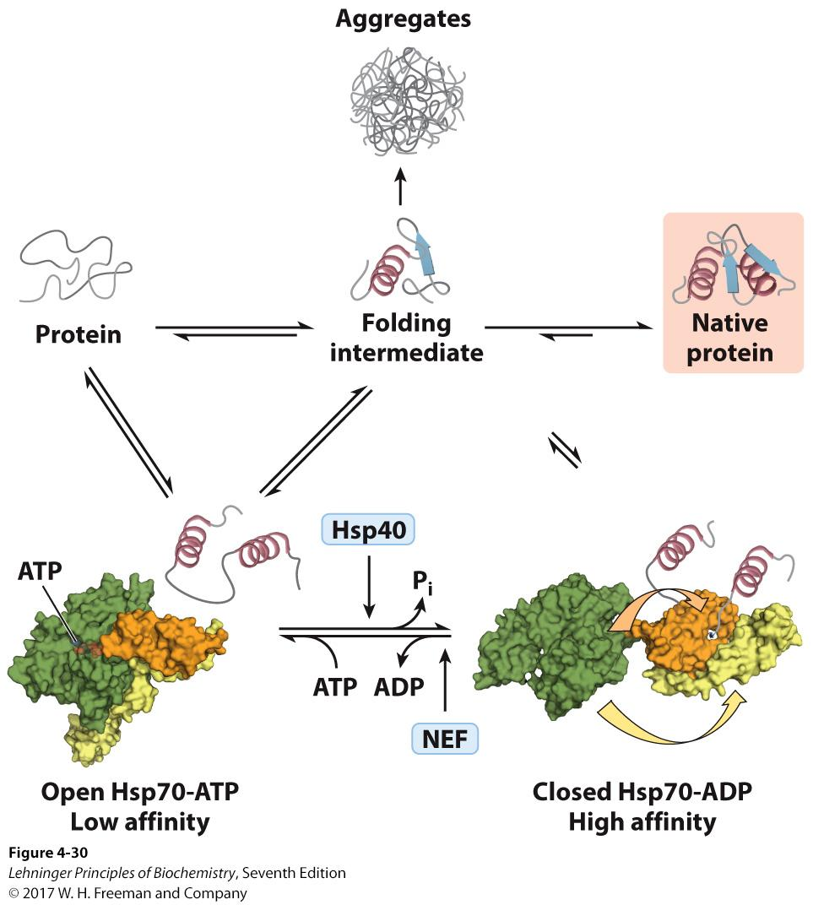{.r-stretch fig-align="center"}

<!-- Slide 68 -->

# Chaperoninas Facilitam o Enovelamento

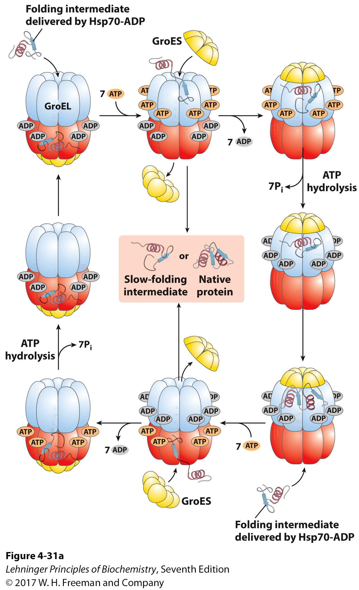{.r-stretch fig-align="center"}

<!-- Slide 69 -->

---

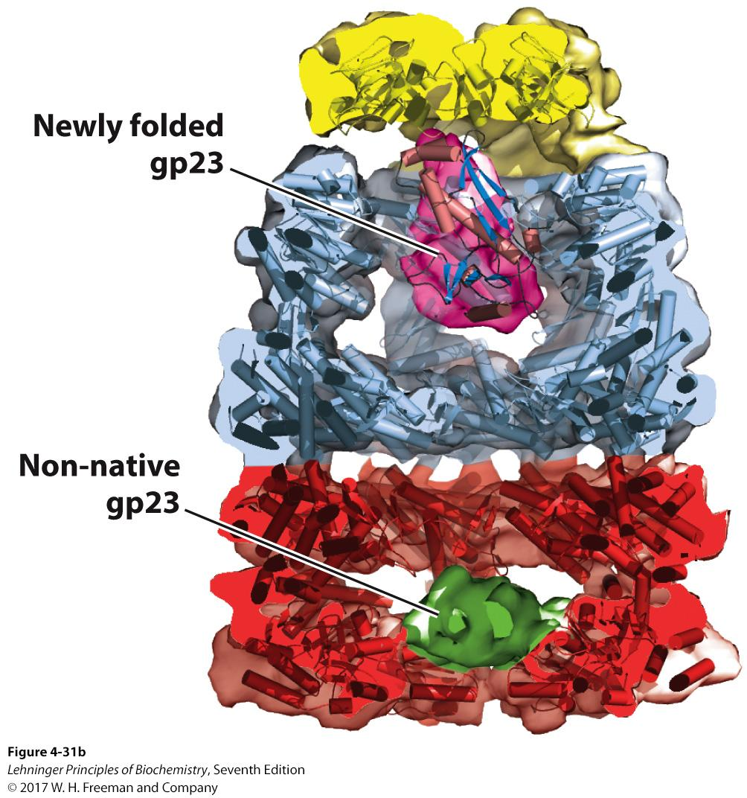{.r-stretch fig-align="center"}

<!-- Slide 70 -->

# O Enovelamento Incorreto de Proteínas É a Base de Inúmeras Doenças Humanas {.smaller}

:::: {.columns}
::: {.column width="45%"}
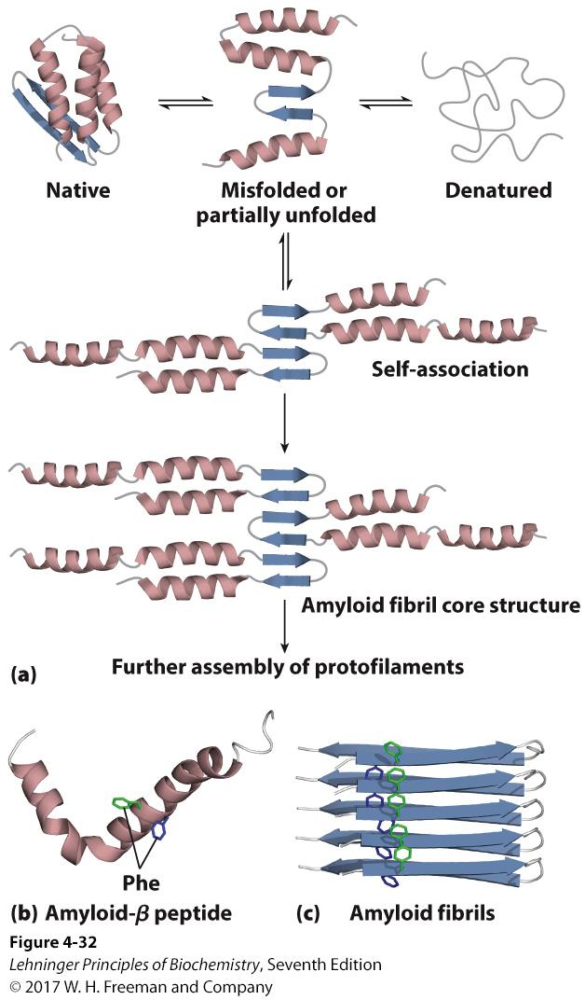{width=323}
:::
::: {.column width="55%"}
- O β-amiloide nativo (corretamente enovelado) é uma proteína globular solúvel,
- O β-amiloide mal enovelado promove agregação na interface proteína-proteína recém-exposta.
- Hélices corretamente enoveladas são perdidas e os peptídeos formam fitas β, hélices β e folhas β.
:::
::::

<!-- Slide 71 -->

# Capítulo 4: Resumo {.smaller}

Neste capítulo, aprendemos sobre:

- as duas estruturas secundárias mais importantes
    - α-hélices
    - folhas β
- como as propriedades e a função das proteínas fibrosas estão relacionadas
- como determinar estruturas tridimensionais de proteínas
- um dos maiores enigmas não resolvidos da bioquímica moderna: como as proteínas se enovelam
