<!-- Slide 1 -->

::: {.absolute left=50 top=295}
[**5 | Função Proteica**]{.azul}
:::

::: {.absolute left=19 top=478 style="font-size:.4em;"}
© 2017 W. H. Freeman and Company
:::

{.absolute left=440 top=21 width=480}

<!-- Slide 2 -->

# CAPÍTULO 5:  Função Proteica

*Objetivos de aprendizagem:*

- Métodos de ligação de ligantes e proteínas
- Modelagem quantitativa e gráfica das interações proteína-ligante
- Interação das globinas com oxigênio e ligantes não oxigenados
- Regulação fisiológica da ligação do oxigênio
- Mecanismo e controle da interação antígeno-anticorpo
- Mecanismo da contração muscular
- Regulação da contração muscular

<!-- Slide 3 -->

# Função das Proteínas Globulares

*Tópicos principais na função proteica:*

- A ligação reversível de ligantes é essencial.
    - especificidade de ligantes e sítios de ligação
    - A ligação do ligante é frequentemente acoplada a mudanças conformacionais, às vezes de forma bastante dramática (**encaixe induzido**).
    - Em proteínas com múltiplas subunidades, mudanças conformacionais em uma subunidade podem afetar as outras (**cooperatividade**).
    - As interações podem ser reguladas.
- Ilustrado por:
    - hemoglobina, anticorpos e proteínas musculares

<!-- Slide 4 -->

# Funções das Proteínas Globulares

- [Armazenamento de íons e moléculas]{.azul}
    - mioglobina, ferritina
- [Transporte de íons e moléculas]{.azul}
    - hemoglobina, transportador de serotonina
- [Defesa contra patógenos]{.azul}
    - anticorpos, citocinas
- [Contração muscular]{.azul}
    - actina, miosina
- [Catálise biológica]{.azul}
    - quimotripsina, lisozima

<!-- Slide 5 -->

# Interação com Outras Moléculas

- Processo reversível e transitório de equilíbrio químico:

::: {style="text-align:center;"}
A + B [↔]{style="color:red;"} AB
:::

- Uma molécula que se liga a uma proteína é chamada de [ligante]{.azul}.
    - tipicamente uma molécula pequena
- Uma região na proteína onde o ligante se liga é chamada de [sítio de ligação]{.azul}.
- O ligante liga-se por meio das mesmas interações [não covalentes]{.azul} que ditam a estrutura proteica (ver Capítulo 4).
    - permite que as interações sejam transitórias

<!-- Slide 6 -->

# Ligação: Descrição Quantitativa {.smaller}

- Considere um processo no qual um ligante (L) se liga reversivelmente a um sítio em uma proteína (P).

- Essa interação pode ser descrita quantitativamente pela [constante de velocidade de associação ka]{.azul} ou pela [constante de velocidade de dissociação kd]{.azul}.
- Após algum tempo, o processo atingirá o [equilíbrio]{.azul} onde as velocidades de associação e dissociação são iguais.

$$k_a[P]\cdot[L] = k_d[PL]$$

:::: columns
::: {.column width="62%"}
- A composição de equilíbrio é caracterizada

  *pela [constante de associação de equilíbrio Ka]{.azul}*

  *ou [pela constante de dissociação de equilíbrio, Kd.]{.azul}*
:::
::: {.column width="38%"}
$$K_a = \frac{[PL]}{[P]\cdot[L]} = \frac{1}{K_d}$$
:::
::::

::: {.absolute left=0 top=0 width=960 height=720 style="pointer-events:none;"}
<svg viewBox="0 0 960 720" width="960" height="720" xmlns="http://www.w3.org/2000/svg"><defs><marker id="s6a" markerWidth="8" markerHeight="8" refX="7" refY="4" orient="auto"><path d="M0,0 L8,4 L0,8 Z" fill="#000"/></marker></defs><path d="M144,248 V176 A72,72 0 1 0 216,248 Z" fill="#FFFFCC" stroke="#000"/><polygon points="375,200 375,256 447,256" fill="#B9E0E3" stroke="#000"/><path d="M704,248 V176 A72,72 0 1 0 776,248 Z" fill="#FFFFCC" stroke="#000"/><polygon points="709,193 709,249 781,249" fill="#B9E0E3" stroke="#000"/><line x1="512" y1="228" x2="592" y2="228" stroke="#000" marker-end="url(#s6a)"/><line x1="584" y1="244" x2="512" y2="244" stroke="#000" marker-end="url(#s6a)"/><text x="314" y="250" text-anchor="middle" font-size="36" font-weight="bold" font-family="Arial,sans-serif">+</text><text x="548" y="212" text-anchor="middle" font-size="26" font-style="italic" font-family="serif">k<tspan font-size="18" dy="6">a</tspan></text><text x="548" y="282" text-anchor="middle" font-size="26" font-style="italic" font-family="serif">k<tspan font-size="18" dy="6">d</tspan></text><text x="144" y="362" text-anchor="middle" font-size="28" font-family="Arial,sans-serif">P</text><text x="393" y="362" text-anchor="middle" font-size="28" font-family="Arial,sans-serif">L</text><text x="707" y="362" text-anchor="middle" font-size="28" font-family="Arial,sans-serif">PL</text></svg>
:::

<!-- Slide 7 -->

# Ligação:  Análise em Termos da Fração Ligada {.smaller}

:::: columns
::: {.column width="62%"}
- Na prática, podemos frequentemente determinar a [fração de sítios de ligação ocupados (θ)]{.azul}.

$$K_a = \frac{[PL]}{[P]\cdot[L]}$$
:::
::: {.column width="38%"}
$$\theta = \frac{[PL]}{[PL]+[P]}$$
:::
::::

:::: columns
::: {.column width="62%"}
- Substituindo \[PL\] por Ka\[L\]\[P\], eliminaremos \[PL\].
:::
::: {.column width="38%"}
$$\theta = \frac{K_a[L][P]}{K_a[L][P]+[P]}$$
:::
::::

:::: columns
::: {.column width="62%"}
- Eliminar \[P\] e reorganizar fornece o resultado em termos da constante de associação de equilíbrio.
:::
::: {.column width="38%"}
$$\theta = \frac{[L]}{[L]+\frac{1}{K_a}}$$
:::
::::

:::: columns
::: {.column width="62%"}
- Em termos da [constante de dissociação de equilíbrio]{.azul}, mais comumente usada:
:::
::: {.column width="38%"}
$$\boxed{\theta = \frac{[L]}{[L]+K_d}}$$
:::
::::

<!-- Slide 8 -->

# Ligação: Análise Gráfica

:::: columns
::: {.column width="75%"}
- A fração de sítios ligados depende

  *da concentração de ligante livre e do Kd.*
- Experimentalmente:
    - a concentração do ligante é conhecida
    - o Kd pode ser determinado graficamente ou por regressão de mínimos quadrados
:::
::: {.column width="25%"}
$$\theta = \frac{[L]}{[L]+K_d}$$

\[L\] ≈ \[L\]total
:::
::::

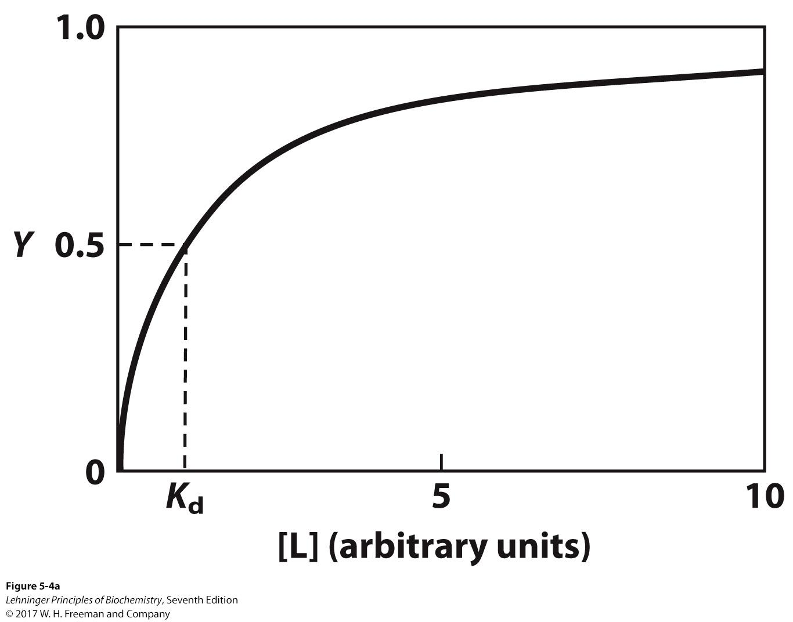{.r-stretch fig-align="center"}

<!-- Slide 9 -->

# Exemplo: Ligação do Oxigênio à Mioglobina

::: {.recorte .absolute left=24 top=146 width=454 style="aspect-ratio: 1221/1072;"}
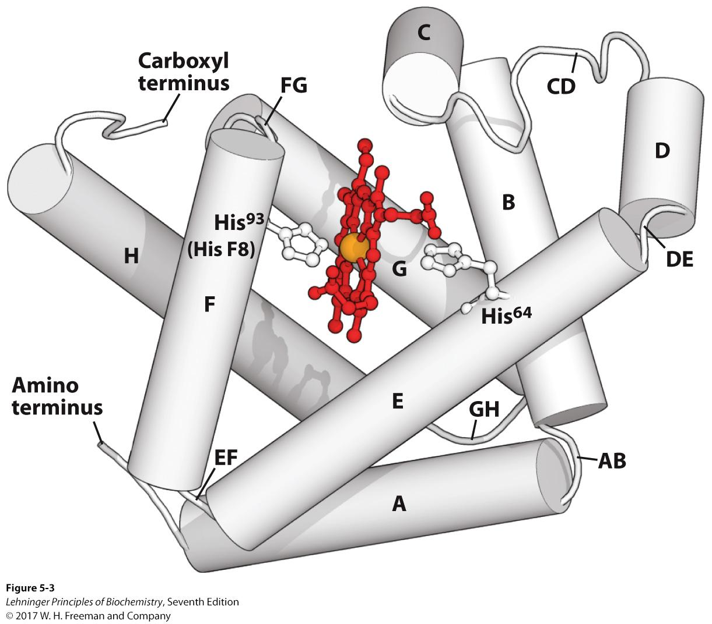{style="width:100%; left:0%; top:0%;"}
:::

::: {.recorte .absolute left=480 top=184 width=473 style="aspect-ratio: 1400/1069;"}
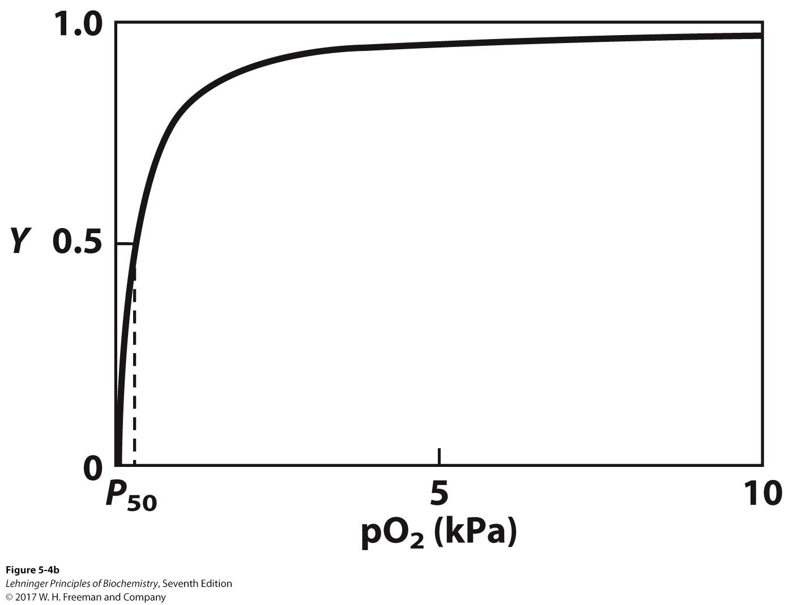{style="width:100%; left:0%; top:0%;"}
:::

::: {.absolute left=8 top=600 width=464}
Quando um ligante é um gás, a ligação é expressa em termos de pressões parciais.
:::

::: {.absolute left=464 top=592 width=160 .eq}
$$\theta = \frac{[L]}{K_d+[L]}$$
:::

::: {.absolute left=632 top=612 width=96 style="text-align:center; font-size:1.4em;"}
⟶
:::

::: {.absolute left=736 top=584 width=190 .eq}
$$\theta = \frac{pO_2}{p_{50}+pO_2}$$
:::

<!-- Slide 10 -->

# Ligação: Conexões Termodinâmicas {.smaller}

- A força de interação pode ser expressa como:
    - constante de associação (ligação) Ka, unidades M−1
    - constante de dissociação Kd, unidades M, Kd = 1/Ka
    - energia livre de interação (ligação) ΔG°, unidades: kJ/mol

    Definições

    - ΔG° = ΔH° − TΔS°: entalpia e entropia
    - Ka = \[PL\]/\[P\]\[L\]&emsp;&emsp;Kd = \[P\]\[L\]/\[PL\]
- Relações
    - ΔG° = −RT ln Ka  = RT ln Kd&emsp;(RT a 25°C é 2,48 kJ/mol.)
- Magnitudes
    - ligação forte: Kd < 10 nM
    - ligação fraca: Kd > 10 μM

<!-- Slide 11 -->

# Exemplos de Força de Ligação

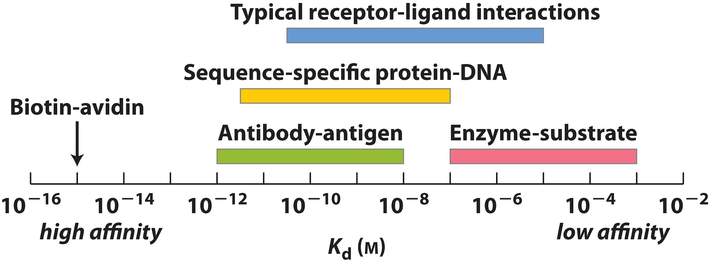{.r-stretch fig-align="center"}

<!-- Slide 12 -->

# Especificidade: Modelo Chave-Fechadura

- As proteínas tipicamente têm alta especificidade: apenas certos ligantes se ligam.
- A alta especificidade pode ser explicada pela [complementaridade]{.azul} entre o sítio de ligação e o ligante.
- Complementaridade em:
    - [tamanho]{.azul}
    - [forma]{.azul}
    - [carga]{.azul}
    - [caráter hidrofóbico/hidrofílico]{.azul}
- O modelo “chave-fechadura” de Emil Fischer (1894) assume que as superfícies complementares são [pré-formadas]{.azul}.

::: {.absolute left=0 top=0 width=960 height=720 style="pointer-events:none;"}
<svg viewBox="0 0 960 720" width="960" height="720" xmlns="http://www.w3.org/2000/svg"><defs><marker id="s12a" markerWidth="8" markerHeight="8" refX="7" refY="4" orient="auto"><path d="M0,0 L8,4 L0,8 Z" fill="#000"/></marker></defs><path transform="translate(120,576)" d="M3,0 H84 C77,5 77,15 85,20 C95,25 96,30 96,38 V72 H13 C21,66 23,58 14,52 C0,46 0,8 3,0 Z" fill="#B9E0E3" stroke="#000"/><path transform="translate(304,592)" d="M14,0 H86 C78,9 78,31 86,40 H14 C-4,38 -4,2 14,0 Z" fill="#FF9999" stroke="#000"/><text x="258" y="628" text-anchor="middle" font-size="36" font-weight="bold" font-family="Arial,sans-serif">+</text><line x1="448" y1="608" x2="568" y2="608" stroke="#000" marker-end="url(#s12a)"/><line x1="560" y1="624" x2="448" y2="624" stroke="#000" marker-end="url(#s12a)"/><path transform="translate(664,576)" d="M3,0 H84 C77,5 77,15 85,20 C95,25 96,30 96,38 V72 H13 C21,66 23,58 14,52 C0,46 0,8 3,0 Z" fill="#B9E0E3" stroke="#000"/><path transform="translate(736,576)" d="M14,0 H86 C78,9 78,31 86,40 H14 C-4,38 -4,2 14,0 Z" fill="#FF9999" stroke="#000"/></svg>
:::

<!-- Slide 13 -->

# Especificidade: Encaixe Induzido

- Mudanças conformacionais podem ocorrer após a ligação do ligante (Daniel Koshland em 1958).
    - Essa adaptação é chamada de [encaixe induzido]{.azul}.
    - O encaixe induzido permite uma ligação mais firme do ligante.
    - O encaixe induzido permite alta afinidade por diferentes ligantes.
- Tanto o ligante quanto a proteína podem alterar suas conformações.

::: {.absolute left=0 top=0 width=960 height=720 style="pointer-events:none;"}
<svg viewBox="0 0 960 720" width="960" height="720" xmlns="http://www.w3.org/2000/svg"><defs><marker id="s13a" markerWidth="8" markerHeight="8" refX="7" refY="4" orient="auto"><path d="M0,0 L8,4 L0,8 Z" fill="#000"/></marker></defs><polygon points="96,528 140,480 224,480 175,528 224,576 140,576" fill="#B9E0E3" stroke="#000"/><polygon points="288,520 361,511 362,551 289,545" fill="#FF9999" stroke="#000"/><text x="250" y="540" text-anchor="middle" font-size="36" font-weight="bold" font-family="Arial,sans-serif">+</text><line x1="424" y1="528" x2="544" y2="528" stroke="#000" marker-end="url(#s13a)"/><line x1="536" y1="544" x2="424" y2="544" stroke="#000" marker-end="url(#s13a)"/><path transform="translate(616,488) scale(1.25,1.222)" d="M3,0 H84 C77,5 77,15 85,20 C95,25 96,30 96,38 V72 H13 C21,66 23,58 14,52 C0,46 0,8 3,0 Z" fill="#B9E0E3" stroke="#000" vector-effect="non-scaling-stroke"/><path transform="translate(712,487) scale(1,1.2)" d="M14,0 H86 C78,9 78,31 86,40 H14 C-4,38 -4,2 14,0 Z" fill="#FF9999" stroke="#000" vector-effect="non-scaling-stroke"/></svg>
:::

<!-- Slide 14 -->

# Estudo de Caso I: Globinas São Proteínas Ligantes de Oxigênio {.smaller}

Problemas biológicos:

- As cadeias laterais das proteínas carecem de afinidade pelo O2.
- Alguns metais de transição ligam bem o O2, mas gerariam radicais livres se estivessem livres em solução.
- Compostos organometálicos como o heme são mais adequados, mas o [Fe2+]{.azul} no heme livre poderia ser oxidado a Fe3+ (muito reativo!).

Solução biológica:

- [Capturar a molécula de oxigênio com o heme ligado a uma proteína.]{.azul}

  **A mioglobina (armazenamento) e a hemoglobina (transporte) podem ligar oxigênio por meio de um heme ligado à proteína.**

<!-- Slide 15 -->

# Estruturas da Porfirina e do Heme

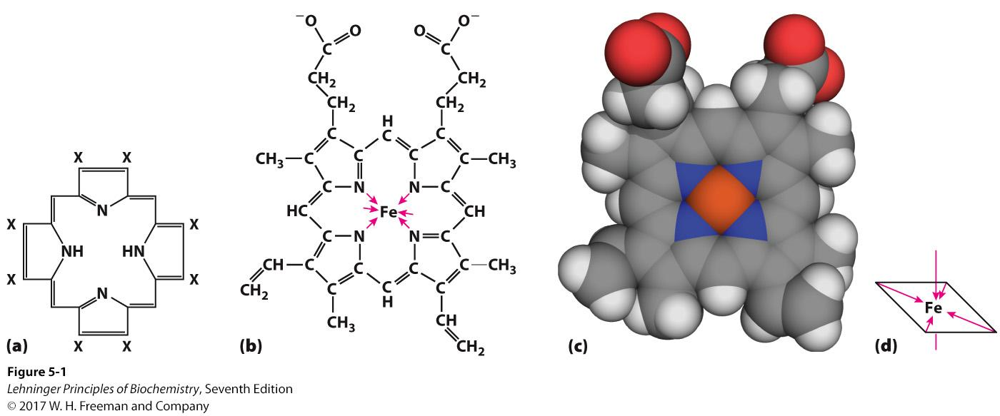{.r-stretch fig-align="center"}

<!-- Slide 16 -->

# Estrutura da Mioglobina

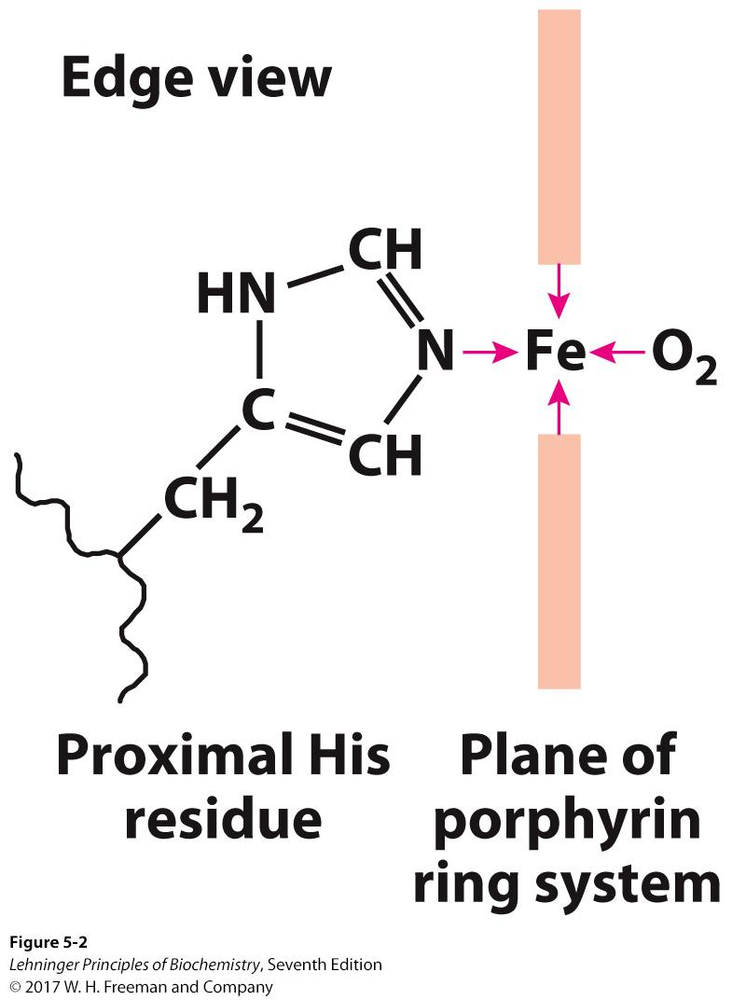{.absolute left=28 top=136 width=412}

::: {.recorte .absolute left=460 top=240 width=495 style="aspect-ratio: 1221/1072;"}
{style="width:100%; left:0%; top:0%;"}
:::

<!-- Slide 17 -->

# Ligação do Monóxido de Carbono {.smaller}

- O CO tem tamanho e forma semelhantes ao O2; ele pode caber no mesmo sítio de ligação.
- [O CO liga-se]{.azul} ao heme mais de 20.000 vezes [melhor]{.azul} do que o O2 porque o carbono no CO possui um par de elétrons isolados preenchido que pode ser doado aos orbitais d vazios do Fe2+.
- O bolsão proteico diminui a afinidade pelo CO, mas ele ainda se liga cerca de 250 vezes melhor do que o oxigênio.
- O CO é altamente tóxico, pois compete com o oxigênio. Ele bloqueia a função da [mioglobina, hemoglobina]{.azul} e [citocromos mitocondriais]{.azul} envolvidos na fosforilação oxidativa.

<!-- Slide 18 -->

# Ligação de CO vs. O2 ao Heme Livre

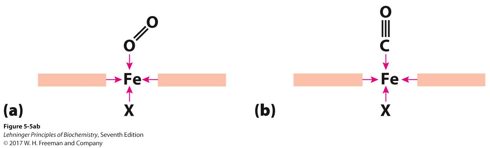{.r-stretch fig-align="center"}

<!-- Slide 19 -->

# A Ligação do Heme à Proteína Afeta a  Ligação de CO vs. O2

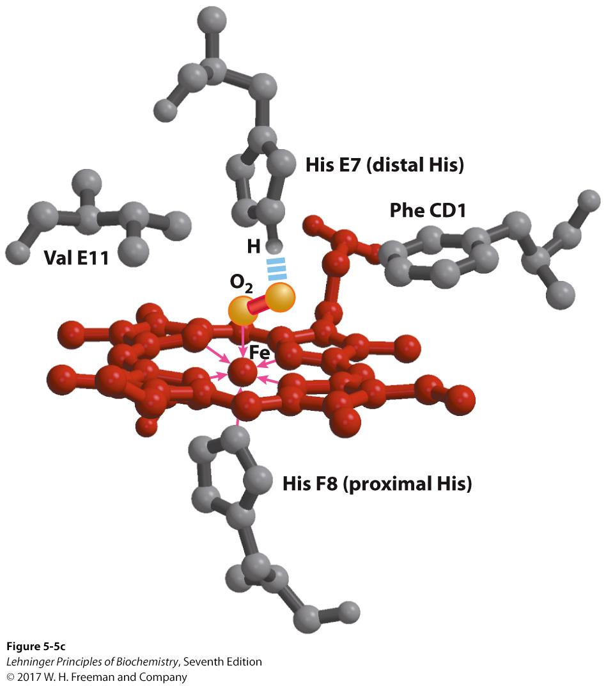{.r-stretch fig-align="center"}

<!-- Slide 20 -->

# Detecção Espectroscópica da  Ligação de Oxigênio às Globinas {.smaller}

- O grupo heme é um forte [cromóforo]{.azul} que absorve tanto na faixa ultravioleta quanto na visível.
- A forma ferrosa ([Fe2+]{.azul}) sem oxigênio apresenta uma banda de Soret intensa em 429 nm.
- A ligação do oxigênio altera as propriedades eletrônicas do heme e desloca a posição da banda de Soret para 414 nm.
- [A ligação do oxigênio pode ser monitorada por espectrofotometria UV-Vis.]{.azul}
- A desoxi-hemoglobina (no sangue venoso) apresenta cor arroxeada e a oxi-hemoglobina (no sangue arterial) é vermelha.

<!-- Slide 21 -->

# A Mioglobina Poderia Transportar O2?

- A pO2 nos pulmões é de cerca de 13 kPa: certamente liga bem o oxigênio.
- A pO2 nos tecidos é de cerca de 4 kPa: ela não o liberará!

::: {.recorte .absolute left=208 top=215 width=536 style="aspect-ratio: 1400/1069;"}
{style="width:100%; left:0%; top:0%;"}
:::

::: {.absolute left=32 top=640 width=896}
Diminuir a afinidade (P50) da mioglobina pelo oxigênio ajudaria?
:::

<!-- Slide 22 -->

# Para um Transporte Eficaz, a  Afinidade Deve Variar com a pO2

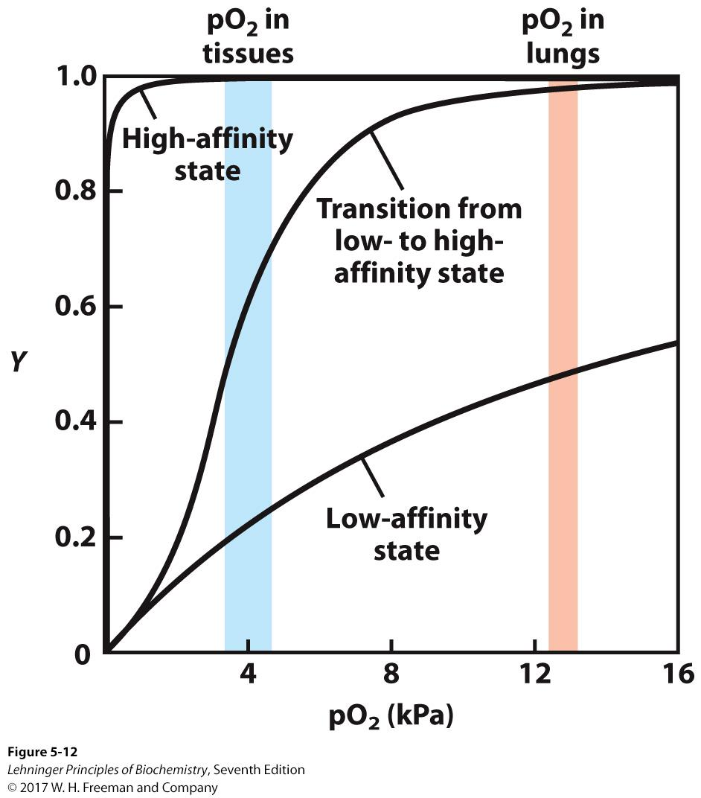{.r-stretch fig-align="center"}

<!-- Slide 23 -->

# Como a Afinidade pelo Oxigênio Pode Mudar? {.smaller}

- Deve ser uma proteína com [múltiplos sítios de ligação]{.azul}.
- Os sítios de ligação devem ser capazes de [interagir entre si]{.azul}.
- Esse fenômeno é chamado de [cooperatividade]{style="color:red;"}.
    - cooperatividade positiva
        - o primeiro evento de ligação aumenta a afinidade nos sítios restantes
        - [reconhecida por curvas de ligação sigmoidais]{.azul}
    - cooperatividade negativa
        - o primeiro evento de ligação reduz a afinidade nos sítios restantes

<!-- Slide 24 -->

# Cooperatividade

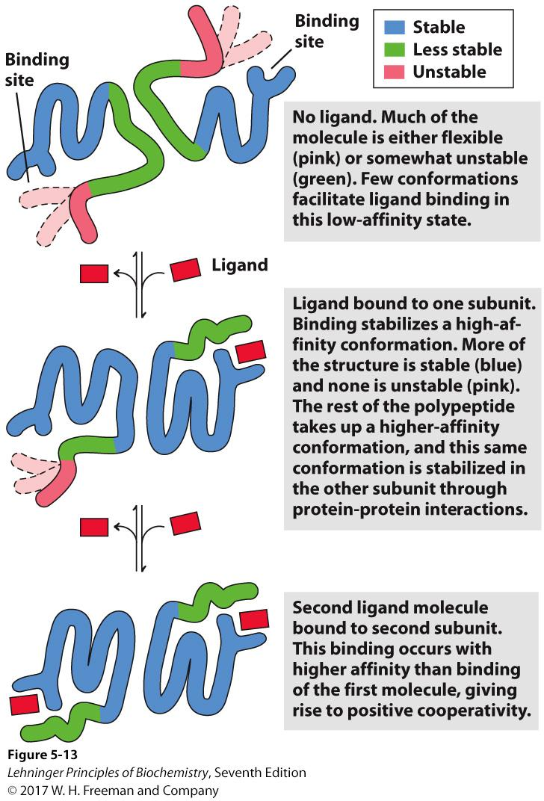{.r-stretch fig-align="center"}

<!-- Slide 25 -->

# Cooperatividade: Descrição Quantitativa

::: {.absolute left=479 top=208 width=200 .eq}
$$K_a = \frac{[PL_n]}{[P][L]^n}$$
:::

::: {.absolute left=480 top=309 width=180 .eq}
$$\theta = \frac{[L]^n}{[L]^n+K_d}$$
:::

<!-- Slide 26 -->

# O Gráfico de Hill da Cooperatividade

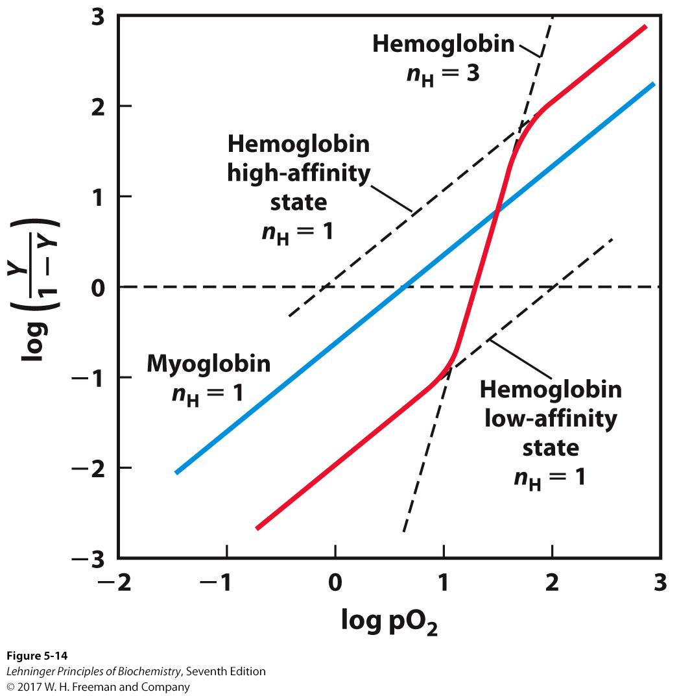{.r-stretch fig-align="center"}

<!-- Slide 27 -->

# Dois Modelos de Cooperatividade: Concertado vs. Sequencial

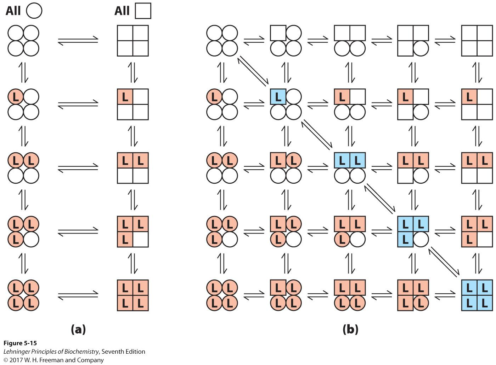{.r-stretch fig-align="center"}

<!-- Slide 28 -->

# A Cooperatividade É um  Caso Especial de Regulação Alostérica {.smaller}

- Proteína alostérica
    - A ligação de um ligante a um sítio afeta as propriedades de ligação de um sítio diferente na mesma proteína.
    - pode ser positiva ou negativa
    - homotrópica
        - O ligante normal da proteína é o regulador alostérico.
    - heterotrópica
        - Um ligante diferente afeta a ligação do ligante normal.
- Cooperatividade = regulação homotrópica positiva

<!-- Slide 29 -->

# A Hemoglobina Liga Oxigênio Cooperativamente

- A hemoglobina (Hb) é um tetrâmero de duas subunidades (α2β2).
- Cada subunidade é semelhante à mioglobina.

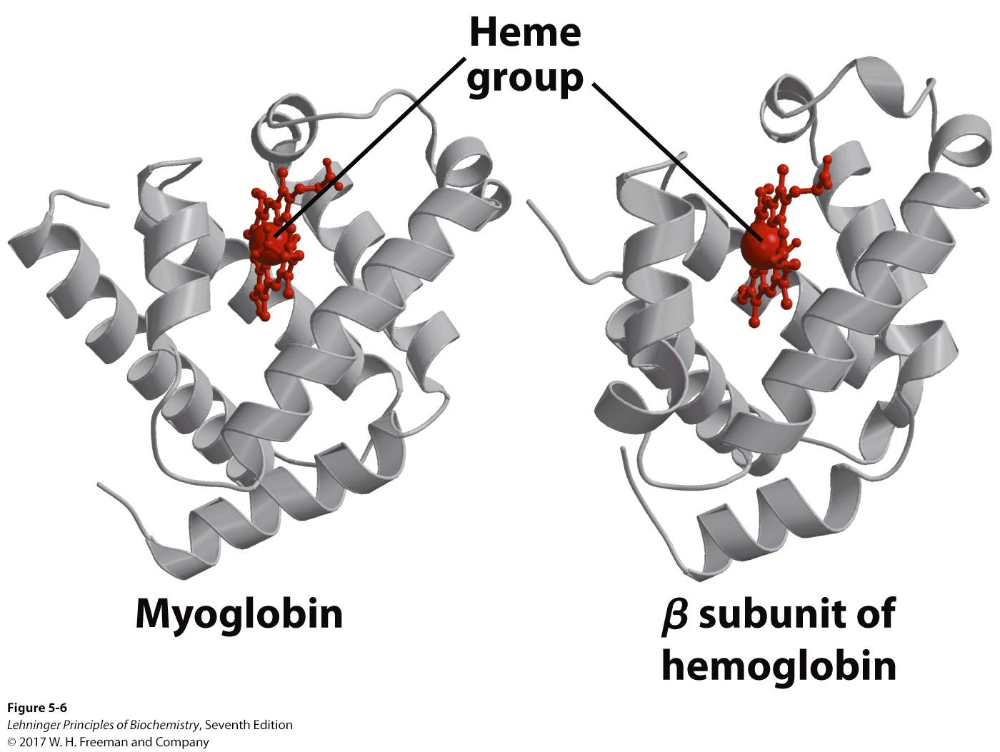{.r-stretch fig-align="center"}

<!-- Slide 30 -->

# Interações entre Subunidades na Hemoglobina

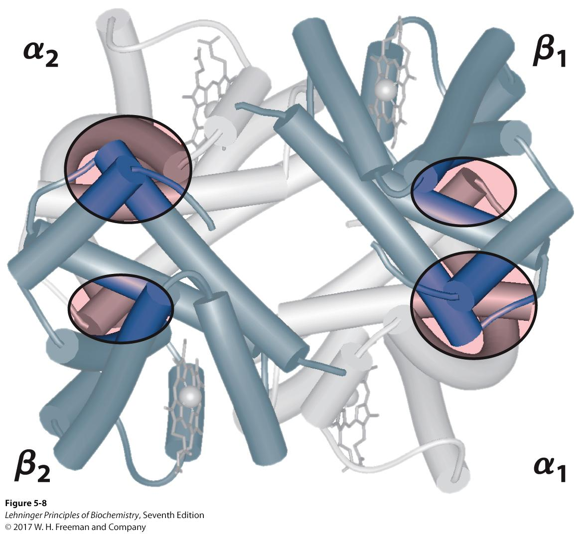{.r-stretch fig-align="center"}

<!-- Slide 31 -->

# Interações entre Subunidades: Detalhes

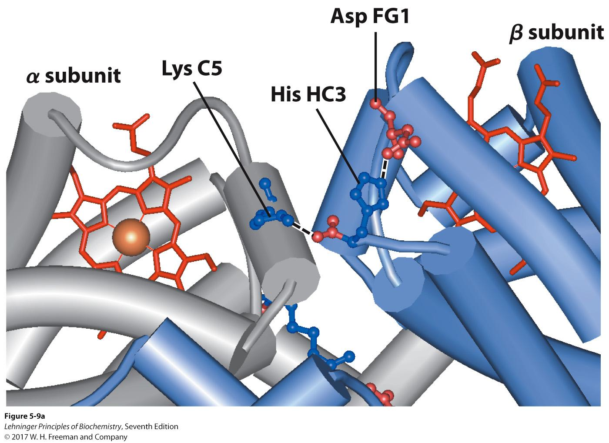{.r-stretch fig-align="center"}

<!-- Slide 32 -->

# Interações entre Subunidades: Detalhes

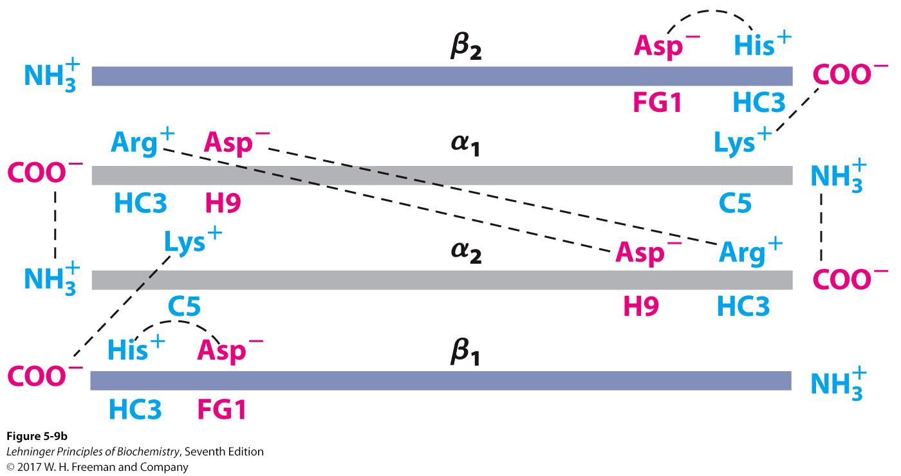{.r-stretch fig-align="center"}

<!-- Slide 33 -->

# Similaridade de Sequência Entre  Hemoglobina e Mioglobina {.absolute left=336 top=18 width=600}

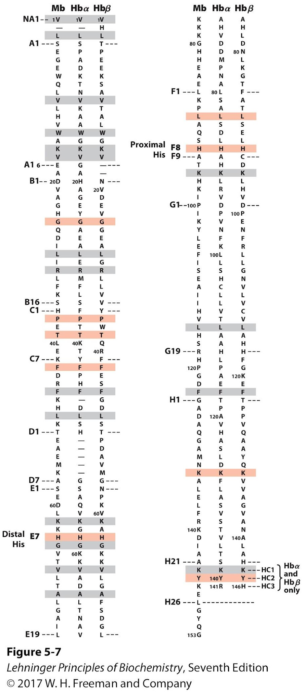{.absolute left=39 top=18 width=298}

<!-- Slide 34 -->

# Estados R e T da Hemoglobina {.smaller}

- T = estado tenso
    - mais interações, mais estável
    - menor afinidade pelo O2
- [R = estado relaxado]{.azul}
    - menos interações, mais flexível
    - [maior afinidade]{.azul} pelo O2
- **A ligação do O2 desencadeia uma mudança conformacional T → R.**
- A mudança conformacional do estado T para o estado R envolve a [quebra de pares iônicos]{.azul} na interface α1-β2.

<!-- Slide 35 -->

# Estados R e T da Hemoglobina

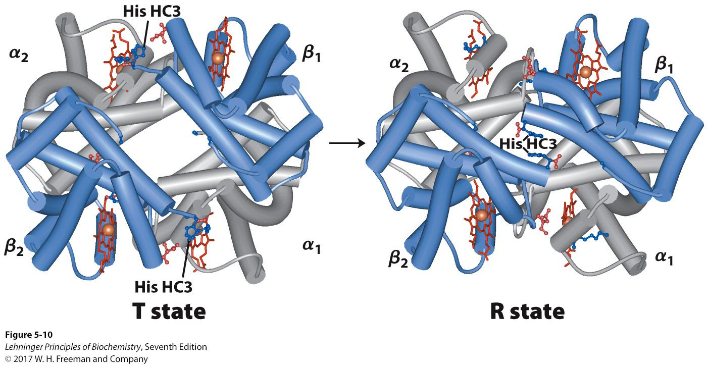{.r-stretch fig-align="center"}

<!-- Slide 36 -->

# A Mudança Conformacional É Desencadeada pela Ligação do Oxigênio

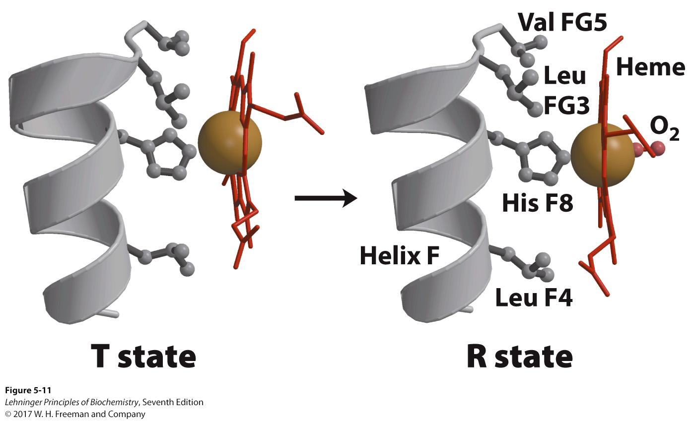{.r-stretch fig-align="center"}

<!-- Slide 37 -->

# Efeito do pH na Ligação do O2 à Hemoglobina

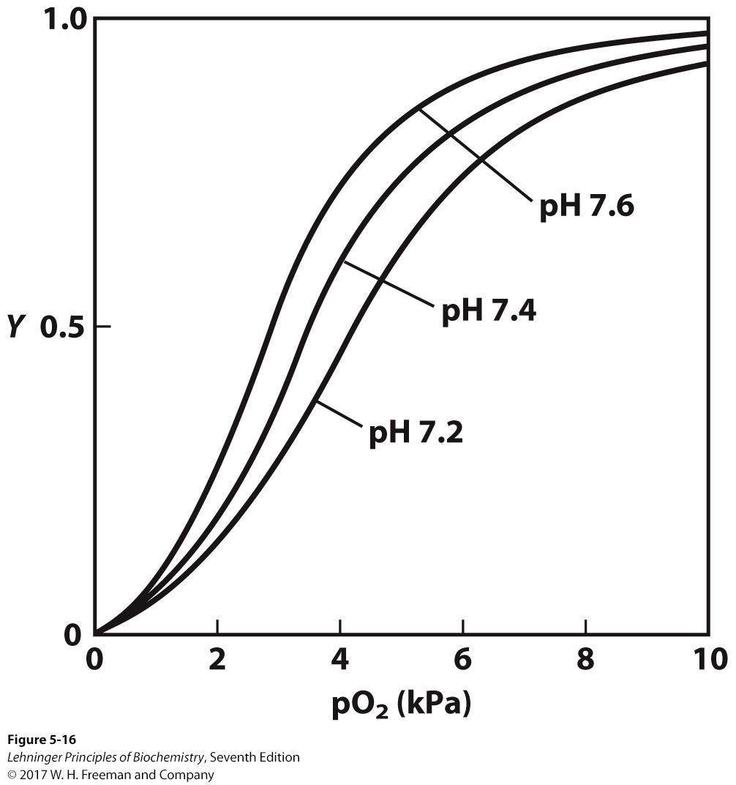{.r-stretch fig-align="center"}

*A acidez aumenta ou diminui o Kd?*

<!-- Slide 38 -->

# Efeito do pH na Ligação do O2 à Hemoglobina {.smaller}

- Tecidos metabolicamente ativos geram H+, diminuindo o pH do sangue próximo aos tecidos em relação aos pulmões (catalisado pela anidrase carbônica).

::: {style="text-align:center; color:red;"}
CO2 + H2O ↔ HCO3− + H+
:::

- A afinidade da Hb pelo oxigênio depende do pH.
    - O H+ liga-se à Hb e estabiliza o estado T.
        - protona a His146, que então forma uma ponte salina com o Asp94
        - leva à liberação de O2 (nos tecidos)
- [A diferença de pH entre os pulmões e os tecidos metabólicos aumenta a eficiência do transporte de O2.]{.azul}
- Isso é conhecido como efeito Bohr.

<!-- Slide 39 -->

# Hemoglobina e Exportação de CO2 {.smaller}

- O CO2 é produzido pelo metabolismo nos tecidos e deve ser exportado.
- 15–20% do CO2 é exportado na forma de um carbamato nos [resíduos amino-terminais]{.azul} de cada uma das subunidades polipeptídicas.

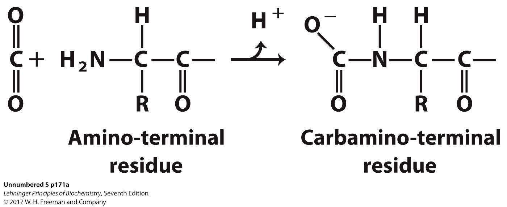{.r-stretch fig-align="center"}

- Observe:
    - A formação de um carbamato produz um próton que pode contribuir para o efeito Bohr.
    - O carbamato forma pontes salinas adicionais, estabilizando o estado T.

<!-- Slide 40 -->

# O 2,3-Bisfosfoglicerato Regula a Ligação de O2

- Regulador heterotrópico negativo da função da Hb
- Presente em concentrações mM nos eritrócitos
    - produzido a partir de um intermediário da glicólise
- Molécula pequena carregada negativamente,

  liga-se à cavidade central carregada\
  positivamente da Hb
- Estabiliza o estado T

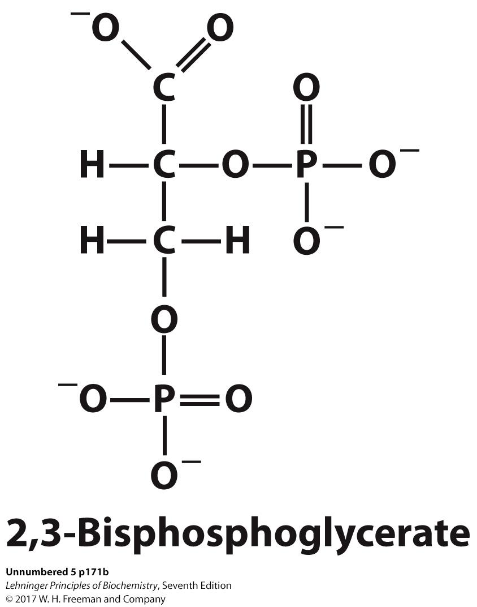{.absolute left=632 top=320 width=304}

<!-- Slide 41 -->

# O 2,3-BPG Liga-se à Cavidade Central da Hb

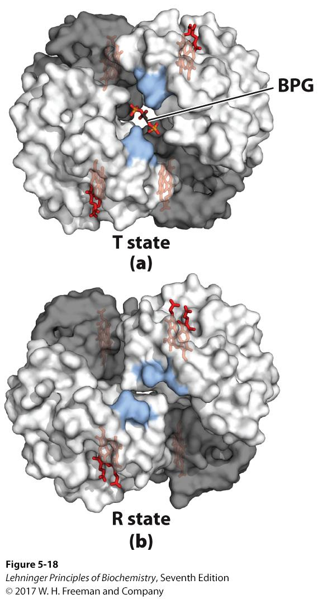{.r-stretch fig-align="center"}

<!-- Slide 42 -->

# O 2,3-BPG Permite a Liberação de O2 nos Tecidos  e a Adaptação a Mudanças de Altitude

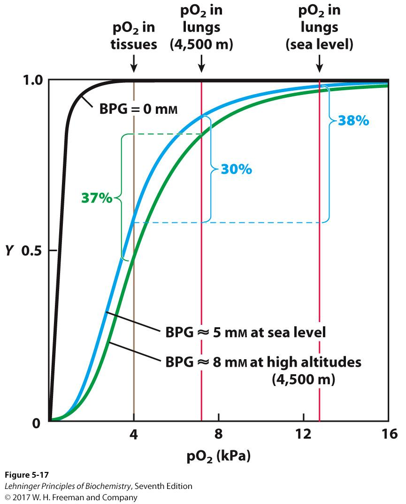{.r-stretch fig-align="center"}

<!-- Slide 43 -->

# A Anemia Falciforme Deve-se a  uma Mutação na Hemoglobina

:::: columns
::: {.column width="56%"}
- Glu6 → Val na cadeia β da Hb
- A nova cadeia lateral de valina pode ligar-se a uma molécula diferente de Hb para formar um filamento semelhante às proteínas amiloidogênicas discutidas no Capítulo 4.
- Isso torna as hemácias falciformes (em forma de foice).
- Indivíduos homozigotos não tratados geralmente morrem na infância.
- Indivíduos heterozigotos exibem resistência à malária.
:::
::: {.column width="44%"}
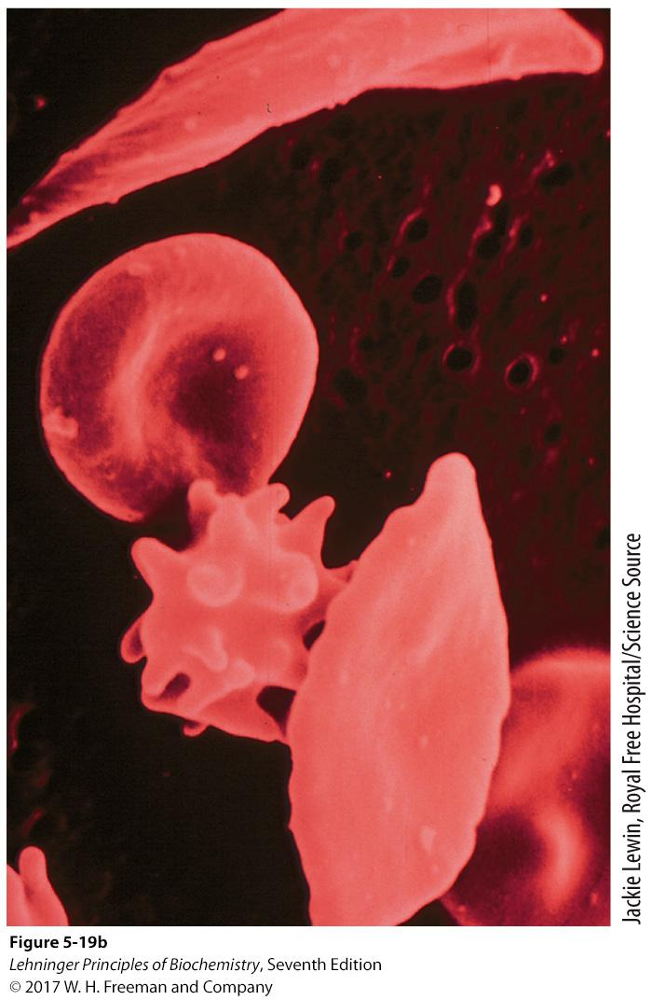{width=349 fig-align="center"}
:::
::::

<!-- Slide 44 -->

# Formação de Filamentos de Hb  na Anemia Falciforme

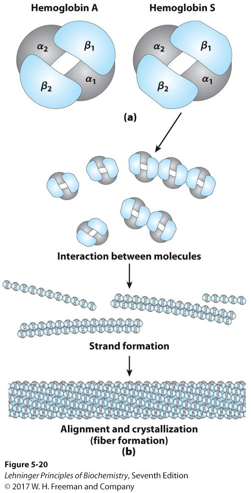{.r-stretch fig-align="center"}

<!-- Slide 45 -->

# Estudo de Caso 2: Interação Anticorpo/Antígeno Dois Tipos de Sistemas Imunes {.smaller}

- Sistema imune celular
    - tem como alvo as próprias células que foram infectadas
    - também elimina partículas virais e bactérias infectantes
    - atores principais: [macrófagos, células T citotóxicas (Tc)]{.azul} e [células T inflamatórias (TH1)]{.azul}
- Sistema imune humoral (“fluido”)
    - tem como alvo patógenos extracelulares
    - também pode reconhecer proteínas estranhas
    - produz anticorpos solúveis
    - mantém “memória” de infecções passadas
    - atores principais: [linfócitos B]{.azul} e [células T auxiliares (TH2)]{.azul}

<!-- Slide 46 -->

# Sistema Imune Celular

- Os anticorpos ligam-se a fragmentos exibidos na superfície das células invasoras.
- Fagócitos: células especializadas que englobam invasores
- Macrófagos: grandes fagócitos que ingerem bactérias marcadas por anticorpos

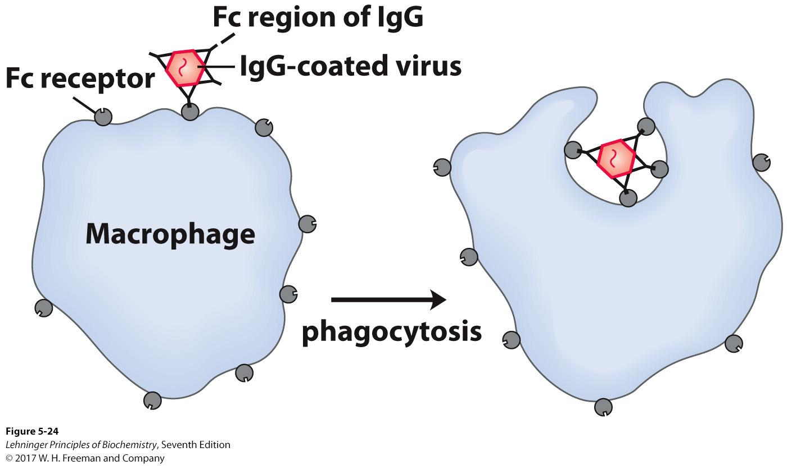{.r-stretch fig-align="center"}

<!-- Slide 47 -->

# Sistema Imune Humoral {.smaller}

- Os vertebrados também combatem infecções com anticorpos solúveis que se ligam especificamente a antígenos.
    - Antígenos são substâncias que estimulam a produção de anticorpos.
        - tipicamente de natureza macromolecular
        - reconhecidos como estranhos pelo sistema imune
        - proteínas do envoltório de bactérias e vírus
        - carboidratos de superfície de células ou vírus
    - Anticorpos são proteínas produzidas pelas células B e que se ligam especificamente a antígenos.
        - A ligação marcará o antígeno para destruição ou interferirá em sua função.
        - Um determinado anticorpo ligar-se-á a uma pequena região (epítopo) do antígeno.
        - Um antígeno pode ter vários epítopos.

<!-- Slide 48 -->

# Anticorpos: Imunoglobulina G {.smaller}

:::: columns
::: {.column width="48%"}
Duas **cadeias pesadas** e duas **cadeias leves**

- compostas por domínios constantes e domínios variáveis

**Cadeias leves:** um domínio constante e um domínio variável

**Cadeias pesadas:** três domínios constantes e um domínio variável

**Os domínios variáveis** de cada cadeia formam o sítio de ligação ao antígeno (dois por anticorpo) e são hipervariáveis, o que confere especificidade ao antígeno.
:::
::: {.column width="52%"}
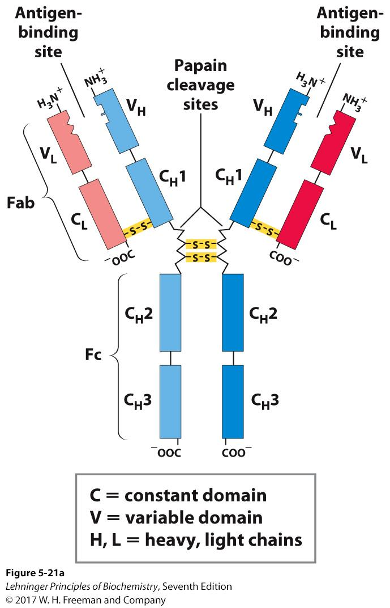{width=395 fig-align="center"}
:::
::::

<!-- Slide 49 -->

# Anticorpos: Imunoglobulina G

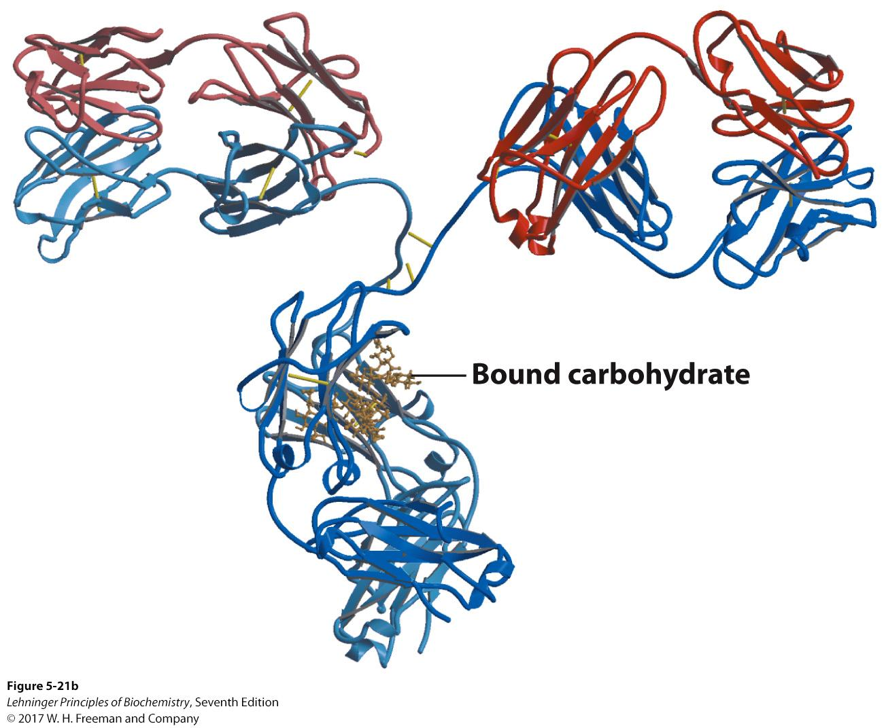{.r-stretch fig-align="center"}

<!-- Slide 50 -->

# Antígenos Ligam-se via Encaixe Induzido

A ligação do antígeno causa mudanças estruturais significativas no anticorpo.

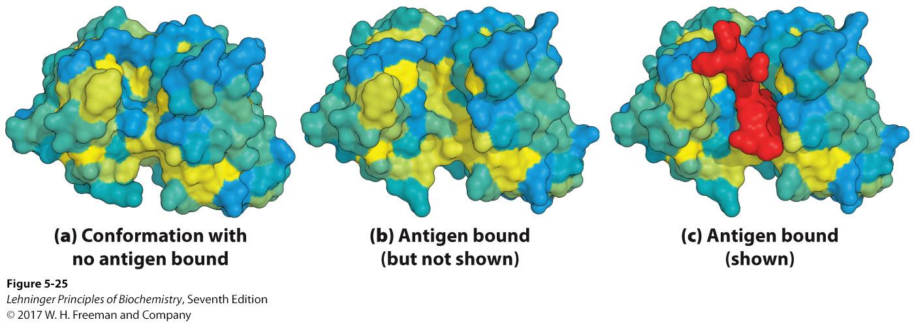{.r-stretch fig-align="center"}

<!-- Slide 51 -->

# A Especificidade de Anticorpos É um  Importante Reagente Analítico

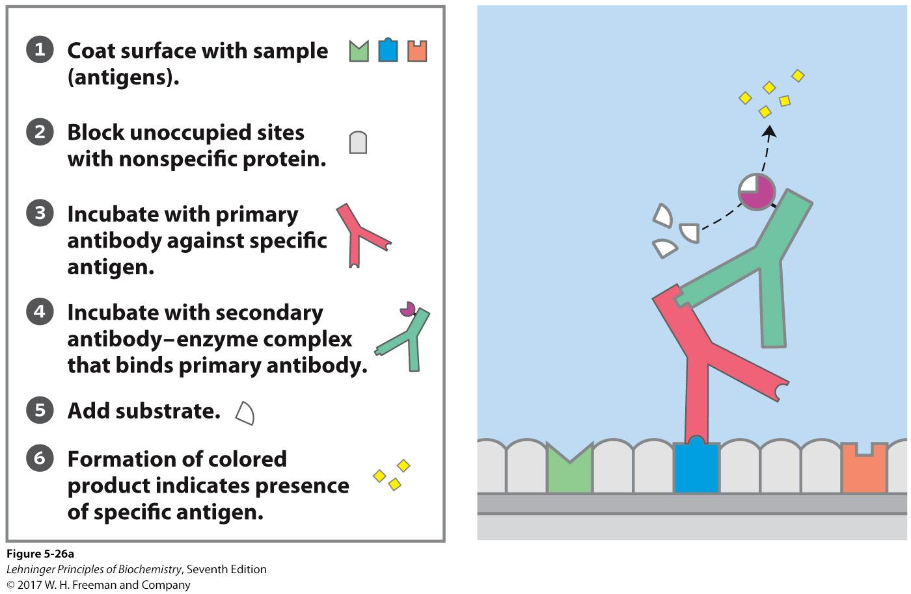{.r-stretch fig-align="center"}

<!-- Slide 52 -->

# A Detecção de Anticorpos Pode Ser  Colorimétrica ou Luminescente

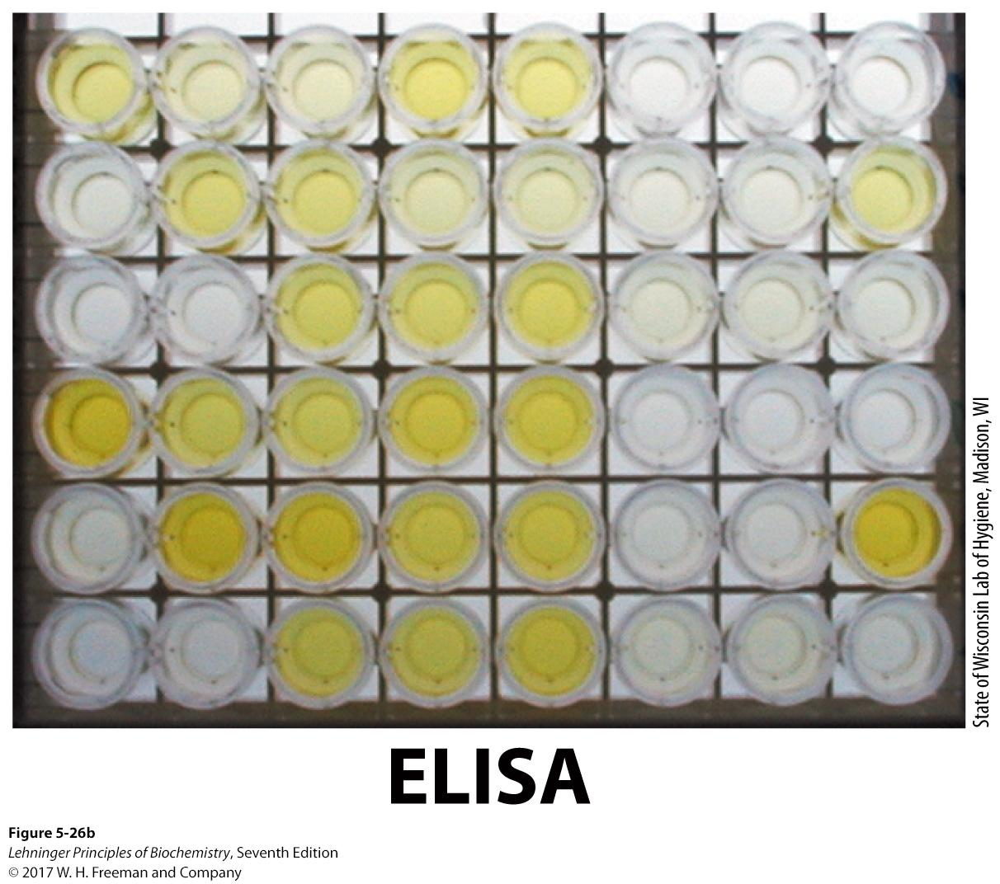{.r-stretch fig-align="center"}

<!-- Slide 53 -->

# Estudo de Caso 3: Proteínas Musculares Estrutura Muscular

- Fibra muscular: célula grande, única, alongada e multinucleada
- Cada fibra contém cerca de 1.000 miofibrilas.

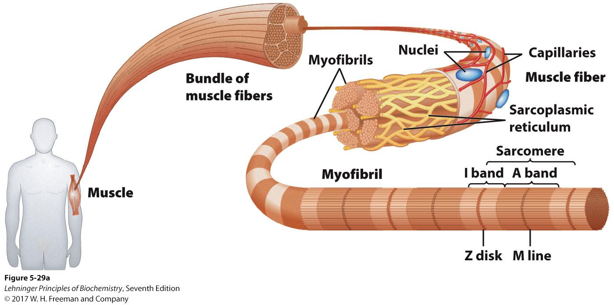{.r-stretch fig-align="center"}

<!-- Slide 54 -->

# Miofibrilas Contêm  Filamentos Espessos de Miosina

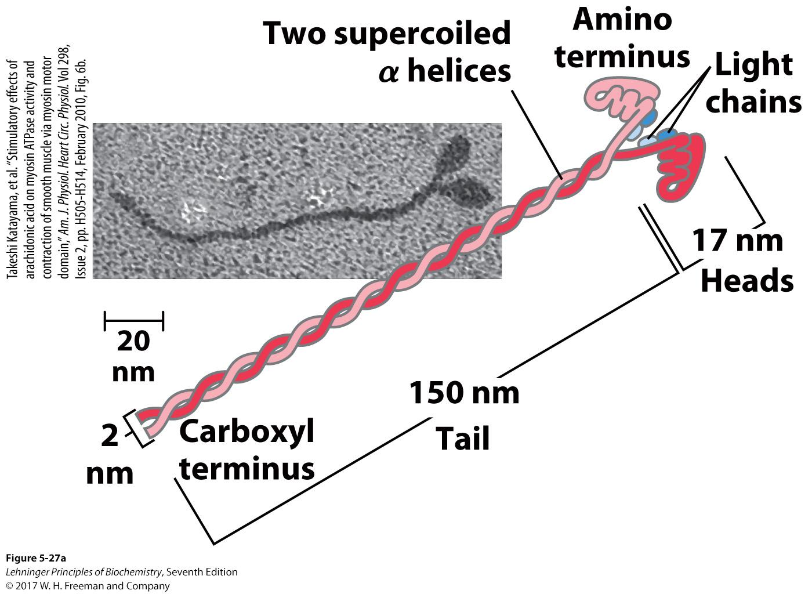{.absolute left=21 top=176 width=547}

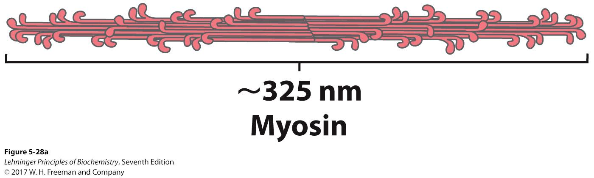{.absolute left=352 top=521 width=608}

<!-- Slide 55 -->

# Miofibrilas Contêm  Filamentos Finos de Actina

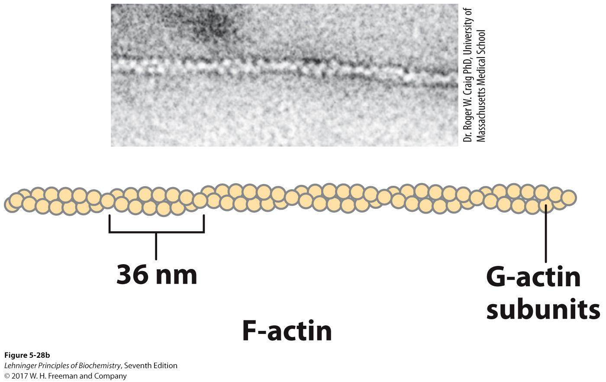{.r-stretch fig-align="center"}

<!-- Slide 56 -->

# Filamentos Espessos de Miosina Deslizam ao Longo de  Filamentos Finos de Actina

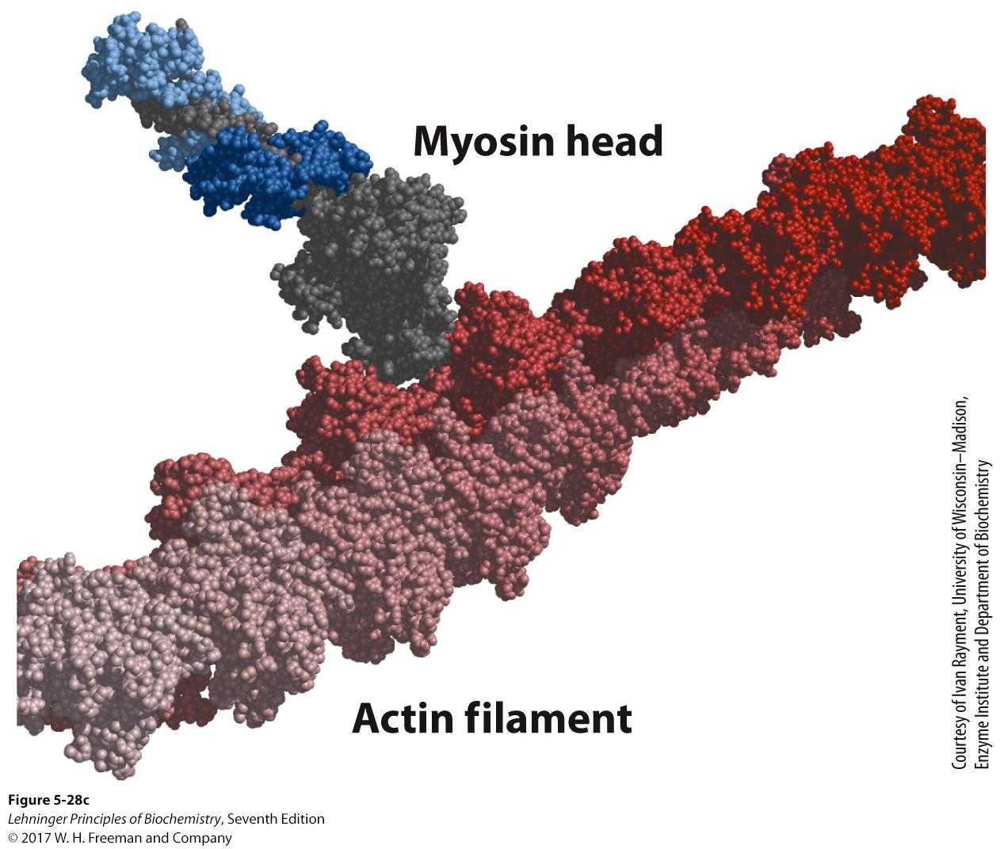{.r-stretch fig-align="center"}

<!-- Slide 57 -->

# Filamentos Espessos de Miosina Deslizam ao Longo de  Filamentos Finos de Actina

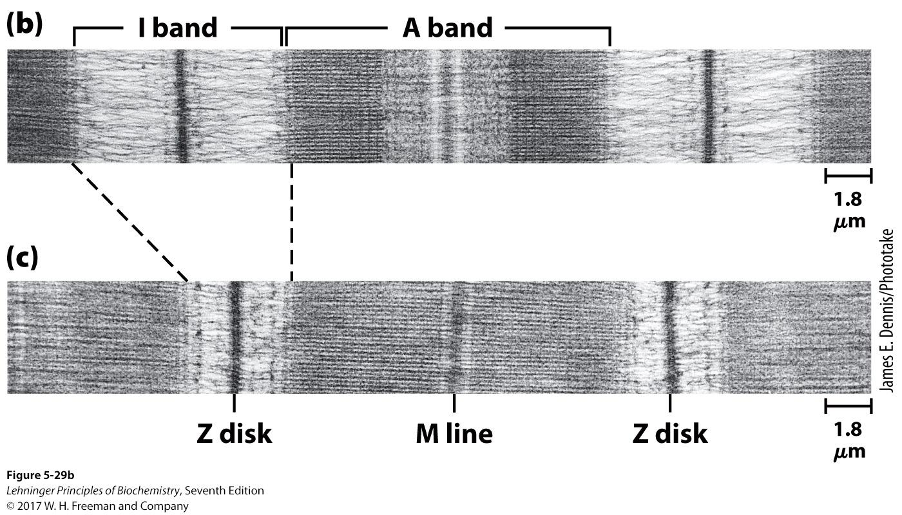{.absolute left=16 top=312 width=448}

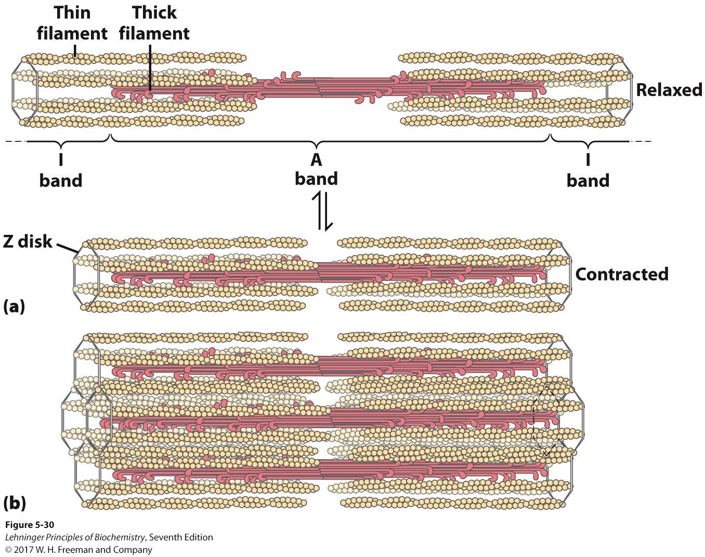{.absolute left=481 top=251 width=455}

<!-- Slide 58 -->

# Interações Proteicas  Moduladas por Energia Química

- O uso de energia química (ATP) pode causar mudanças conformacionais nas proteínas, geralmente necessárias para sua função.

Especialmente em proteínas motoras

- controlam o movimento de células e organelas dentro das células
- A contração muscular ocorre por meio de uma série de [mudanças conformacionais]{.azul} na estrutura proteica devido à ligação, hidrólise e liberação de ATP e ADP.

<!-- Slide 59 -->

# Ciclo da Actomiosina

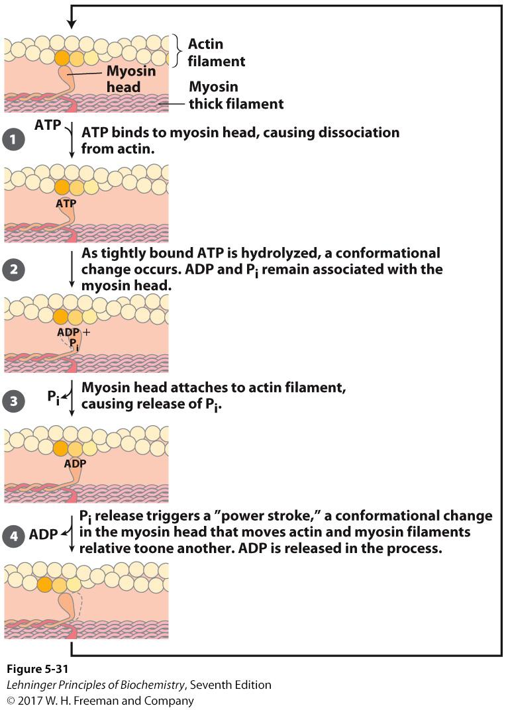{.r-stretch fig-align="center"}

<!-- Slide 60 -->

# Regulação da Contração Muscular

- A disponibilidade dos sítios de ligação da miosina na actina é regulada pela troponina e tropomiosina.
    - evita a contração muscular contínua
- O impulso nervoso desencadeia a liberação de Ca2+.
    - causa mudanças conformacionais no complexo tropomiosina-troponina, expondo os sítios de ligação da miosina

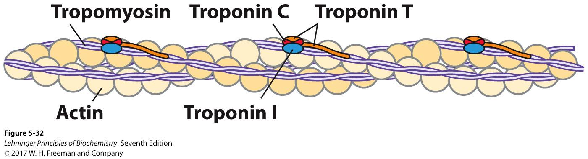{.r-stretch fig-align="center"}

<!-- Slide 61 -->

# Capítulo 5: Resumo

Neste capítulo, aprendemos:

- como a ligação de ligantes pode afetar a função proteica
- como analisar quantitativamente dados de ligação
- como a mioglobina armazena oxigênio
- como a hemoglobina transporta O2, prótons e CO2
- como os anticorpos reconhecem estruturas estranhas
- como o músculo funciona
